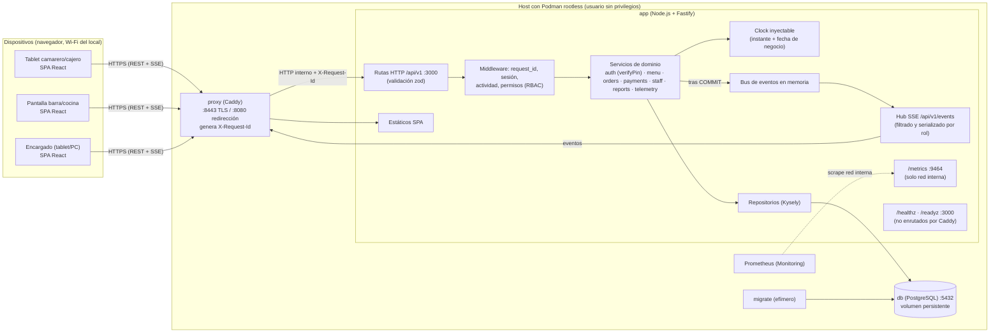
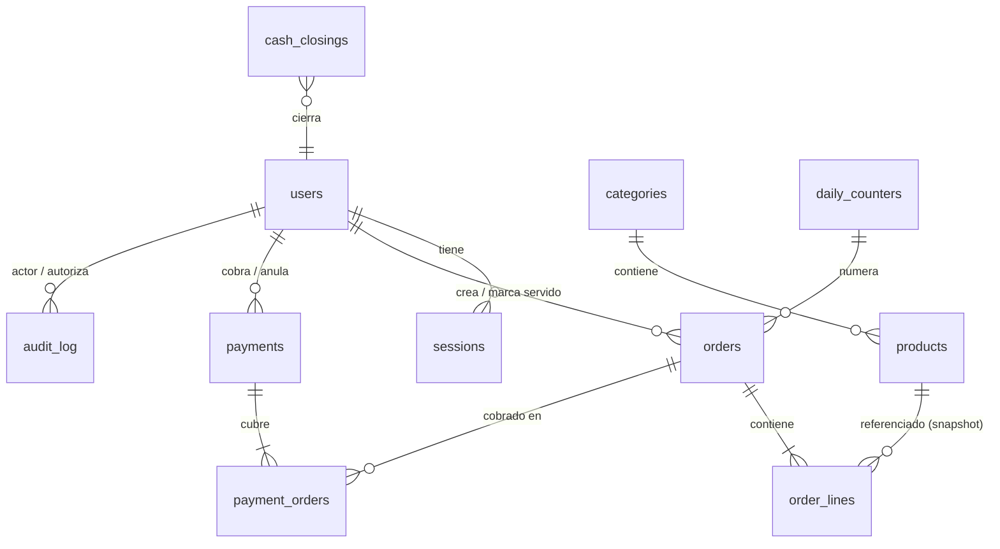
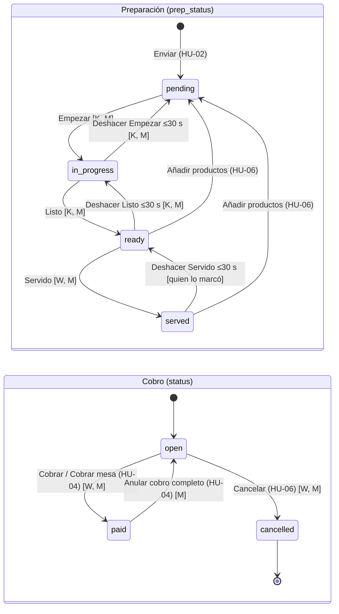

# Arquitectura — Toma de pedidos para cafetería (MVP)

> Responsable: Software Engineer. Entradas: `docs/historias/` (HU-01 a HU-08 y
> supuestos del README; HU-09 **fuera del MVP**, decisión del humano
> 2026-11-23), `docs/ux/`, `docs/testing.md`, `docs/logging.md` y
> `docs/reglas-equipo.md` (sección 3). La arquitectura asume una **UI web
> táctil** que funciona en navegador (tablets de 10", pantalla de barra de 24"
> FHD o mayor —supuesto 21—, TPV u ordenador).
>
> Revisión 2026-11-21 (tarea 1.3b): dos dimensiones de estado, estado "Servido",
> deshacer, vuelta a la cola, lista de sala, "Cobrados hoy", anulación del cobro
> completo, día natural `Europe/Madrid`, autorización de encargado para una sola
> acción, ajustes del local (condicionado a HU-09), hallazgos T-10, T-11,
> M-01..M-04 y decisiones de Cybersecurity SEC-001, 002, 004, 005, 006, 007 y
> 012 (`docs/seguridad.md` §6). Registro de decisiones en la §14.
>
> Revisión 2026-11-23 (tarea 1.3c): `verifyPin` única para toda verificación de
> PIN (SEC-016), redacción de logs por `/pin/i` (SEC-017), cookie `__Host-sid`
> (SEC-021), cobros del día para el camarero (SEC-022), UID 1000 en la imagen
> de `app` (SEC-010) y retirada de los ajustes editables (HU-09 fuera del MVP).
> Registro en la §15.
>
> Revisión 2026-11-23 (tarea 1.7a): límite por sesión solo en aprobaciones y
> bloqueo antes que la sesión para `confirmPin`/`currentPin` (T-20), códigos de
> `tableNumber` (T-19), `managerApproval` en sesión de encargado (T-21), tiempo
> igualado con encargado bloqueado (SEC-025), `expiresAt` en `GET /auth/me` y
> `403 PIN_CHANGE_REQUIRED` (preguntas de UX). Registro en la §16.
>
> Revisión 2026-11-24 (tarea 1.7h): resumen de un día cerrado como
> **instantánea** guardada al cerrar, sección "Cambios tras el cierre"
> (cancelaciones, anulaciones y cobros posteriores, HU-08/CA-F05, CA-F15),
> cerrojo de cierre e índices para HU-08/CA-N02 (§4.4). Registro en la §16.
>
> Revisión 2026-11-24 (tarea 1.7o): aislamiento `READ COMMITTED` y orden de
> sentencias de las transacciones del cerrojo de cierre, y `409
> DAY_ALREADY_CLOSED` (nunca `500`) con dos cierres en paralelo (T-26, §4.4,
> §9). Registro en la §16.
>
> Revisión 2026-11-24 (tarea 2.1c, Etapa 2): contrato de `buildApp(deps)`, de
> los comandos y de los *exports* de los paquetes (§2.1, §3.1, T-32), formato
> de errores (§5), reglas de PIN con códigos y orden (§7), actividad de sesión
> sin desfase (T-37, §7), `SESSION_MAX_HOURS` y resto de variables (§10.1,
> T-36), rutas de la SPA y "Acceso denegado" (§5.2, T-31) y `BEGIN ISOLATION
> LEVEL READ COMMITTED` explícito en el cerrojo de cierre (§4.4, T-27).
> Registro en la §17.
>
> Revisión 2026-11-24 (tarea 2.1i, Etapa 2): validación estricta de
> `TRUSTED_PROXIES` (SEC-029, §10.1), peticiones pasivas con
> `X-Activity: passive` (SEC-030, §7), `search_path=public` en el *pool*,
> borrado de la cookie en el `401` y `details` cerrado (§5), escrituras del
> *hub* acotadas (§7), `404` antes de los hooks de sesión (T-40), forma de
> `parseSettings` (T-38), `403` de `POST /auth/pin` antes de zod (T-39),
> envoltorios de comandos (T-41), `@mi-app/web/pin-messages` (T-42) e
> intervalo del *hub* en `AppDeps` (T-43). Registro en la §17.
>
> Revisión 2026-11-26 (tarea 2.2c, Etapa 2, D-2.2-06): se documenta lo que la
> implementación de HU-01 (tareas 2.2, 2.5 y 2.8b) hace de forma distinta o más
> concreta que este documento, ya probado por Testing y revisado por
> Cybersecurity: columnas `revoked_reason`/`expired_reason`, enumerados como
> `text` + `CHECK`, guarda en un solo hook, 2 flujos SSE por sesión y 50 en
> total, `/healthz` con `503`, `Cache-Control: no-store` en `/api`, atomicidad
> de `verifyPin` (SEC-038, SEC-047), regla del banner de T-48, imágenes
> derivadas y etapa de construcción Debian (IMG-02). Se deciden además SEC-043
> (clave del límite por IP y capacidad), el tope de la cola del semáforo
> argon2 y la regla general de texto (D-2.5-03). Registro en la §18.
>
> Revisión 2026-11-27 (tarea 2.21, Etapa 2, T-50 y T-53 de Testing): contrato
> de HU-05 antes de implementarla: tablas `categories` y `products` con
> columnas, índices y privilegios (§4.1), rutas, cuerpos, respuestas y códigos
> del menú, con la ruta nueva `GET /menu/manage` en lugar de
> `?includeInactive=true` (§5.1, §5.3), cerrojo del menú, auditoría del precio,
> eventos `product.updated` y `menu.changed` (§6) y los extremos de `apiName`
> (§5, §18.2). Registro en la §19.

## 1. Visión general

Tamaño del problema (supuestos del PO): 1 local, ~20 mesas, ≤15 empleados,
~10 dispositivos a la vez, ~500 pedidos/día, ~200 productos. Esto es una carga
**muy pequeña y limitada por E/S** (base de datos y red Wi-Fi), no por CPU.

Decisión de forma: **monolito modular, una sola instancia**, con tres
contenedores en ejecución:

| Servicio | Imagen | Función |
|---|---|---|
| `proxy` | Caddy (derivada mínima de la oficial, mismo binario; §10) | TLS, HTTP/2, proxy inverso hacia `app`, genera `X-Request-Id` |
| `app` | Imagen propia (Node.js distroless) | API REST + flujo SSE de tiempo real + archivos estáticos de la SPA (puerto 3000); métricas Prometheus en puerto interno 9464 |
| `db` | PostgreSQL (derivada de la oficial alpine; §10) | Persistencia |

Más un contenedor efímero `migrate` (misma imagen que `app`, otro comando) que
aplica las migraciones antes de arrancar `app`.

Stack (ver ADRs):

| Capa | Elección | ADR |
|---|---|---|
| Backend | TypeScript + Node.js LTS + Fastify | [ADR-001](decisiones/ADR-001-lenguaje-y-framework-backend.md) |
| Frontend | SPA React + Vite + TypeScript | [ADR-002](decisiones/ADR-002-frontend.md) |
| Base de datos | PostgreSQL + Kysely (SQL tipado) | [ADR-003](decisiones/ADR-003-base-de-datos.md) |
| Tiempo real | Server-Sent Events + resincronización por snapshot | [ADR-004](decisiones/ADR-004-tiempo-real.md) |
| Autenticación/autorización | Usuario + PIN (argon2id), sesión opaca en servidor, RBAC en servidor | [ADR-005](decisiones/ADR-005-autenticacion-y-autorizacion.md) |
| Dinero | Enteros en céntimos de euro | [ADR-006](decisiones/ADR-006-importes-monetarios.md) |
| Exposición/TLS | Caddy como proxy inverso, puertos > 1024 | [ADR-007](decisiones/ADR-007-proxy-tls-y-puertos.md) |
| Concurrencia | IDs generados por el cliente (idempotencia) + versión optimista + máquina de estados | [ADR-008](decisiones/ADR-008-concurrencia-e-idempotencia.md) |

Rust no se usa: no hay ningún componente con carga de CPU, latencia sub-ms o
memoria restringida; el cuello de botella sería la BD/red (justificación en ADR-001).

## 2. Componentes y capas



Capas dentro de `app` (dependencias solo hacia abajo):

1. **Rutas (HTTP/SSE):** parseo y validación de entrada con esquemas zod,
   serialización de salida por rol. Sin lógica de negocio.
2. **Middleware:** `request_id`, resolución de sesión, control de inactividad,
   comprobación de permiso de la ruta.
3. **Servicios de dominio:** reglas de negocio (máquina de estados del pedido,
   cálculo de totales, bloqueo de PIN, cobro, anulación, cierre). Reciben sus
   dependencias por constructor (repositorios, `Clock`, bus, hasher) →
   testeables sin BD y con reloj falso.
4. **Repositorios:** acceso a PostgreSQL con Kysely; transacciones. Reciben las
   marcas de tiempo y la fecha de negocio como **parámetros** (§4, T-10).
5. **Bus de eventos:** el servicio publica **después del COMMIT**; el hub SSE
   reenvía a los clientes conectados. En memoria porque hay **una sola
   instancia** (si algún día hay varias, se sustituye por `LISTEN/NOTIFY` de
   PostgreSQL sin tocar los servicios).

La aplicación se construye con una factoría `buildApp(deps)` (en `main.ts` se
compone con `SystemClock`; los tests de integración la componen en proceso con
un `FakeClock` y la BD real). No hay endpoints de prueba en la imagen.

### 2.1 Contrato de `buildApp(deps)` y de los comandos [2.1c, T-32]

Se adopta la propuesta de Testing (`tests/README.md` §2) con dos añadidos
(`sessionMaxHours`, aislamiento del registro de métricas) y una precisión
(quién recibe el hasher).

```ts
// apps/api/src/app.ts — export '@mi-app/api/app'
export interface Clock { now(): Date }

export interface DatabaseDeps {
  host: string; port: number; database: string;
  user: string; password: string;       // la contraseña ya leída del fichero de secreto
  poolMax?: number;                     // por defecto 10
}
// Toda conexión creada a partir de DatabaseDeps (app, migrate, comandos) fija
// search_path=public en el arranque de la conexión: opción `options: '-c search_path=public'`
// del Pool de `pg` [2.1i]. Al ser un parámetro de la conexión, prevalece sobre
// un `ALTER DATABASE/ROLE … SET search_path` (defensa tipo CVE-2018-1058).

export interface AppDeps {
  clock: Clock;                         // SystemClock en main.ts, FakeClock en los tests
  database: DatabaseDeps;               // buildApp crea el pool y lo cierra en onClose
  pinHasher: PinHasher;                 // solo lo recibe el módulo auth (ver abajo)
  publicOrigin: string;                 // origen exacto aceptado en Origin (RS-24), p. ej. 'https://caja.local:8443'
  trustedProxies: string[];             // IP o CIDR de proxy, reglas de §10.1 (SEC-029); solo de ellas se acepta X-Forwarded-For (RS-06). [] = ninguna
  installation: { tableCount: number; delayThresholdMinutes: number };  // §4.1
  sessionMaxHours?: number;             // caducidad absoluta, entero 1–12, por defecto 12 (§10.1, T-36)
  kitchenActivityIntervalMs?: number;   // periodo del temporizador del hub (§7, barra); entero 10–60000, por defecto 60000 (T-43). No es variable de entorno
  logDestination?: NodeJS.WritableStream; // destino de pino (por defecto stdout); misma redacción (§11)
  logLevel?: string;                    // por defecto 'info'
  onRoute?: (route: { method: string | string[]; url: string; config?: unknown }) => void;
}

export function buildApp(deps: AppDeps): Promise<FastifyInstance>;
```

- **No llama a `listen`**: `main.ts` hace `listen({ host, port })` y arranca el
  servidor de métricas en `METRICS_PORT` (§10.1) sirviendo
  `app.metricsText()`. Los tests usan `inject()` o `listen({ port: 0 })`.
- **Valida sus dependencias** con la misma función que `config.ts`
  (`parseSettings`, §10.1): fuera de rango → rechaza la promesa (defensa en
  profundidad; en producción ya ha fallado `config.ts`). En concreto,
  `trustedProxies` pasa por el mismo validador de elementos que
  `TRUSTED_PROXIES` (§10.1, SEC-029) y `kitchenActivityIntervalMs` por su
  rango; si falla, rechaza con `ConfigError` (`variable` = nombre del campo).
- **`trustProxy` de Fastify [2.1i, SEC-029]:** se le pasa el *array* ya
  validado (`trustedProxies`) o `false` si está vacío; nunca una cadena, un
  número ni `true`.
- **`onRoute`** se registra como **primer** hook `onRoute`, antes de cualquier
  plugin de rutas, así ve todas las rutas (RS-17).
- **Decorador `metricsText(): Promise<string>`**: texto Prometheus de un
  `prom-client` `Registry` **propio de esa instancia** (nunca el registro
  global por defecto, para que dos instancias en el mismo proceso no se
  mezclen ni fallen por métricas duplicadas). Los contadores de
  `docs/logging.md` §6.3 existen a 0 desde el arranque (RS-47).
- **Contadores por IP y por sesión** (§7) en memoria **de la instancia**;
  igual el temporizador del hub SSE (§7, actividad de barra), que se detiene
  en `onClose`.
- **Cada ruta declara en `config` exactamente uno** de:
  `{ permission: '<permiso>' }` (permiso de la matriz de §7),
  `{ public: true }` (solo `POST /api/v1/auth/login` y
  `GET /api/v1/auth/login-options`) o `{ internal: true }` (solo `GET /healthz`
  y `GET /readyz`). El plugin de RBAC lee `routeOptions.config` en
  `onRequest`; una ruta sin ninguno de los tres responde `403 FORBIDDEN`
  (denegación por defecto) y el test RS-17 la detecta. Rutas "con sesión" sin
  permiso de negocio (`/auth/me`, `/auth/logout`, `/auth/pin`,
  `/session/activity`) usan `session:self`; `/events` usa
  `events:subscribe`; `/telemetry`, `telemetry:write`.
  - **Implementado [2.2c]** (tipo `RouteAuthConfig` en
    `apps/api/src/http/context.ts`): un hook `onRoute` propio, registrado
    justo después del de los tests, **lanza al arrancar** si una ruta declara
    más de uno de `permission`/`public`/`internal`. Además de esa
    declaración, `config` admite tres marcas, nunca otra cosa:
    `allowProvisional: true` (ruta permitida con PIN provisional: solo
    `GET /auth/me`, `POST /auth/pin` y `POST /auth/logout`, RS-15),
    `provisionalPinOnly: true` (solo `POST /auth/pin`, T-39) y
    `activity: false` (la petición no cuenta como actividad: `GET /events`
    y, cuando exista, `POST /telemetry`; §7). Una ruta nueva sin
    `allowProvisional` recibe `403 PIN_CHANGE_REQUIRED` con PIN provisional
    (denegación por defecto también aquí).
  - Fastify con `bodyLimit` de 64 KiB (`413 PAYLOAD_TOO_LARGE`, RS-23),
    solo el analizador `application/json` (cuerpo vacío = sin cuerpo; resto
    `415`) y `return503OnClosing: true` (durante el cierre ordenado responde
    `503`).
- **Hasher**: `PinHasher = { hash(pin): Promise<string>; verify(hash, pin): Promise<boolean> }`,
  creado con `createPinHasher({ pepper })` (export `@mi-app/api/auth/hasher`,
  argon2id + *pepper*). `buildApp` lo entrega **solo al módulo `auth`**, que
  expone dos funciones: `verifyPin` (única que llama a `verify`, §7) y
  `hashNewPin(pin, role)` (valida las reglas de PIN con `validatePin` y llama a
  `hash`; la usan el alta, el restablecimiento y el cambio obligatorio). Ningún
  otro módulo recibe el hasher.

**Comandos** (export `@mi-app/api/commands`; los scripts
`create-initial-manager` y `unlock-user` de la imagen son envoltorios finos
que leen la configuración con `loadConfig()` y llaman a estas funciones):

```ts
export interface CommandDeps {
  clock: Clock; database: DatabaseDeps; pinHasher: PinHasher;
  logDestination?: NodeJS.WritableStream;
}
export function createInitialManager(deps: CommandDeps, input: { name: string; pin: string }): Promise<'created' | 'skipped'>;
export function unlockUser(deps: Pick<CommandDeps, 'clock' | 'database' | 'logDestination'>, name: string): Promise<'unlocked' | 'not_found'>;
```

- `createInitialManager`: en una transacción con
  `pg_advisory_xact_lock(INITIAL_MANAGER_LOCK)` comprueba si existe algún
  usuario `manager` (activo o no); si existe → `'skipped'` sin tocar nada. Si
  no, valida `validatePin(pin, 'manager')` (si falla, **rechaza** con
  `InvalidPinError` cuyo `rule` es el `PinRule`, sin crear nada y sin incluir
  el PIN en el mensaje), valida el nombre (1–30 caracteres tras recortar) e
  inserta con `must_change_pin = true`, `pin_digits = 6` y auditoría
  `user.created` con actor `system` (RS-09).
- `unlockUser`: busca por `lower(name)`; si no existe → `'not_found'`; si
  existe pone `failed_attempts = 0`, `locked_until = null`,
  `locked_manual = false` y audita `user.unlocked` con actor `system` (RS-09b),
  aunque no estuviera bloqueado.
- Envoltorios: código de salida `0` en `created`/`skipped`/`unlocked`, `2` en
  `not_found`, `1` en cualquier error (el mensaje en stderr nunca contiene el
  PIN). Ambos escriben un log JSON con la misma redacción.
- **Envoltorios y cómo se prueban [2.1i, T-41].** Toda la lógica del
  envoltorio (leer la configuración, llamar a la función, traducir el
  resultado a código de salida y escribir en stderr) está en una función de
  `@mi-app/api/commands/cli`:

  ```ts
  export function runCommand(
    name: 'create-initial-manager' | 'unlock-user',
    argv: readonly string[],                 // argumentos tras el nombre del script
    io: { env: Record<string, string | undefined>; stderr: NodeJS.WritableStream;
          clock?: Clock; logDestination?: NodeJS.WritableStream },
  ): Promise<0 | 1 | 2>;                     // nunca lanza: todo error → 1
  ```

  `runCommand` llama a `loadConfig(io.env)` (§10.1). Los ficheros de la
  imagen son solo `process.exitCode = await runCommand(…, process.argv.slice(2), { env: process.env, stderr: process.stderr })`:
  - `dist/commands/create-initial-manager.js` (sin argumentos; nombre y PIN
    de `INITIAL_MANAGER_NAME_FILE` / `INITIAL_MANAGER_PIN_FILE`; un argumento
    de más → `1`);
  - `dist/commands/unlock-user.js <nombre>` (exactamente un argumento no
    vacío; si no, `1` con un mensaje de uso en stderr).

  En la imagen distroless se ejecutan con su `node` y `WORKDIR` de la imagen:
  `podman exec <app> /nodejs/bin/node dist/commands/unlock-user.js "Ana"`
  (el binario exacto lo fija Infrastructure en el Containerfile y en
  `docs/infraestructura.md`).
  **Prueba:** (1) en integración, en proceso, `runCommand` con un `env` que
  apunta a ficheros temporales del test (contraseña de `app_rw`, un *pepper*
  propio de la prueba, nombre y PIN): los códigos 0/2/1 y que stderr y el log
  no contienen el PIN; (2) en la suite `containers`, un único humo por
  comando contra la imagen real, con un servicio efímero que añade
  Infrastructure a `compose.test.yaml` (misma imagen que `app`, `app_rw`,
  `pin_pepper` y los secretos del encargado inicial de esa ejecución,
  `cap-drop: ALL`, raíz `ro`, en `backend`), que comprueba el código de salida
  del proceso.
- `unlockUser` acepta un `CommandDeps` completo (es un subconjunto): los tests
  pueden pasar el mismo objeto a los dos.

Funciones puras en `packages/shared`: dinero, máquina de estados del pedido
(preparación y cobro), deshacer, fecha de negocio, reglas de PIN, matriz de
permisos. Las usa el servidor (autoridad) y el cliente (feedback inmediato,
p. ej. total en ≤ 200 ms en HU-02), pero **el servidor siempre recalcula**.

## 3. Estructura de carpetas

```
mi-app/
├── apps/
│   ├── api/                      # Backend Fastify
│   │   └── src/
│   │       ├── main.ts           # arranque: compone buildApp() con SystemClock (DI manual)
│   │       ├── app.ts            # buildApp(deps): factoría usada por main y por los tests
│   │       ├── config.ts         # lectura de variables/secretos (fallo si faltan); configuración de instalación (§4.1)
│   │       ├── http/             # rutas por módulo + plugins (request_id, sesión, rbac, errores)
│   │       ├── realtime/         # hub SSE, serializadores por rol, ping
│   │       ├── metrics/          # registro prom-client y servidor interno :9464
│   │       ├── modules/
│   │       │   ├── auth/         # verifyPin (única que usa el hasher), login, logout, sesiones, bloqueo, cambio de PIN, aprobación y reconfirmación
│   │       │   ├── staff/        # HU-07
│   │       │   ├── menu/         # HU-05
│   │       │   ├── orders/       # HU-02, HU-03, HU-06 (cola, lista de sala, servido)
│   │       │   ├── payments/     # HU-04 (cobro, anulación, cobrados hoy)
│   │       │   ├── reports/      # HU-08
│   │       │   ├── telemetry/    # POST /telemetry → métricas (M-03)
│   │       │   └── audit/
│   │       ├── db/               # cliente Kysely, tipos de tablas, migraciones
│   │       └── healthcheck.ts    # usado por HEALTHCHECK de la imagen (GET /healthz)
│   └── web/                      # SPA React + Vite
│       └── src/
│           ├── app/              # router, layout por rol, guardas de ruta
│           ├── features/         # login, pedidos (sala), toma, cola, cobro, cobrados-hoy, menu, personal, resumen
│           ├── realtime/         # cliente SSE, vigilante "Sin conexión", resync, cambio de día
│           ├── telemetry/        # cola de métricas del cliente, envío por lotes
│           ├── api/              # cliente HTTP tipado
│           └── ui/               # componentes del design system (de docs/ux)
├── packages/
│   └── shared/                   # esquemas zod/DTOs, dinero, permisos, estados, deshacer, fecha de negocio, reglas PIN
├── tests/                        # (Testing) todos los tests: estructura en docs/testing.md §4.1
├── deploy/                       # (Infrastructure) Containerfile, compose.*.yaml, Caddyfile, quadlet/
├── infra/                        # (Infrastructure) Terraform PROD
├── docs/
├── package.json
└── pnpm-workspace.yaml           # paquetes: apps/*, packages/*, tests
```

Gestor de paquetes: **pnpm workspaces** (un único lockfile, versiones fijadas).
Los tests **no** viven dentro de `apps/*` (T-11): así se ejecutan como imagen de
pruebas independiente sin tocar las imágenes de producción.

**Cómo quedó en HU-01 [2.2c]** (sin cambiar las capas de la §2):
- `apps/api/src/`: `clock.ts` (`Clock`, `systemClock`), `session-policy.ts`
  (`IDLE_TIMEOUT_MS`, compartido por la guarda y el *hub*, D-2.5-03 e),
  `migrate.ts` (punto de entrada del servicio `migrate`), `bin/` (envoltorios
  de los comandos, §2.1), `commands/` (`index.ts`, `cli.ts`), `logging/`
  (pino con la redacción de la §11), `http/` (`guard.ts` con la guarda única
  de la §5, `errors.ts`, `cookies.ts`, `validate.ts`, `spa.ts`,
  `context.ts`, `routes/`), `modules/auth/` (`verify-pin.ts`,
  `rate-limit.ts`, `serialize.ts`, `hasher.ts`, `tokens.ts`).
- **Migraciones:** módulos TypeScript en `apps/api/src/db/migrations/`
  (`0001_hu01_auth.ts` exporta `name` y el SQL; `index.ts` las lista en
  orden). Las aplica un migrador propio (`db/migrator.ts`, ~50 líneas, no el
  `Migrator` de Kysely): cerrojo consultivo `pg_advisory_lock` para que no
  corran dos `migrate` a la vez, una transacción por migración y tabla
  `schema_migrations (name PK, applied_at)` con `SELECT` para `app_rw`, que
  lee `/readyz`. Motivo: el `Migrator` de Kysely carga ficheros con
  `import()` dinámico, que no encaja con el `dist/` empaquetado por esbuild.
  Solo hacia delante (§12).
- `pnpm-workspace.yaml`: `allowBuilds` solo para `argon2` y `esbuild`
  (scripts de instalación) y `hoistWorkspacePackages: false` (SEC-026: sin
  enlace a `tests/` en `node_modules/.pnpm/node_modules`). Aprobados por
  Cybersecurity (2.3).

### 3.1 Paquetes y subrutas de import [2.1c, T-32]

| Paquete | Carpeta |
|---|---|
| `@mi-app/shared` | `packages/shared` |
| `@mi-app/api` | `apps/api` |
| `@mi-app/web` | `apps/web` |
| `@mi-app/tests` | `tests` |

Cada paquete publica solo lo que se lista en el campo `exports` de su
`package.json` (pueden apuntar a `src/*.ts` en DEV/tests o a `dist/` en la
imagen). Importar rutas internas que no estén aquí no está permitido (bajo
acoplamiento: los tests y la web dependen de estas superficies, no de la
estructura interna).

| Subruta | Exporta |
|---|---|
| `@mi-app/shared/pin` | `validatePin(pin: string, role: Role): { ok: true } \| { ok: false; rule: PinRule }`, tipos `Role`, `PinRule` (§7) |
| `@mi-app/shared/permissions` | `PERMISSIONS_BY_ROLE: Readonly<Record<Role, readonly Permission[]>>`, `hasPermission(role, permission): boolean`, tipo `Permission` |
| `@mi-app/shared/lockout` | `lockoutForFailures(failedAttempts): { kind: 'none' } \| { kind: 'temporary'; minutes: 5 \| 15 \| 60 } \| { kind: 'manual' }` (efecto de **llegar** a ese número de fallos consecutivos: 5, 10, 15 → temporal de 5, 15 y 60 min; ≥ 20 → manual; el resto, incluidos los fallos entre escalones, → `none`) |
| `@mi-app/shared/retry` | `retryMinutes(retryAfterSeconds): number` (minutos redondeados hacia arriba, mínimo 1; I-03); `secondsUntil(untilMs, nowMs): number` (segundos restantes redondeados hacia arriba, mínimo 1; lo usa el servidor para `retryAfterSeconds`) [2.2c] |
| `@mi-app/shared/business-date` | `businessDate(instant: Date): string` (`YYYY-MM-DD` en `Europe/Madrid`), `BUSINESS_TIME_ZONE` (§4) [2.2c] |
| `@mi-app/shared/api` | esquemas zod y DTOs de la API (`LoginBody`, `ChangePinBody`, `EmptyBody`, `UnauthenticatedDetails`, `apiText`, `PIN_FIELD_MAX`, tipos `ApiError`, `MeResponse`…); reexporta `api-constants` [2.2c]. Con HU-05: `apiName` y los esquemas y DTO del menú (§5.3) [2.21] |
| `@mi-app/shared/money` | `parseCents(text: string): number \| null` y `formatCents(cents: number): string`, sin zod (la web los importa como valores); contrato de `tests/README.md` §7.3, aceptado (ADR-006) [2.21] |
| `@mi-app/shared/api-constants` | constantes sin dependencias: `API_PREFIX`, `SESSION_COOKIE`, `REVOKED_REASONS`, tipo `RevokedReason` [2.2c, H-2.3-11] |
| `@mi-app/shared/zod-csp` | efecto: `config({ jitless: true })` de zod; **primer** import de `apps/web/src/main.tsx` (T-45). El servidor no lo usa [2.2c] |
| `@mi-app/api/app` | `buildApp`, tipos `AppDeps`, `Clock`, `DatabaseDeps` (§2.1) |
| `@mi-app/api/auth/hasher` | `createPinHasher({ pepper: Buffer \| string }): PinHasher`, tipo `PinHasher` |
| `@mi-app/api/commands` | `createInitialManager`, `unlockUser`, tipos `CommandDeps`, `InvalidPinError` (§2.1) |
| `@mi-app/api/commands/cli` | `runCommand(name, argv, io): Promise<0 \| 1 \| 2>` (§2.1, T-41) |
| `@mi-app/api/config` | `parseSettings(env): Settings`, `loadConfig(env?): Config`, `ConfigError` (con `variable: string`), tipos `Settings`, `Config` (§10.1, T-38) |
| `@mi-app/web/pin-messages` | `pinRuleMessage(rule: string): string`: texto de UX de cada `PinRule` (`docs/ux/wireframes/01-login.md`, "Reglas de PIN"); función **total**: una regla desconocida devuelve el texto genérico de esa tabla. Fichero `apps/web/src/features/pin/pin-messages.ts`, lo usan el cambio obligatorio del PIN (HU-01/HU-07) y Personal (HU-07) (T-42) |

`Role = 'waiter' | 'kitchen' | 'manager'`. Los esquemas zod y DTOs de la API
se añaden como subrutas de `@mi-app/shared` cuando los pida cada historia
(p. ej. `@mi-app/shared/money`, `/business-date`), siguiendo esta misma
regla.

**zod en el cliente [2.2c, T-45, H-2.3-11].** `apps/web` importa de
`@mi-app/shared/api` **solo tipos** (`import type`) y los valores, de
subrutas sin zod (`api-constants`, `pin`, `permissions`, `retry`,
`business-date`…). Así zod no entra en el *bundle* (370 → 287 kB) y la CSP
estricta no ve su sonda `new Function("")`. Si una historia necesita validar
con un esquema zod en el cliente, puede importarlo: `zod-csp` ya desactiva el
JIT (sin `unsafe-eval` en la CSP, RS-26), a cambio del tamaño del *bundle*.
El servidor sigue siendo quien valida.

## 4. Modelo de datos

Convenciones:
- Claves `uuid` (las de pedidos, líneas y cobros las **genera el cliente**,
  ver ADR-008). Nombres de tabla en inglés, `snake_case`.
- Fechas `timestamptz` en UTC; importes `integer` en céntimos con `CHECK`.
- **Enumerados [2.2c]:** columna `text NOT NULL CHECK (col IN (…))`, no un
  tipo `enum` de PostgreSQL. Donde las tablas de abajo dicen "enum", se
  implementa así. Mismo efecto (la BD rechaza otro valor y el servidor valida
  con zod), y añadir o quitar un valor es un `ALTER TABLE … DROP/ADD
  CONSTRAINT` en una migración normal, sin las limitaciones de `ALTER TYPE …
  ADD VALUE` dentro de transacciones. Lo usa `users.role` desde HU-01
  (aprobado por Cybersecurity en la 2.3); las tablas de HU-02..HU-08 siguen la
  misma regla.
- **Fecha de negocio** (`business_date`) = día natural en `Europe/Madrid`
  (supuesto 15), de 00:00:00 a 23:59:59. **Se calcula en la aplicación** con la
  función pura `businessDate(instant)` de `packages/shared` sobre el instante
  que da el `Clock` inyectado, y se pasa como parámetro a las consultas junto
  con las marcas de tiempo (`sent_at`, `paid_at`…). La lógica de negocio no usa
  `now()` de SQL; `DEFAULT now()` solo existe como red de seguridad en columnas
  de auditoría técnica (`created_at`). Así los tests de integración controlan
  el paso de medianoche y los cambios de hora (T-10). La zona horaria es una
  constante (`Europe/Madrid`), no un ajuste (YAGNI; pregunta 14 del README).



### 4.1 Tablas

**users** — personal (HU-01, HU-07). No se borran.
| Columna | Tipo | Notas |
|---|---|---|
| id | uuid PK | |
| name | varchar(30) `CHECK (char_length(btrim(name)) BETWEEN 1 AND 30)` | nombre visible y de inicio de sesión; único sin distinguir mayúsculas (índice único `users_name_lower_key` sobre `lower(name)`); normalización al crearlo en la §5 (`apiName`) |
| role | `text CHECK (role IN ('waiter','kitchen','manager'))` [2.2c] | camarero/cajero, barra/cocina, encargado; índice `users_role_idx` (comprobación "existe algún encargado" de `create-initial-manager`) |
| pin_hash | text | argon2id con pepper (ADR-005) |
| pin_digits | smallint `CHECK (pin_digits BETWEEN 4 AND 6)` | longitud del PIN; al promocionar a encargado con < 6 → `must_change_pin` (SEC-001) |
| must_change_pin | boolean | true tras alta, restablecimiento o promoción a encargado con PIN corto |
| active | boolean | |
| failed_attempts | smallint | fallos **consecutivos acumulados** de cualquier verificación del PIN de este usuario (login, `managerApproval`, `confirmPin`, `currentPin`; `verifyPin`, §7); no se reinicia al expirar un bloqueo (SEC-001, SEC-016) |
| locked_until | timestamptz null | bloqueo temporal: 5 / 15 / 60 min al llegar a 5 / 10 / 15 fallos |
| locked_manual | boolean | true al llegar a 20 fallos: bloqueo indefinido hasta desbloqueo por encargado o `unlock-user`; al ponerse a true se revocan **todas** las sesiones del usuario (SEC-016) |
| created_at, updated_at | timestamptz | |

**sessions** (ADR-005)
| Columna | Tipo | Notas |
|---|---|---|
| id | uuid PK | |
| token_hash | bytea UNIQUE | SHA-256 del token; el token en claro solo vive en la cookie |
| user_id | uuid FK users | |
| created_at | timestamptz | |
| last_activity_at | timestamptz | hora (del `Clock`) de la última petición que cuenta como actividad; se escribe en **cada** una (sin intervalo mínimo, T-37, §7) |
| expires_at | timestamptz | `created_at + SESSION_MAX_HOURS` (12 h por defecto, 1–12, solo a la baja; SEC-004, §10.1). Se fija al crear la sesión: cambiar la variable no alarga ni acorta las sesiones ya abiertas |
| revoked_at | timestamptz null | logout, desactivación, restablecimiento de PIN, cambio de PIN propio (las demás), bloqueo indefinido (todas) |
| revoked_reason [2.2c] | `text null CHECK (IN ('logout','user_disabled','pin_reset','pin_changed','account_locked_manual'))` | se escribe junto con `revoked_at`; es el `details.revokedReason` del `401` (§5) y el `reason` de `session.revoked` (§6) |
| expired_reason [2.2c] | `text null CHECK (IN ('idle','absolute'))` | lo escribe la guarda la **primera** vez que detecta la caducidad (`UPDATE … WHERE expired_reason IS NULL AND revoked_at IS NULL`); a partir de ahí el `401` repite ese motivo aunque después venza también el otro, y `auth.session.expired` se registra una sola vez (D-2.2-06 a) |
| user_agent | varchar(200) null | solo diagnóstico (recortado a 200) |

Índice: `sessions_user_open_idx (user_id) WHERE revoked_at IS NULL`
(revocar todas las sesiones abiertas de un usuario) [2.2c].

**Configuración de instalación (sin tabla; HU-09 fuera del MVP, supuesto 20).**
Número de mesas y umbral de retraso son valores **de solo lectura** para la
aplicación: no hay tabla `settings`, ni ruta de escritura, ni evento, ni
auditoría de ajustes (YAGNI). `config.ts` los lee al arrancar de variables de
entorno no secretas y **no arranca** si están fuera de rango (lista completa
de variables de `app` en §10.1):

| Variable | Rango | Valor por defecto | Uso |
|---|---|---|---|
| `TABLE_COUNT` | 1–99 | 20 (supuestos 1 y 20) | rejilla de mesas (HU-02/CA-F01); `POST /orders` rechaza mesas entre N + 1 y 99 con `422 TABLE_OUT_OF_RANGE` (fuera de 1–99 → `400`, §5.1) |
| `DELAY_THRESHOLD_MINUTES` | 1–60 | 10 (supuesto 24) | "RETRASADO" en la cola (HU-03/CA-F06) |

- Solo los cambia soporte técnico (variable del despliegue + reinicio de
  `app`). Tras el reinicio, los clientes reconectan y vuelven a leer
  `GET /auth/me` (§6), así que reciben el valor nuevo sin evento propio.
- Bajar `TABLE_COUNT` no toca los pedidos ya abiertos en mesas mayores: siguen
  visibles y se pueden cobrar; solo se impide crear pedidos nuevos en ellas.
- El tiempo de "Deshacer" (30 s) tampoco es configurable: es una constante de
  `packages/shared`.
- Si HU-09 entra más adelante, se añadirá una tabla de una fila y su ruta en un
  ADR nuevo; los contratos de lectura (`localConfig`, `delayThresholdMinutes`
  de la cola) no cambian.

**categories** (HU-05) [2.21, T-50]
| Columna | Tipo | Notas |
|---|---|---|
| id | uuid PK | lo genera el servidor (`randomUUID()`); el menú no usa ids de cliente (ADR-008, revisión 2026-11-27) |
| name | `varchar(30) NOT NULL CHECK (char_length(btrim(name)) BETWEEN 1 AND 30)` | valor ya normalizado por `apiName(1, 30)` (§5) |
| position | `integer NOT NULL` | orden en la toma de pedidos, ascendente; puede tener huecos (solo se compara) |
| archived_at | `timestamptz null` | "Borrar" = archivar (hora del `Clock`). Una categoría archivada no se lee, no se edita ni se restaura en el MVP: para toda ruta es inexistente (§5.3) |

Índice único parcial `categories_name_lower_key (lower(name)) WHERE archived_at IS NULL`.
Sin `created_at`/`updated_at`: nada los lee (YAGNI).

**products** (HU-05) [2.21, T-50]
| Columna | Tipo | Notas |
|---|---|---|
| id | uuid PK | lo genera el servidor |
| category_id | `uuid NOT NULL REFERENCES categories(id)` | sin `ON DELETE` (nada se borra) |
| name | `varchar(40) NOT NULL CHECK (char_length(btrim(name)) BETWEEN 1 AND 40)` | `apiName(1, 40)` |
| price_cents | `integer NOT NULL CHECK (price_cents BETWEEN 1 AND 99999)` | IVA incluido (ADR-006) |
| available | `boolean NOT NULL DEFAULT true` | `false` = agotado |
| active | `boolean NOT NULL DEFAULT true` | `false` = desactivado |
| position | `integer NOT NULL` | orden dentro de la categoría, entre **todos** sus productos (activos o no) |
| updated_at | `timestamptz NOT NULL` | hora del `Clock` de la última escritura |

Índices: único parcial `products_category_name_lower_key (category_id, lower(name)) WHERE active`
y `products_category_position_idx (category_id, position)` (lectura del menú y clave foránea).

- **Posiciones:** alta de categoría → `COALESCE(max(position), -1) + 1` entre
  las no archivadas; alta de producto → lo mismo entre todos los productos de
  su categoría; mover un producto → al final de la categoría nueva;
  `PUT /menu/order` → `0 … n−1` en el orden de la lista; archivar no toca las
  demás. Sin `UNIQUE` sobre `position` (obligaría a restricciones diferidas al
  renumerar): que no se repitan lo garantiza el cerrojo del menú (§5.3).
  Lectura `ORDER BY position, id`.
- **Invariante:** ningún producto activo en una categoría archivada. Lo
  garantizan, bajo el cerrojo del menú, el `409 CATEGORY_HAS_ACTIVE_PRODUCTS`
  al archivar y el `422 CATEGORY_NOT_FOUND` al crear, mover o reactivar.
- **Mayúsculas:** `lower()` usa el `LC_CTYPE` de la BD (`C.UTF-8` en los
  compose, proveedor libc), que pasa a minúsculas también las letras con tilde,
  igual que en `users_name_lower_key`. Lo comprueba el caso "CAFÉ SOLO" de
  CA-F07. Si alguna imagen de la BD no lo cumpliera, se avisa al Software
  Engineer; no se cambia la comparación por otra.
- **Privilegios [2.21, T-50 a]:** `app_rw` tiene `SELECT, INSERT, UPDATE` en
  las dos tablas y **ni `DELETE` ni `TRUNCATE`** (tampoco `REFERENCES` ni
  `TRIGGER`), como ya fija `docs/permisos.md` §4: un `DELETE` o `TRUNCATE`
  como `app_rw` falla con `42501`. "Borrar" no existe: una categoría se
  archiva (CA-F08) y un producto se desactiva (CA-F05), y el histórico
  (`order_lines`, HU-02) los referencia. La migración concede los privilegios
  explícitamente, sin `GRANT ALL`. No hace falta un trigger como el de
  `audit_log`: el privilegio basta y ninguna ruta borra.

**daily_counters**: `business_date date PK`, `last_number int`. El número
correlativo se obtiene con
`INSERT … VALUES ($businessDate, 1) ON CONFLICT (business_date) DO UPDATE SET last_number = daily_counters.last_number + 1 RETURNING last_number`
dentro de la transacción que crea el pedido (sin huecos ni repeticiones por
concurrencia; los cancelados conservan su número). `$businessDate` viene del
`Clock` (HU-02: 23:59:59 → número siguiente; 00:00:00 → 1 del día nuevo).

**orders** (HU-02, HU-03, HU-06)
| Columna | Tipo | Notas |
|---|---|---|
| id | uuid PK | generado por el cliente (idempotencia del envío) |
| business_date | date | del envío; **no cambia** aunque se modifique o cobre otro día |
| daily_number | int | `UNIQUE (business_date, daily_number)` |
| type | enum `table` \| `counter` | Mesa / Mostrador-Para llevar |
| table_number | smallint null | `CHECK` coherente con `type` y `BETWEEN 1 AND 99`; ≤ `TABLE_COUNT` al crear (validado en servicio). Códigos de la API en §5.1 (`POST /orders`, T-19) |
| customer_ref | varchar(30) null | |
| status | enum `open` \| `paid` \| `cancelled` | **dimensión de cobro** (Abierto / Cobrado / Cancelado) |
| prep_status | enum `pending` \| `in_progress` \| `ready` \| `served` | **dimensión de preparación** (Pendiente / En preparación / Listo / Servido) |
| prep_last_action | enum `start` \| `ready` \| `serve` \| `requeue` \| `undo` null | última transición de preparación; decide qué "Deshacer" es válido (§4.2) |
| prep_changed_at | timestamptz null | hora de la última transición de preparación (ventana de 30 s) |
| prep_changed_by | uuid FK users null | quién la hizo ("Deshacer Servido" solo por quien lo marcó) |
| kitchen_flag | enum `none` \| `modified` \| `cancelled` | etiqueta pendiente de confirmar por barra |
| total_cents | integer ≥ 0 | recalculado en servidor en cada cambio de líneas, misma transacción |
| version | integer | control optimista (ADR-008); sube con **cualquier** cambio |
| created_by | uuid FK users | |
| sent_at | timestamptz | hora de envío original (se muestra siempre) |
| queued_at | timestamptz | hora de entrada en la cola vigente: `= sent_at` al enviar; se actualiza al **volver a la cola** (§4.2). Ordena la cola y cuenta la espera |
| prep_started_at, ready_at, served_at | timestamptz null | del ciclo de preparación vigente |
| served_by | uuid FK users null | |
| cancelled_at, cancelled_by, cancel_authorized_by, cancel_reason_code, cancel_reason_text | | motivo: `customer_left` \| `entry_error` \| `other` (+ texto ≤ 100) |

Índices: `(status) WHERE status = 'open'` (por cobrar y lista de sala),
`(queued_at) WHERE prep_status IN ('pending','in_progress')` (cola),
`(business_date, status)` (lista de sala del día y HU-08),
`(table_number) WHERE status = 'open'` (aviso de mesa ocupada),
`(cancelled_at) WHERE status = 'cancelled'` (cancelados por día de
cancelación y tras el cierre, HU-08, §4.4).

**order_lines**
| Columna | Tipo | Notas |
|---|---|---|
| id | uuid PK | generado por el cliente |
| order_id | uuid FK | |
| product_id | uuid FK | |
| product_name | varchar(40) | **snapshot** al enviar |
| unit_price_cents | integer | **snapshot** del precio vigente al enviar/añadir (HU-02, HU-05) |
| quantity | smallint `CHECK (quantity BETWEEN 1 AND 99)` | máx. 100 líneas no eliminadas por pedido → total ≤ 989 990 100 < 2³¹ − 1 (SEC-006, ADR-006) |
| note | varchar(100) null | |
| added_at | timestamptz null | null = línea del envío original; con valor = añadida después (HU-06) |
| removed_at, removed_by, removal_authorized_by | null | línea "ELIMINADO" (se conserva, no se borra) |

Índice: `(order_id)` (líneas de un pedido; productos vendidos de HU-08).

Etiquetas en barra: una línea se marca **"AÑADIDO"** si `added_at >= queued_at`
y **"ELIMINADO"** si `removed_at >= queued_at` (cambios del ciclo de cola
vigente). Las líneas añadidas o eliminadas en ciclos anteriores (ya preparadas)
se muestran sin etiqueta o no se muestran (eliminadas), para que barra no
confunda lo ya servido con lo nuevo. La vista de sala muestra todo el historial.

**payments** (HU-04)
| Columna | Tipo | Notas |
|---|---|---|
| id | uuid PK | generado por el cliente (anti doble cobro por reintento) |
| method | enum `cash` \| `card` | |
| amount_cents | integer > 0 | suma de los pedidos cubiertos, calculada en servidor |
| tendered_cents, change_cents | integer null | solo efectivo; `tendered ≥ amount` |
| business_date | date | **del cobro** (HU-08: un cobro a las 00:05 cuenta en el día nuevo) |
| paid_at, paid_by | | |
| voided_at, voided_by, void_reason | null | anulación por encargado (motivo ≥ 5 caracteres); `CHECK` todos nulos o todos con valor |

Índice: `(business_date)` ("Cobrados hoy" y todas las consultas de HU-08, §4.4).

**payment_orders**: `payment_id`, `order_id`, `voided boolean`;
`PRIMARY KEY (payment_id, order_id)`. Índice único
parcial `UNIQUE (order_id) WHERE NOT voided` → **la BD impide cobrar dos veces**
el mismo pedido aunque falle la lógica de aplicación. "Cobrar mesa" = un
`payment` con varias filas aquí. La anulación marca `voided = true` en **todas**
las filas del cobro a la vez (no existe operación para anular una sola).

**cash_closings** (HU-08): `business_date PK`, `expected_cash_cents`,
`counted_cash_cents`, `difference_cents`, `summary jsonb` (**instantánea** de
las cifras, el desglose CA-F13 y los productos vendidos al guardar el cierre;
esquema en §4.4), `closed_by`, `closed_at`. Inmutable. Lo ocurrido en ese día
después del cierre (cancelaciones, anulaciones y cobros) no toca el cierre: se
calcula al consultar comparando con `closed_at` y se muestra en la sección
aparte "Cambios tras el cierre" (§4.4).

**audit_log** (HU-04, HU-05, HU-06, HU-07): `id bigserial`, `at`,
`actor_id`, `authorized_by null` (encargado que autorizó), `action` (p. ej.
`price.changed`, `order.line_removed`, `order.cancelled`, `payment.voided`,
`user.role_changed`, `user.unlocked`), `entity_type`, `entity_id`,
`details jsonb` (p. ej. valor anterior y nuevo). `actor_id` nulo = actor
`system` (comandos `create-initial-manager` y `unlock-user`). **Nunca contiene
PIN ni hashes.** Inmutable a dos niveles: el rol de BD de la aplicación solo tiene
`INSERT, SELECT` y un trigger rechaza `UPDATE/DELETE`. **Implementado [2.2c]:**
`id bigint GENERATED ALWAYS AS IDENTITY` (equivale a `bigserial`);
`entity_id` es **`text` null** (no solo UUID: admite identificadores de otras
entidades, p. ej. una fecha de negocio de `cash_closings`; D-2.2-06 b);
`details jsonb NOT NULL DEFAULT '{}'`; índices `(entity_type, entity_id)` y
`(at)`; un segundo trigger rechaza también `TRUNCATE`. `user.unlocked`
guarda `details.was_lock_kind` ∈ `manual` \| `temporary` \| `none` (`none`
si `unlock-user` desbloquea a alguien sin bloqueo vigente, D-2.2-06 c; el log
`staff.unlocked` lleva el mismo valor). **`price.changed` (HU-05/CA-N02)
[2.21, T-50 e]:** una fila por cada cambio **efectivo** de `price_cents` (no
al renombrar, mover, desactivar ni al mandar el mismo precio), en la misma
transacción que el `UPDATE`: `at` = la misma hora del `Clock` que
`products.updated_at`, `actor_id` = usuario de la sesión, `authorized_by`
nulo (no hay autorización de otro), `entity_type = 'product'`,
`entity_id` = id del producto, `details` = exactamente
`{ "old_price_cents": <int>, "new_price_cents": <int> }`. El precio anterior
se lee con `SELECT … FOR UPDATE` de la fila, así varios cambios seguidos
forman una cadena sin huecos. Las mismas restricciones
(sin `DELETE`) aplican a `payments`, `payment_orders` y `cash_closings`
(en `payments` y `payment_orders` solo se permite `UPDATE` de las columnas de
anulación).

### 4.2 Estados del pedido

Dos dimensiones **independientes** (supuesto 14): cobrar no saca un pedido de la
cola, y ninguna transición de preparación cambia el cobro (ni al revés).



**Transiciones de preparación** (función pura `prepTransition(order, action, actor, now)`):

| Acción | Desde → hasta | Quién | Condición | Efecto |
|---|---|---|---|---|
| `start` | pending → in_progress | K, M | `status <> 'cancelled'` | `prep_started_at = now` |
| `ready` | in_progress → ready | K, M | `status <> 'cancelled'` | `ready_at = now`; aviso a sala |
| `serve` | ready → served | W, M (**nunca K**: `403`) | cualquier `status` salvo `cancelled` | `served_at = now`, `served_by = actor` |
| `undo` (barra) | in_progress → pending / ready → in_progress | K, M | `prep_last_action ∈ {start, ready}` y `now − prep_changed_at ≤ 30 s` | limpia `prep_started_at` / `ready_at` |
| `undo_serve` | served → ready | W, M | `prep_last_action = 'serve'`, `prep_changed_by = actor` y ≤ 30 s | limpia `served_at`, `served_by` |
| `requeue` (interna) | ready/served → pending | al añadir líneas (HU-06) | `status = 'open'` | `queued_at = now`; limpia `prep_started_at`, `ready_at`, `served_at` |

- Toda transición fija `prep_last_action`, `prep_changed_at`, `prep_changed_by`
  y sube `version`. Un `undo` deja `prep_last_action = 'undo'`: no se puede
  deshacer un deshacer ni deshacer dos veces.
- Consecuencia directa: si sala marca "Servido", la última acción ya es `serve`
  y el "Deshacer Listo" de barra deja de ser válido (HU-03). Si se añaden
  productos, la última acción es `requeue` y ningún "Deshacer" anterior vale.
- Ventana de 30 s: constante `UNDO_WINDOW_SECONDS = 30`; el servidor acepta
  hasta 32 s (tolerancia de red), el cliente oculta el botón a los 30 s según
  `serverTime`. "Solo la última acción de esa pantalla" lo gestiona el cliente;
  el servidor garantiza que el pedido sigue en el estado que se quiere deshacer.

**Transiciones de cobro:**
- `open → paid`: cobro (HU-04), en cualquier estado de preparación.
- `paid → open`: **anulación del cobro completo** (supuesto 16): todos los
  pedidos del cobro vuelven a `open` en una transacción; la preparación no
  cambia; el cobro se conserva marcado como anulado y no se puede anular otra
  vez. Se vuelven a cobrar con un cobro **nuevo**.
- `open → cancelled`: definitivo; un pedido cancelado no se modifica, no se
  cobra y no se reabre (no hay transición de salida).

**Reglas de HU-06** (en la misma máquina de estados):
- Solo con `status = 'open'`. Con `paid` → `409 ORDER_PAID` (la UI indica que el
  encargado debe anular el cobro); con `cancelled` → `409 ORDER_CANCELLED`.
- Quitar líneas, reducir cantidades o cancelar exige autorización de encargado
  si `prep_status ∈ {in_progress, ready, served}`; añadir nunca la exige.
- Añadir con `prep_status ∈ {pending, in_progress}`: el pedido sigue en su sitio
  de la cola y `kitchen_flag = 'modified'`. Con `ready` o `served`: **vuelta a
  la cola** (`requeue`), sin etiqueta MODIFICADO (no estaba en la cola); barra
  lo recibe como entrada nueva (con aviso sonoro) y líneas "AÑADIDO".
- Cancelar un pedido que está en la cola (`pending`/`in_progress`) pone
  `kitchen_flag = 'cancelled'`; si ya no estaba en la cola (`ready`/`served`),
  `kitchen_flag` no cambia (barra no tiene nada que confirmar).

**Orden de la cola al volver un pedido (decisión técnica, reportada al PO):**
un pedido que vuelve a la cola se ordena por **`queued_at` (hora de la
modificación)**, no por la hora de envío original, y los minutos de espera y el
"retrasado" se cuentan desde `queued_at`. Motivo: ordenado por el envío
original, un pedido servido hace 20 min y ampliado con un cruasán se colaría el
primero y saldría como "RETRASADO" al instante, aunque lo nuevo lleva segundos
esperando; barra atendería antes un añadido que pedidos completos que llevan
más tiempo. La tarjeta sigue mostrando el número y la hora de envío original y
añade la hora del añadido. Añadir productos a un pedido que **sigue** en la
cola no cambia su posición. Pendiente de confirmar por el PO (`docs/estado.md`).

**Vistas derivadas** (consultas en servidor; `today` = `businessDate(clock.now())`):

| Vista | Condición | Roles | Endpoint |
|---|---|---|---|
| Cola de barra | (`prep_status IN ('pending','in_progress') AND status <> 'cancelled'`) OR (`status = 'cancelled' AND kitchen_flag = 'cancelled'`), orden `queued_at` ASC | K, M | `GET /kitchen/queue` |
| Lista de sala "Pedidos" | `status = 'open'` (cualquier preparación y fecha) OR (`status = 'paid' AND prep_status <> 'served' AND business_date = today`), orden `sent_at` ASC; el cliente agrupa por mesa | W, M | `GET /orders/floor` |
| "Listos para servir" | subconjunto de la lista de sala con `prep_status = 'ready'` (se pinta delante) | W, M | incluido en `/orders/floor` |
| Por cobrar | `status = 'open'` | W, M | incluido en `/orders/floor` |
| "Cobrados hoy" | `payments.business_date = today`, orden `paid_at` DESC, con anulados marcados | W, M | `GET /payments/today` |

Un pedido cobrado y "Listo" que nadie marca "Servido" deja de cumplir la
condición de la lista de sala a las 00:00 `Europe/Madrid` (HU-03); el cliente lo
detecta porque el `ping` lleva `businessDate` (§6) y recarga el snapshot.

| Preparación \ Cobro | open | paid | cancelled |
|---|---|---|---|
| pending / in_progress | Cola + sala | Cola + sala (COBRADO) | Cola hasta confirmar CANCELADO |
| ready | Sala: "Listos para servir" | Sala: "Listos para servir" (COBRADO), hasta fin del día de envío | — |
| served | Sala (por cobrar) | Solo "Cobrados hoy" | — |

### 4.3 Conservación de datos

90 días es la **ventana de consulta** del resumen (HU-08, supuesto 11), no un
borrado. No hay purga en el MVP: ~500 pedidos/día ≈ 180 000 pedidos/año, unos
pocos cientos de MB como mucho. La conservación legal la decide el humano
(pregunta 10 del README). Las copias de seguridad (`pg_dump` diario) son tarea
de Infrastructure. La validación de la ventana (`today − 90 ≤ date ≤ today`) se
hace en servidor con el `Clock`.

### 4.4 Resumen del día y cierre de caja (HU-08) [1.7h]

**Decisión: un día cerrado se lee de la instantánea guardada al cerrar
(`cash_closings.summary`), no se recalcula con un corte en la hora del
cierre.** Criterio del humano (2026-11-23): la opción de menor carga.

| Opción | Carga | Problema |
|---|---|---|
| A. Recalcular al consultar con corte en `closed_at` | Cada consulta necesita condiciones "en el pasado" en todas las cifras, también en productos | Las líneas **no tienen historial de cantidad**: `PATCH /orders/:id/lines` cambia `quantity` en el sitio (HU-06). Un cobro anulado tras el cierre reabre sus pedidos, que se pueden modificar; el corte daría productos distintos de los del cierre (incumple CA-F05, CA-F15 b). Arreglarlo exigiría versionar las líneas: más tablas, más tests |
| **B. Instantánea al cerrar (elegida)** | Un único cálculo, el del día abierto, que se ejecuta también al cerrar y se guarda; leer un día cerrado es una lectura por clave primaria | Duplica unos pocos KB por día; el esquema del `jsonb` se versiona |

Consecuencias de B: CA-F05, CA-F13 (desglose del cierre), CA-F14 (las filas
suman los totales: se calculan en la misma transacción) y CA-F15 (b) se cumplen
por construcción, porque nada cambia la instantánea (tabla inmutable, §4.1).
Un día cerrado **no** vuelve a ejecutar las consultas del día abierto. Ya era el
modelo de la revisión 1.3b (`summary jsonb`); aquí se fija su contenido.

**Parámetros (T-10).** El servicio recibe `date` (validada en
`[today − 90, today]`, `today = businessDate(clock.now())`) y calcula con la
función pura `businessDayBounds(date)` de `packages/shared` los instantes UTC
`dayStart` y `dayEnd` (`[dayStart, dayEnd)`, 23 o 25 h en los cambios de hora).
Ni las consultas ni la lógica usan `now()` de SQL.

**Cálculo del día (función `computeDailySummary(tx, date, bounds, cutoff?)`).**
Se usa para un día sin cerrar (sin `cutoff`) y al guardar el cierre (con
`cutoff = closed_at`); con `cutoff`, "antes del cierre" es `< cutoff`:

| Cifra | Filas |
|---|---|
| Cobros vigentes (CA-F01, CA-F07, CA-F08, CA-F10) | `payments` con `business_date = $date`, `paid_at < $cutoff` y (`voided_at IS NULL` OR `voided_at >= $cutoff`); pedidos cobrados = filas de `payment_orders` de esos cobros; totales por `method` con `SUM(amount_cents)` |
| Cobros anulados (CA-F09) | `business_date = $date` y `voided_at < $cutoff` (sin `cutoff`: `voided_at IS NOT NULL`); por `voided_by` |
| Pedidos cancelados (CA-F11) | `status = 'cancelled'` y `cancelled_at` en `[dayStart, min(dayEnd, cutoff))`; importe `total_cents`; por (`cancelled_by`, `cancel_authorized_by`) |
| Productos vendidos (CA-F02) | `order_lines` sin `removed_at` de los pedidos de los cobros vigentes (unión por `payment_orders.payment_id`, no por `payment_orders.voided`, para que el corte valga también con un cobro anulado justo después); por `product_id`, `SUM(quantity)` y `SUM(quantity * unit_price_cents)`, de mayor a menor importe |
| Pedidos sin cobrar (CA-F03) | `status = 'open'` en el momento de la consulta (no forma parte de la instantánea; I-15, T-25) |

Sin `cutoff` las condiciones con `$cutoff` desaparecen. Con un día pasado que
se cierra más tarde, `cutoff > dayEnd` y el corte no cambia nada.

**Instantánea `summary` (esquema zod `DailySummarySnapshotV1` en
`packages/shared`, validado al escribir y al leer):**
`{schemaVersion: 1, figures, byUser, products}` con la misma forma que la
respuesta (§5.1, `GET /reports/daily`), guardando ids de usuario (no
nombres). Los nombres se resuelven al leer con una consulta a `users` (≤ 15
filas), como en el día abierto y en la sección aparte: si un empleado cambia de
nombre (HU-07), todo el resumen muestra el nombre actual. `expected_cash_cents`
= `figures.cashCents`.

**Cerrojo del cierre (sin huecos ni dobles conteos; T-23, I-13).** Para que
todo lo que no entra en la instantánea salga en la sección aparte, el reparto
es **solo por hora**: antes del cierre (`< closed_at`) en la instantánea; a
partir del cierre (`>= closed_at`) en la sección. **Regla del instante igual:**
un cobro, anulación o cancelación con la misma marca de tiempo que el cierre
cuenta como **posterior** (sección), lo haya confirmado la BD antes o después
del cierre. Es la única regla con la que el cerrojo de abajo garantiza el
reparto exacto sin ajustar marcas de tiempo: con `<=` en la instantánea, una
escritura que espera al cerrojo y lee el mismo milisegundo que `closed_at`
quedaría fuera de los dos sitios. Con un reloj en milisegundos, el empate solo
se da en la práctica en los tests (`FakeClock` sin avanzar). Para que ningún
cobro, anulación o cancelación con hora anterior al cierre se confirme después
de calcular la instantánea:
- `POST /payments`, `POST /payments/:id/void` y `POST /orders/:id/cancel`
  abren su transacción con `pg_advisory_xact_lock_shared(CASH_CLOSING_LOCK)` y
  **después** leen `clock.now()` para `paid_at` / `voided_at` /
  `cancelled_at` (y la `business_date` del cobro). Entre ellas no se bloquean.
- `POST /reports/daily/:date/closing` abre su transacción con
  `pg_advisory_xact_lock(CASH_CLOSING_LOCK)` (exclusivo), lee
  `closed_at = clock.now()`, ejecuta `computeDailySummary(…, cutoff =
  closed_at)` e inserta la fila (orden exacto y aislamiento abajo).
- `CASH_CLOSING_LOCK` es una constante de `apps/api/src/db/locks.ts`. Se toma
  antes de cualquier `FOR UPDATE`, así que no hay interbloqueos. El cierre se
  guarda una vez al día y tarda milisegundos: la espera de los cobros es
  despreciable. Lo demás (líneas, preparación) no toma el cerrojo: solo cambia
  pedidos abiertos, que no están en la instantánea.

**Aislamiento y orden de las transacciones del cerrojo [1.7o, T-26; 2.1c,
T-27].** Las cuatro transacciones que toman `CASH_CLOSING_LOCK` (cierre, cobro,
anulación y cancelación) corren en **`READ COMMITTED`**, **declarado de forma
explícita** al abrir la transacción (decisión del humano, T-27): no se confía
en el valor por defecto de PostgreSQL, que un `ALTER DATABASE`/`ALTER ROLE …
SET default_transaction_isolation` o un cambio de configuración podría
cambiar sin tocar el código. Las cuatro se abren con un único helper de
`apps/api/src/db/locks.ts`:

```ts
withCashClosingLock(db, mode: 'shared' | 'exclusive', fn: (tx) => Promise<T>): Promise<T>
// = db.transaction().setIsolationLevel('read committed').execute(async (tx) => {
//     await sql`SELECT pg_advisory_xact_lock[_shared](${CASH_CLOSING_LOCK})`.execute(tx);
//     return fn(tx);   // fn lee clock.now() aquí dentro, nunca antes
//   })
```

Kysely emite `start transaction isolation level read committed`, que en
PostgreSQL es equivalente a `BEGIN ISOLATION LEVEL READ COMMITTED`. Ninguna
otra ruta abre una transacción con `CASH_CLOSING_LOCK` por su cuenta (se
comprueba en revisión de código; Testing puede verificarlo con
`log_statement` o con `pg_stat_activity` en integración). Ninguna de las
cuatro usa `REPEATABLE READ` ni `SERIALIZABLE`. Motivo: en `REPEATABLE READ` la foto se
toma al empezar la primera sentencia, que es el propio
`pg_advisory_xact_lock`, **antes** de esperar al cerrojo; un cobro que confirma
mientras el cierre espera tendría `paid_at < closed_at` y no saldría ni en la
instantánea ni en la sección (rompería CA-F07 y CA-F15 b). En `READ COMMITTED`
cada sentencia toma su foto al empezar, así que todas las que van después del
cerrojo ven lo confirmado por quien lo tenía.

Orden obligatorio en el cierre (una sola transacción, una sentencia por paso):

1. `BEGIN ISOLATION LEVEL READ COMMITTED` (explícito).
2. `SELECT pg_advisory_xact_lock(CASH_CLOSING_LOCK)`: espera a que confirmen o
   deshagan todos los cobros, anulaciones y cancelaciones en vuelo.
3. `SELECT 1 FROM cash_closings WHERE business_date = $date`: si existe →
   `ROLLBACK` y `409 DAY_ALREADY_CLOSED` (no se calcula nada).
4. `closed_at = clock.now()` (en la aplicación, **después** del paso 2).
5. `computeDailySummary(tx, date, bounds, cutoff = closed_at)` (varias
   sentencias).
6. `INSERT INTO cash_closings … ON CONFLICT (business_date) DO NOTHING
   RETURNING business_date`: si no devuelve fila → `ROLLBACK` y `409
   DAY_ALREADY_CLOSED`.
7. `COMMIT` y `201`.

Orden obligatorio en cobro, anulación y cancelación: `BEGIN ISOLATION LEVEL
READ COMMITTED` (explícito) → `SELECT pg_advisory_xact_lock_shared(CASH_CLOSING_LOCK)` →
`clock.now()` → `SELECT … FOR UPDATE` y comprobaciones (§9) → escrituras →
`COMMIT`. Ninguna sentencia de lectura ni de escritura de datos va antes del
cerrojo (las validaciones de entrada con zod y la autorización, que no tocan
la BD, sí).

Por qué el reparto es exacto con este orden:
- Escritura que confirma antes del cierre: el paso 2 espera a su `COMMIT`, y su
  `clock.now()` fue anterior; su hora es `<=` `closed_at` y los pasos 5 y
  siguientes la ven confirmada. Si es `<`, va a la instantánea; si es igual, a
  la sección (regla del instante igual).
- Escritura que llega mientras el cierre tiene el cerrojo: espera a su
  `COMMIT`, y su `clock.now()` es posterior al de `closed_at`, así que su hora
  es `>=` `closed_at` y va a la sección.
- Coherencia de la instantánea entre sentencias (CA-F14) aunque `READ
  COMMITTED` tome una foto por sentencia: mientras el cierre tiene el cerrojo
  exclusivo no puede confirmarse ningún cobro, anulación ni cancelación, y las
  líneas solo cambian en pedidos `open` (comprobado bajo `FOR UPDATE`, §9),
  que no entran en las cifras guardadas; un pedido cobrado o cancelado no
  puede volver a `open` sin una anulación, que necesita el cerrojo. Nada de
  lo que lee `computeDailySummary` en el cierre puede cambiar entre los pasos 5
  y 6.
- Supuesto: una sola instancia de `app` con un solo reloj del sistema (§1,
  §13). Si el reloj retrocediera (ajuste NTP brusco justo durante un cierre) el
  reparto podría fallar; riesgo aceptado en el MVP, sin código adicional.

**Dos cierres en paralelo (C-19, CA-N03).** El cerrojo exclusivo los
serializa: el segundo entra cuando el primero ha confirmado y el paso 3 ya ve
la fila → `409 DAY_ALREADY_CLOSED`. El paso 6 (`ON CONFLICT DO NOTHING`) es la
segunda barrera si algún día el cerrojo faltara: la PK de `cash_closings`
nunca llega a lanzar `23505`. Además, el traductor de errores de BD del
repositorio de cierres convierte un `23505` sobre `cash_closings_pkey` en
`DayAlreadyClosedError` (→ `409 DAY_ALREADY_CLOSED`) por defensa; **nunca**
sale un `500` por esta causa. `ON CONFLICT DO NOTHING` solo necesita el
privilegio `INSERT` y no dispara el trigger que rechaza `UPDATE` (§4.1). El
`201` lo recibe exactamente la petición cuya fila se insertó, con su
`countedCashCents` y su `closedBy`.

**Lectura del resumen (`GET /reports/daily`).** No toma el cerrojo y sigue en
una transacción de solo lectura `REPEATABLE READ` (abajo): no usa `clock.now()`
como corte, así que la foto tomada en la primera sentencia es la correcta.

**Sección "Cambios tras el cierre" (CA-F05, CA-F13, CA-F15).** Solo con el día
cerrado. Parámetros: `$date`, `$closedAt` (de `cash_closings`) y `$dayEnd`.
Tres consultas agregadas:

| Columna | Filas | "Hecho por" | "Autorizado por" |
|---|---|---|---|
| Pedidos cancelados | `orders.status = 'cancelled'` y `cancelled_at` en `[$closedAt, $dayEnd)`, sea cual sea el día del pedido (I-16, T-24); una cancelación de un día posterior cuenta en ese día (CA-F11) | `cancelled_by` | `cancel_authorized_by` o `none` ("Sin autorización") |
| Cobros anulados | `payments.business_date = $date` y `voided_at >= $closedAt` (cualquier día; CA-F09 la imputa al día del cobro original). Incluye los cobros posteriores al cierre que luego se anulan (CA-F15 d) | `voided_by` | `not_applicable` ("No aplica (encargado)") |
| Cobros tras el cierre | `payments.business_date = $date`, `paid_at >= $closedAt` y `voided_at IS NULL` (CA-F15 c). Un cobro de un pedido de ese día registrado otro día tiene otra `business_date` y no sale aquí | `paid_by` | `none` ("Sin autorización") |

La función pura `mergeAfterClosingRows` une las tres en filas por
(`doneBy`, `authorizedBy`) con las tres columnas `{count, amountCents}` (ceros
si no hay), ordenadas de mayor a menor importe total y, a igual importe, por
nombre (orden de UX), y calcula los totales de la sección. Número = cobros o
pedidos (un "Cobrar mesa" es un cobro). Un cobro tras el cierre que se vuelve a
cobrar tras anularse (CA-F10) aparece una vez en "Cobros anulados" y el nuevo en
"Cobros tras el cierre".

**Productos vendidos de un día cerrado (punto aclarado).** Son siempre los de
la instantánea: una anulación posterior al cierre **no** resta de ellos y un
cobro posterior al cierre **no** suma (CA-F05, CA-F15 b). Los productos de lo
ocurrido tras el cierre no se muestran en ninguna parte (la sección solo lleva
número e importe). La misma regla vale para las cifras: CA-F09 ("no suma en los
productos vendidos de su día") se aplica al día abierto y al calcular la
instantánea; en un día cerrado manda CA-F05.

**Rendimiento (CA-N02, ≤ 2 s p95 con 500 pedidos).**
- Día cerrado: 1 lectura por PK de `cash_closings` + 3 agregados de la sección
  (normalmente 0 filas) + nombres de usuarios. Milisegundos.
- Día abierto (y el cálculo al cerrar): con 500 pedidos, ~500 cobros y unas
  2 500 líneas, cinco agregados sobre los índices `payments (business_date)`,
  `payment_orders` PK `(payment_id, order_id)`, `order_lines (order_id)` y
  `orders (cancelled_at) WHERE status = 'cancelled'` (§4.1). Del orden de
  decenas de ms en el servidor del supuesto 12, independiente del tamaño
  histórico (sin índices, `order_lines` crecería ~1 M filas/año y las lecturas
  por escaneo completo serían el riesgo).
- Las consultas van en una sola petición (`GET /reports/daily`) y en una
  transacción de solo lectura `REPEATABLE READ`, para que totales y desglose
  salgan de la misma foto de la BD (CA-F14) aunque entre un cobro a la vez; el
  presupuesto de 2 s lo consume sobre todo la red y el pintado. Testing lo mide con 500 pedidos y con 90 días de datos sembrados
  (`docs/testing.md`).

## 5. API principal

REST JSON bajo `/api/v1`, mismo origen que la SPA (sin CORS). Importes siempre
en **céntimos enteros** (`…Cents`). Fechas ISO 8601 UTC; fechas de negocio
`YYYY-MM-DD`. Toda respuesta que el cliente use para calcular tiempos de espera
o ventanas de deshacer incluye `serverTime` (el cliente calcula su desfase de
reloj; los minutos de espera, el "retrasado" y los 30 s no dependen del reloj
de la tablet).

**Correlación (M-04):** Caddy genera un UUID por petición en `X-Request-Id`;
`app` lo acepta solo si es un UUID válido (si falta —DEV, tests— genera uno),
lo devuelve en la cabecera `X-Request-Id` de todas las respuestas y en
`error.requestId`.

Errores con formato único:
```json
{ "error": { "code": "ORDER_VERSION_CONFLICT", "message": "El pedido ha cambiado", "requestId": "6f1c2b0e-…", "details": { } } }
```
Códigos HTTP: `400` validación (con campo y regla, para los mensajes de
HU-05/HU-07), `401` sin sesión o caducada, `403` sin permiso, `404`,
`409` conflicto de estado/versión (incluye el recurso actual), `422` regla de
negocio sobre datos válidos, `423` usuario bloqueado (con `retryAfterSeconds`),
`429` límite de peticiones.

**Códigos fijados en la implementación [2.2c]:** `413 PAYLOAD_TOO_LARGE`
(cuerpo > 64 KiB), `415 UNSUPPORTED_MEDIA_TYPE`, `500 INTERNAL` (mensaje fijo,
sin traza ni texto interno, RS-27; log `http.request.unhandled_error`) y
**`503 SERVICE_UNAVAILABLE`** con cabecera `Retry-After: 5` y **sin**
`details`: capacidad agotada que no depende de quién pide (tope global de
flujos SSE, SEC-040, §6; cola del semáforo argon2 llena, SEC-043, §7,
pendiente de implementar) y
cierre ordenado de `app`. El cliente lo trata como un fallo de red
transitorio (P-01 ya muestra el aviso de conexión ante cualquier `5xx`).

**`Cache-Control: no-store` en toda respuesta bajo `/api/` [2.2c, SEC-041,
RS-27]**, con cualquier estado (`200`, `204`, `4xx`, `503`): un solo hook
`onSend` en `app.ts`, no ruta a ruta. El flujo SSE no pasa por él (*hijack*) y
lleva `Cache-Control: no-cache, no-transform`. Fuera de `/api/`, la caché de
la §5.2.

**Contrato del formato de error [2.1c, T-32]** (un único plugin de errores
en `apps/api/src/http/`; esquema zod `ApiError` en `packages/shared`):

```ts
interface ApiError {
  error: {
    code: string;            // MAYÚSCULAS_CON_GUION_BAJO, estable: el cliente decide por code, nunca por message
    message: string;         // texto breve en español, solo para diagnóstico; la UI usa sus propios textos
    requestId: string;       // = cabecera X-Request-Id
    details?: Record<string, unknown>;
  };
}
```

- **Tiempo de espera** (`423 LOCKED`, `429 TOO_MANY_ATTEMPTS` y cualquier
  otro `429`): `error.details.retryAfterSeconds` (entero ≥ 1, segundos
  restantes **redondeados hacia arriba**) y, además, la cabecera
  `Retry-After` con el mismo valor. `423 ACCOUNT_LOCKED_MANUAL` no lleva
  ninguno de los dos (no hay espera que termine sola). La UI convierte a
  minutos con `retryMinutes` (§3.1).
- **`400` de validación**: `code = 'VALIDATION_FAILED'` y
  `details.issues: Array<{ path: (string | number)[]; rule: string }>` (la
  ruta del campo tal como la da zod; los índices de *array* son números, p. ej.
  `["lines", 3, "quantity"]`). Valores de `rule`:
  - campos de PIN nuevo (`pin` de alta/restablecimiento, `newPin`): los
    códigos de `PinRule` (§7), uno por campo, el primero que falla;
  - el resto: `required`, `type`, `format`, `enum`, `min`, `max`,
    `min_length`, `max_length`, `not_allowed` (campo no admitido, p. ej.
    `tableNumber` con `type = "counter"`, o clave desconocida en un esquema
    `.strict()`), `invalid_json` (cuerpo que no es JSON, con `path: []`).
  El traductor de issues de zod a estas reglas vive en un solo sitio
  (`issuesFromZod`, `apps/api/src/http/errors.ts`; se valida en
  `preValidation`, después de la guarda y del analizador de cuerpo).
- **Campos de PIN recibidos [2.2c, D-2.2-06 d]:** `pin` del login y
  `currentPin` admiten 1–64 caracteres (`PIN_FIELD_MAX`); fuera →
  `400 VALIDATION_FAILED` con `min_length`/`max_length`, **antes** de
  cualquier hash y sin contar como intento. No se les aplican las reglas de
  composición (§7: solo al crear un PIN). `newPin` admite hasta 64 y después
  pasa por `validatePin`. Los campos de PIN **nunca** se normalizan ni se
  recortan (ni NFC ni `trim`).
- **Texto recibido: regla general [2.2c, D-2.5-03 c, SEC-042].** Todo campo de
  texto de la API que no sea un PIN se valida con uno de dos esquemas de
  `@mi-app/shared/api` (no con `z.string()` directo):

  | Esquema | Campos | Proceso, en este orden |
  |---|---|---|
  | `apiText(min, max)` | texto libre: `customerRef`, `note`, `reasonText`, `reason` de la anulación; y el `name` del login (que solo se compara) | 1. normaliza a **NFC**; 2. rechaza con `rule: 'format'` si contiene un carácter `\p{Cc}` (C0 U+0000–U+001F, DEL U+007F y **C1 U+0080–U+009F**), U+2028/U+2029, un control bidireccional (U+202A–U+202E, U+2066–U+2069) o un sustituto UTF-16 suelto (`!s.isWellFormed()`); 3. longitud `min`/`max` (`min_length`/`max_length`) sobre el texto ya normalizado |
  | `apiName(min, max)` | nombres que se muestran a otras personas y son únicos: `users.name` al crear o renombrar (HU-07, encargado inicial), `categories.name`, `products.name` (HU-05) | 1. NFC; 2. `String.prototype.trim()` (quita **en los extremos** el conjunto de ECMAScript: U+0009–U+000D, U+0020, U+00A0, U+1680, U+2000–U+200A, U+2028, U+2029, U+202F, U+205F, U+3000 y U+FEFF; T-53) y cada tramo de espacios U+0020 seguidos → uno; 3. sobre el resultado, las reglas de `apiText` **más**: rechaza `\p{Cf}` (invisibles: U+00AD, U+200B–U+200F, U+2060–U+2064, U+FEFF…), `\p{Co}`, `\p{Cn}` y cualquier `\p{Z}` distinto de U+0020 (NBSP, U+2000–U+200A, U+202F, U+3000…); 4. longitud |

  - **Extremos de `apiName` [2.21, T-53]:** el orden de la tabla es el
    deseado. Los caracteres del conjunto de `trim()` **en los extremos se
    quitan sin error**; los mismos caracteres **en medio** se rechazan
    (`format`). "Café" seguido de NBSP se guarda "Café" (y es duplicado de
    "Café"); "Café" + NBSP + "solo" da `400 format`. Los invisibles que no
    son espacio para ECMAScript (U+200B, U+00AD, U+2060, U+180E…) se rechazan
    en cualquier posición, también en los extremos. Motivo: lo que se guarda y
    se compara nunca contiene ninguno de esos caracteres (el objetivo de la
    regla y de C11), y quitar un espacio invisible al pegar un nombre es mejor
    que un error sobre algo que el encargado no ve. Para C10 equivale: un
    fichero de secreto del encargado inicial con BOM o saltos de línea finales
    da el nombre limpio (`readSecret` ya quita un `\n`/`\r\n` final).
    `apiText` **no** recorta nada (texto libre y `name` del login, sin
    cambios).

  - Lo que se guarda es el valor **ya normalizado**; la unicidad
    (`lower(name)`) se calcula sobre él, así "José" compuesto y descompuesto,
    o "Ana" y "Ana␣", son el mismo nombre (`409` de la historia
    correspondiente). Las longitudes son las de `String.length` (unidades
    UTF-16): nunca superan el `varchar(n)` de PostgreSQL, que cuenta
    caracteres.
  - Hoy (HU-01) `apiText` solo rechaza C0 y DEL y no normaliza. La regla
    completa se implementa con **HU-05**, la primera historia que crea
    nombres; el `name` del login la hereda (un C1 en el login pasará de `401`
    a `400 format`, sin cambio de seguridad: el `400` solo depende del
    formato, no de la cuenta). No se añaden `CHECK` en la BD: la regla vive
    en el servidor (`NUL` ya no puede llegar a PostgreSQL).
  - Todos los campos de texto de los wireframes son de una línea: el
    tabulador y el salto de línea (`\p{Cc}`) se rechazan también en notas y
    motivos. Si UX pide un campo multilínea, se admite `\n` solo en ese
    esquema.
  - No es una lista de caracteres permitidos (YAGNI y riesgo de rechazar
    nombres reales de productos como "Tostada c/ tomate" o "Té"); si el PO
    pide restringir más, se cambia solo `apiName`.
- **Nunca** se repite en `message` ni en `details` el valor recibido de
  ningún campo (en particular de los que casan con `/pin/i`, RS-31).
- **`401`**: `code = 'UNAUTHENTICATED'` para toda petición sin sesión válida.
  Si la cookie corresponde a una sesión que existió, `details.reason` dice por
  qué terminó, para que la app elija el banner de P-01 aunque no recibiera el
  evento SSE (pantalla apagada, sin red): `idle` (inactividad), `absolute`
  (12 h) o `revoked` con `details.revokedReason` ∈ `logout`,
  `user_disabled`, `pin_reset`, `pin_changed`, `account_locked_manual`. Sin
  cookie o con un token desconocido, sin `details`. Revelar el motivo a quien
  tiene la cookie de esa sesión no da información a terceros.
  **Condiciones [2.1i, recomendaciones de la 2.1f]:**
  - `details` es exactamente `{ reason: 'idle' | 'absolute' }` o
    `{ reason: 'revoked', revokedReason: <valor de la lista> }`: esquema zod
    `.strict()` en `packages/shared` (`UnauthenticatedDetails`), sin
    `userId`, nombre, fechas ni quién revocó. Si la fila de la sesión ya se
    purgó (30 días), el token es desconocido.
  - **Cómo se elige `details` [2.2c, D-2.2-06 a]** (guarda,
    `resolveSession`, en este orden sobre la fila leída): `revoked_at` no nulo
    → `revoked` con `revokedReason = revoked_reason` (si la columna fuera nula,
    sin `details`); usuario `active = false` → `revoked` / `user_disabled`
    aunque la sesión no esté revocada (defensa en profundidad: HU-07 debe
    revocar igualmente al desactivar); `expired_reason` no nulo → ese motivo;
    `now >= expires_at` → `absolute`; inactividad (§7) → `idle`. Las dos
    últimas escriben `expired_reason` (una vez) y cierran los flujos SSE de la
    sesión (SEC-039, §6).
  - Sin cookie, con un token desconocido o con un valor de cookie mal
    formado: cuerpo idéntico salvo `requestId` (`code`, `message` fijo, sin
    `details`). **Tiempo:** si hay cookie, siempre se calcula el SHA-256 y se
    hace **una** consulta por `token_hash` (índice único) que trae sesión y
    usuario a la vez, exista o no; no hay rama con trabajo extra para el
    token conocido antes de responder `401`. Sin cookie no se consulta la BD.
  - **Borrado de la cookie:** todo `401 UNAUTHENTICATED` de una petición que
    traía `__Host-sid` (cualquier motivo, también token desconocido o mal
    formado) responde además
    `Set-Cookie: __Host-sid=; Max-Age=0; Path=/; Secure; HttpOnly; SameSite=Strict`,
    idéntica en todos los casos. Sin cookie en la petición, sin `Set-Cookie`.
    (RS-10 sigue valiendo para la cookie que **crea** la sesión: sin
    `Max-Age` ni `Expires`.) La app, al recibir el primer `401`, aborta sus
    peticiones en curso (`AbortController` del cliente HTTP) antes de mostrar
    P-01, para que ninguna respuesta tardía de la sesión vieja borre la cookie
    de un login nuevo.
  - **Fin de sesión en el cliente [2.2c, SEC-032]** (`apps/web/src/session/store.ts`,
    `api/client.ts`, `realtime/events.ts`). Ante el primer `401
    UNAUTHENTICATED`, `session.revoked`, la inactividad del cliente o el
    *logout*, `end()` cierra **todos** los canales antes de pintar P-01:
    `abortAll()` (aborta lo que está en curso y sube un número de generación
    que descarta cualquier respuesta tardía), `events.stop()` (cierra el
    `EventSource`, el vigilante de 5 s y el reintento de 3 s) y el
    temporizador de 1 s. No se usan `sendBeacon` ni `fetch({ keepalive })`.
    El *logout* por inactividad espera la respuesta de `POST /auth/logout`
    antes de mostrar P-01 con el banner `idle`. La cola de telemetría (M-03),
    cuando exista, se vacía también en `end()`.
  - **Banner de un `401` sin `details` [2.2c, T-48, decisión de Testing en la
    2.8d]:** con `details`, el banner lo decide el servidor (§5, `reason` /
    `revokedReason`; `logout` → sin banner). Un `401` **sin** `details` (la
    petición salió sin cookie porque el `401` del flujo SSE, cuyo cuerpo un
    `EventSource` no puede leer, ya la borró) da el banner **`absolute` solo
    si `me.session.expiresAt` ya ha pasado** según la hora del servidor
    (desfase fijado al iniciar la sesión); si la sesión sigue vigente, ningún
    banner. Para que esa carrera no ocurra en el caso normal: (a) hay **una
    sola** recarga pasiva de `GET /auth/me` a la vez (otra petición de
    recarga espera a la que está en curso y, si esta confirma la sesión, se
    repite una vez); (b) el flujo SSE **no se reabre** (vigilante o
    reintento) mientras haya una comprobación de sesión en curso, y con la
    caducidad absoluta ya pasada primero se hace `GET /auth/me` (su `401`
    trae `reason: absolute`), como mucho una vez cada 30 s; si el servidor
    dice que la sesión sigue viva, el flujo se reabre en el acto. La
    inferencia solo elige el texto: cualquier `401` cierra igualmente todos
    los canales. Revisado por Cybersecurity (2.8c, sin impacto).
- **`404 NOT_FOUND` [2.1i, T-40]:** toda ruta bajo `/api/` que no existe
  (ruta o método no declarados, p. ej. `GET`/`PATCH /api/v1/settings`)
  responde `404` con `code = 'NOT_FOUND'`, sin `details`, **igual para
  todos**: con o sin sesión, con PIN provisional, con cualquier rol y con
  cualquier `Origin` (RS-18). No toca la BD ni lleva `Set-Cookie`. Ver el
  orden de comprobaciones a continuación.
- **`403` por permiso (RBAC)**: `code = 'FORBIDDEN'`, sin `details`. Los demás
  `403` usan su propio código (`PIN_CHANGE_REQUIRED`,
  `MANAGER_APPROVAL_INVALID`, `PIN_INVALID`, `USER_DISABLED`…).
- **`403` por `Origin`** ausente o distinto de `publicOrigin` en métodos que
  modifican (RS-24): `code = 'ORIGIN_NOT_ALLOWED'`. `415` por `Content-Type`:
  `UNSUPPORTED_MEDIA_TYPE`.
- **Orden de las comprobaciones** (fijo, para que cada caso dé siempre el
  mismo código): hooks `onRequest` en este orden: `request_id` → `Origin`
  (`403 ORIGIN_NOT_ALLOWED`, solo `POST/PUT/PATCH/DELETE`) → sesión
  (`401 UNAUTHENTICATED`, salvo rutas `public`/`internal`) → PIN provisional
  (`403 PIN_CHANGE_REQUIRED`) → permiso (`403 FORBIDDEN`).
  **Implementado [2.2c]:** dos hooks `onRequest` del contexto raíz:
  `request_id` (cabecera `X-Request-Id`; el de Caddy solo si es un UUID
  válido, guardado en minúsculas) y **una única guarda** (`createGuard`,
  `apps/api/src/http/guard.ts`) que hace, en este orden: ruta inexistente →
  `404` (abajo) → `internal` (sigue sin más) → `Origin` → `public` (sigue) →
  sesión (`401`) → PIN provisional (`403 PIN_CHANGE_REQUIRED`, salvo
  `allowProvisional`) → permiso (`403 FORBIDDEN`) → `provisionalPinOnly`
  (`403 FORBIDDEN`, T-39) → actividad (`last_activity_at`, salvo
  `activity: false` o `X-Activity: passive`, §7). Un solo hook en vez de
  cuatro: el orden queda en una función y no hay huecos entre hooks
  (aprobado por Cybersecurity, 2.3). Después, ya en el
  ciclo de Fastify, el analizador de cuerpo (`415`, `400 invalid_json`) y la
  validación zod (`400 VALIDATION_FAILED`) y, por último, el *handler*. Así un
  rol sin permiso recibe `403` aunque el cuerpo sea inválido, y nada de lo
  anterior al *handler* toca la BD salvo la lectura de la sesión y la
  actualización de `sessions.last_activity_at` (§7).
  - **Rutas inexistentes (T-40):** Fastify ejecuta los hooks `onRequest`
    globales también cuando no encuentra la ruta. Por eso los cuatro hooks
    de guarda (`Origin`, sesión, PIN provisional, permiso) empiezan con
    `if (request.is404) return;` (propiedad de Fastify, verdadera solo cuando
    la petición va al *not-found handler*), aplicado en un único helper que
    envuelve los cuatro, no repetido a mano. Solo `request_id` corre siempre.
    El *not-found handler* responde el `404 NOT_FOUND` de arriba bajo
    `/api/` y la SPA (`index.html`, §5.2) fuera de `/api/`. Una ruta
    declarada nunca tiene `is404 = true`, así que no abre una vía para
    saltarse las guardas; la denegación por defecto de rutas sin `config`
    (RS-17) se mantiene.
    **Implementado [2.2c, SEC-031]:** el `404` no lo da el *not-found
    handler* sino la propia guarda, como primer paso: con `request.is404`,
    bajo `/api/` (o `/api` exacto) **y en cualquier método que no sea
    `GET`/`HEAD`** (también fuera de `/api/`, p. ej. `POST /pedidos`)
    responde `404 NOT_FOUND` JSON **antes del analizador de cuerpo** (un
    cuerpo inválido, de otro tipo o de más de 64 KiB da igualmente `404`, no
    `400`/`413`/`415`), sin BD ni `Set-Cookie`. Solo `GET`/`HEAD` fuera de
    `/api/` siguen al *not-found handler*, que sirve la SPA.
  - **`403 FORBIDDEN` de `POST /auth/pin` sin PIN provisional (T-39):** es
    parte del hook de permiso (`onRequest`), no del *handler*: la ruta
    declara `config: { permission: 'session:self', provisionalPinOnly: true }`
    y, con `mustChangePin = false`, responde `403 FORBIDDEN` **antes** del
    analizador de cuerpo y de zod (un cuerpo inválido o ausente da igualmente
    `403`) y sin llamar a `verifyPin`. Con `mustChangePin = true` sigue el
    orden normal (`415`/`400`, luego `verifyPin`).

**Autorización del encargado (HU-06, supuesto 22).** Las operaciones que la
requieren aceptan en el cuerpo
`"managerApproval": { "managerId": "uuid", "pin": "1234" }`:
- `managerId` se elige de `GET /staff/managers` (solo encargados activos; si hay
  uno, la UI lo preselecciona).
- **Vale para una sola acción por construcción:** va dentro de la petición de
  esa acción, se verifica en esa petición y no deja ningún estado en servidor
  (ni token ni "modo autorizado"). La siguiente acción la vuelve a necesitar.
  El cliente vacía el PIN tras la respuesta (éxito o error) y nunca lo guarda
  en el borrador ni en `localStorage`.
- Si la sesión es de un encargado, se omite y `authorized_by = actor`. **Si una
  sesión de encargado lo envía igualmente (T-21 (b))**, se **ignora**: no se
  llama a `verifyPin`, no suma a ningún contador (cuenta, IP ni sesión), no
  cambia la respuesta y `authorized_by = actor`. Es la opción más simple y no
  abre un oráculo, porque el PIN recibido no se compara con nada (un `400`
  exigiría además que la UI nunca lo mande, sin ganar seguridad). El esquema de
  la petición sigue siendo el mismo para W y M. Si Cybersecurity exige
  reautenticación, el campo pasa a ser obligatorio también para el rol M sin
  cambiar el contrato.
- Errores: `403 MANAGER_APPROVAL_REQUIRED` (falta), `403 MANAGER_APPROVAL_INVALID`
  ("PIN de encargado incorrecto"; la misma respuesta si el id no es un encargado
  activo, para no revelar nada; también si el encargado está bloqueado,
  desactivado o con PIN provisional, **indistinguible en código, cuerpo y
  tiempo**, SEC-025, §7 paso 3), `429` (5 aprobaciones fallidas por sesión en
  10 min, o límite por IP). El cambio pendiente no se aplica y el cliente lo
  conserva.
- Se verifica con `verifyPin` (§7, `purpose: 'approval'`): los fallos cuentan
  en el contador de bloqueo del encargado elegido (misma escala que el login,
  `docs/seguridad.md` §6.1), en el límite por IP y en el **límite por sesión**
  del camarero, que solo existe para las aprobaciones (T-20). PIN de
  encargado: 6 dígitos.

**Reconfirmación del encargado (SEC-007).** Anular un cobro, crear un usuario,
cambiar su rol, activarlo/desactivarlo, restablecer su PIN o desbloquearlo
exigen en el cuerpo `"confirmPin": "123456"` (PIN del propio encargado de la
sesión), aunque la sesión ya sea de encargado. Se verifica con `verifyPin`
(§7) sobre el usuario de la sesión, sin estado en servidor. Errores:
`403 PIN_CONFIRMATION_REQUIRED`, `403 PIN_CONFIRMATION_INVALID`,
`423 LOCKED {retryAfterSeconds}` / `423 ACCOUNT_LOCKED_MANUAL` (en este caso la
sesión ya está revocada), `429 TOO_MANY_ATTEMPTS {retryAfterSeconds}` (solo
por el límite de la IP: la reconfirmación **no** tiene límite por sesión, T-20).
Cambiar solo el nombre de un usuario no la exige.

Durante un **bloqueo temporal** de la cuenta del encargado (HU-01/CA-F12), la
reconfirmación se rechaza **sin comprobar el PIN** con
`423 LOCKED {retryAfterSeconds}` (la UI muestra "Cuenta bloqueada. Espera X
min") y ese rechazo **no cuenta como fallo** (paso 2 de `verifyPin` para
`confirm`/`change`, §7). Como el bloqueo se comprueba antes que cualquier otro
límite salvo el de la IP, el 5.º fallo seguido da el mensaje normal de PIN
incorrecto, los siguientes intentos reciben `423` mientras dure el bloqueo y,
al terminar, se puede volver a intentar (CA-F12 (b), (c) y (d)).

**Cambio obligatorio del PIN provisional (SEC-016).** `POST /auth/pin` solo
existe para el PIN provisional (`mustChangePin = true`, HU-07/CA-F04, CA-F09);
no hay cambio voluntario del PIN en el MVP. Su `currentPin` es una
verificación de PIN más: pasa por `verifyPin` (§7, `purpose: 'change'`) sobre
el usuario de la sesión, con los mismos contadores y límites que `confirmPin`
(cuenta e IP; sin límite por sesión, T-20).

**Sesión con PIN provisional: `403 PIN_CHANGE_REQUIRED` (HU-07/CA-F04, CA-F09;
RS-15).** Mientras `users.must_change_pin = true`, cualquier petición con
sesión salvo `GET /auth/me`, `POST /auth/pin` y `POST /auth/logout` (incluidos
`GET /events` y `POST /telemetry`) recibe
```json
{ "error": { "code": "PIN_CHANGE_REQUIRED", "message": "Tienes que cambiar tu PIN", "requestId": "…" } }
```
con estado `403` y sin ejecutar nada. Lo aplica un middleware **después** de
resolver la sesión (sin sesión → `401`) y **antes** del de permisos (para que
la app reciba siempre el mismo código, tenga o no permiso para la ruta). Como
la sesión y el usuario se leen en cada petición (§7), una promoción a
encargado con PIN corto (HU-07/CA-F09) surte efecto **en la siguiente
acción**: la app, al recibir `PIN_CHANGE_REQUIRED` en cualquier respuesta,
abre la pantalla "Cambio obligatorio del PIN" (el cambio que se intentaba no
se aplica). Además, la promoción envía `session.updated` y cierra el flujo SSE
de esa sesión (§6): la app recarga `GET /auth/me`, ve `mustChangePin = true` y
abre la pantalla aunque nadie toque nada (p. ej. un encargado con la cola de
barra abierta). Tras el `204` de `POST /auth/pin` la app vuelve a cargar
`GET /auth/me` y reconecta el flujo.

### 5.1 Endpoints

Permisos: **W** = camarero/cajero, **K** = barra/cocina, **M** = encargado
(M puede todo).

| Método y ruta | Permiso | Historia | Descripción |
|---|---|---|---|
| `GET /auth/login-options` | público | HU-01 | rejilla de P-01 (SEC-005): solo `[{name, role}]` de usuarios **activos**, sin `id`, bloqueo ni `mustChangePin`; `Cache-Control: no-store`; mismo límite por IP que el login. [2.2c] Orden por `lower(name)`, como mucho 500 filas |
| `POST /auth/login` | público | HU-01 | `{name, pin}` → `200 {user:{id,name,role,mustChangePin}}` + cookie; `401 INVALID_CREDENTIALS`; `423 LOCKED {retryAfterSeconds}`; `423 ACCOUNT_LOCKED_MANUAL`; `429 TOO_MANY_ATTEMPTS {retryAfterSeconds}` (por IP, antes del hash); `403 USER_DISABLED` (solo si el PIN es correcto). [2.2c] `name` con `apiText(1, 30)` y `pin` de 1–64 (§5); `503 SERVICE_UNAVAILABLE` si la cola de argon2 está llena (§7, pendiente de implementar con SEC-043). El acierto con un usuario desactivado pone igualmente su contador a 0 (es un acierto) y no crea sesión |
| `POST /auth/logout` | sesión | HU-01 | revoca la sesión; `204` con el mismo `Set-Cookie` de borrado que el `401` (§5) [2.1i] |
| `GET /auth/me` | sesión (permitida con `mustChangePin`) | HU-01, HU-07 | `{user:{id, name, role, mustChangePin}, permissions:[…], session:{expiresAt}, serverTime, businessDate, localConfig}`. `session.expiresAt` = `sessions.expires_at` (caducidad absoluta de 12 h, ISO 8601 UTC): la app avisa 15 min antes (HU-01/CA-N06, aviso de barra) calculando con su desfase respecto a `serverTime`, no con el reloj de la tablet. No se expone la caducidad por inactividad (la lleva el cliente con su temporizador de 15 min). `localConfig` (configuración de instalación, §4.1) filtrado por rol: W `{tableCount}`, K `{delayThresholdMinutes}`, M ambos |
| `POST /auth/pin` | sesión **con `mustChangePin = true`** | HU-07/CA-F04, CA-F09 | **Solo el cambio obligatorio del PIN provisional** (ronda 1.1f: ninguna historia pide el cambio voluntario; un PIN que se sospecha visto lo restablece el encargado con `reset-pin`). Con `mustChangePin = false` → `403 FORBIDDEN` sin verificar nada (no suma a ningún contador). `{currentPin, newPin}` → `204`; pone `must_change_pin = false`; revoca las demás sesiones del usuario; única ruta (con `/auth/me` y logout) permitida con `mustChangePin`. `currentPin` pasa por `verifyPin` (SEC-016): `403 PIN_INVALID` (incorrecto; no `401`, la sesión sigue válida); `423 LOCKED {retryAfterSeconds}`; `423 ACCOUNT_LOCKED_MANUAL` (al llegar a 20 fallos: todas las sesiones del usuario, incluida esta, quedan revocadas); `429 TOO_MANY_ATTEMPTS {retryAfterSeconds}` (solo por IP, antes del hash; sin límite por sesión, T-20); `400` si `newPin` incumple las reglas de PIN. El resto de rutas con `mustChangePin` → `403 PIN_CHANGE_REQUIRED` (§5). **[2.2c] Orden:** `403 FORBIDDEN` sin PIN provisional (guarda) → zod → `validatePin(newPin, rol)` (`400` **sin** verificar `currentPin` ni contar intento: las reglas son públicas) → `verifyPin(currentPin)` → solo si acierta, hash del PIN nuevo → en la transacción condicionada del acierto (§7), `pin_hash`, `pin_digits`, `must_change_pin = false` y revocación de las demás sesiones (`revoked_reason = 'pin_changed'`); `503` si la cola de argon2 está llena (pendiente, SEC-043) |
| `POST /session/activity` | sesión | HU-01 | latido de interacción (como mucho 1/min si hay toques sin otras peticiones); `204`. El cliente nunca lo marca pasivo; si no pudo enviarse por falta de red y hubo toques, lo envía al recibir `hello`, antes de los *snapshots* (§7, SEC-030) |
| `GET /events` | sesión | HU-02..HU-06 | flujo SSE (§6). [2.2c] No cuenta como actividad (`activity: false`); `503 SERVICE_UNAVAILABLE` + `Retry-After: 5` antes de abrir el flujo si se pasaría del tope global (§6) |
| `GET /menu` | W, K, M (`menu:read`) | HU-02, HU-05 | toma de pedidos: categorías no archivadas con sus productos **activos**, por `position`, con `available` (K sin precio). La *query* se ignora. Forma en §5.3 |
| `GET /menu/manage` | M (`menu:manage`) | HU-05 | P-09: lo mismo **más** los productos desactivados, cada uno con `active` [2.21, T-50 c] (§5.3) |
| `PATCH /products/:id/availability` | W, M (`product:set_availability`) | HU-05 | `{available}` y nada más → `200 {product}`; `404` (§5.3) |
| `POST /categories` · `PATCH /categories/:id` · `DELETE /categories/:id` | M (`menu:manage`) | HU-05 | `{name}` → `201`/`200 {category}`; `DELETE` archiva → `204`; `404`; `409 CATEGORY_NAME_TAKEN`; `409 CATEGORY_HAS_ACTIVE_PRODUCTS {count}` (§5.3) |
| `POST /products` · `PATCH /products/:id` | M (`menu:manage`) | HU-05 | alta `{categoryId, name, priceCents, available?}` → `201 {product}`; edición parcial `{name?, categoryId?, priceCents?, available?, active?}` → `200 {product}` (`active:false` desactiva); `404`; `409 PRODUCT_NAME_TAKEN`; `422 CATEGORY_NOT_FOUND`; cambio de precio auditado (§4.1, `price.changed`) (§5.3) |
| `PUT /menu/order` | M (`menu:manage`) | HU-05 | `{categories:[id…], products:{categoryId:[id…]}}` → `204`; `422 MENU_ORDER_MISMATCH` (§5.3) |
| `GET /tables/:n/open-orders` | W, M | HU-02 | aviso "La mesa X ya tiene un pedido abierto" (`status = 'open'`); `:n` con la misma regla que `tableNumber` de `POST /orders` (`400` fuera de 1–99 o no entero, `422 TABLE_OUT_OF_RANGE` por encima de `TABLE_COUNT`) |
| `POST /orders` | W, M | HU-02 | `{id, type, tableNumber?, customerRef?, lines:[{id, productId, quantity, note?}]}` → `201` pedido con número del día, `businessDate` y precios del servidor. **`tableNumber` (T-19):** con `type = "table"` es obligatorio y debe ser un entero JSON (no cadena, sin coerción) entre 1 y 99; si falta, es 0, negativo, > 99, no entero o no numérico → `400` de validación con `path: ["tableNumber"]`; con `type = "counter"` no se admite (presente, aunque sea `null`, → `400` con `path: ["tableNumber"]`). Entero entre 1 y 99 pero > `TABLE_COUNT` (21–99 con 20 mesas) → `422 TABLE_OUT_OF_RANGE {tableCount}`. Ninguno crea pedido ni consume número del día; `422 ORDER_TOO_MANY_LINES` (> 100); `quantity` 1–99; mismo `id` del mismo usuario → `200` con el mismo pedido; `id` de otro usuario → `409` sin datos |
| `GET /orders/floor` | W, M | HU-02, HU-03, HU-04 | **lista de sala** (§4.2): `{serverTime, businessDate, orders:[staffDto]}`; incluye abiertos, cobrados sin servir del día y "Listos para servir" |
| `GET /orders/:id` | W, M | HU-04, HU-06 | detalle con importes, líneas con historial y `version` |
| `POST /orders/:id/serve` | W, M (`order:serve`) | HU-03 | marca "Servido"; `409 INVALID_TRANSITION` si no está "Listo"; K → `403` |
| `POST /orders/:id/serve/undo` | W, M (`order:serve`) | HU-03 | Servido → Listo; `409 UNDO_NOT_AVAILABLE` si pasó la ventana, no es la última acción o no la hizo este usuario |
| `GET /kitchen/queue` | K, M | HU-03 | snapshot de la cola **sin importes ni cobro**, orden `queued_at`, con `serverTime` y `delayThresholdMinutes` |
| `POST /orders/:id/prep` | K, M (`kitchen:transition`) | HU-03 | `{action: "start" \| "ready" \| "undo"}`; `undo` deshace el último `start` o `ready` (≤ 30 s); `409 INVALID_TRANSITION` / `409 UNDO_NOT_AVAILABLE` |
| `POST /orders/:id/kitchen-ack` | K, M | HU-03 | barra confirma la etiqueta MODIFICADO/CANCELADO; un cancelado sale de la cola |
| `PATCH /orders/:id/lines` | W, M | HU-06 | `{expectedVersion, add:[{id, productId, quantity, note?}], change:[{lineId, quantity}], remove:[lineId], managerApproval?}` → pedido actualizado (`requeued: true` si volvió a la cola); `409 ORDER_VERSION_CONFLICT {order}`; `409 ORDER_PAID` / `ORDER_CANCELLED`; errores de aprobación (§5) |
| `POST /orders/:id/cancel` | W, M | HU-06 | `{expectedVersion, reasonCode, reasonText?, managerApproval?}` |
| `GET /staff/managers` | W, M (`approval:request`) | HU-06 | `[{id, name}]` de encargados activos, para el diálogo de autorización |
| `POST /payments` | W, M | HU-04 | `{id, orderIds:[…], method, tenderedCents?, expectedTotalCents}` → `201 {payment, changeCents}`; `409 TOTAL_CHANGED`; `409 ALREADY_PAID`; `409 ORDER_CANCELLED`; `422 INSUFFICIENT_CASH {missingCents}`; `422 PAYMENT_AMOUNT_TOO_HIGH` (ADR-006); `tenderedCents` ≤ 10 000 000; reintento con el mismo `id` → `200` |
| `GET /payments/today` | W, M | HU-04 | "Cobrados hoy": `{serverTime, businessDate, payments:[{id, paidAt, method, amountCents, orders:[{id, dailyNumber, tableNumber?, customerRef?}], voided, voidedAt?}]}` |
| `GET /payments/:id` | W (solo hoy), M | HU-04 | detalle del cobro y pedidos que cubre (para el diálogo de anulación). **W (SEC-022):** solo si `payments.business_date = businessDate(clock.now())`; si no, `404 NOT_FOUND`, la misma respuesta que un id inexistente. M: cualquier día |
| `GET /payments/:id/ticket` | W (solo hoy), M | HU-04 | resumen en pantalla; misma regla de fecha que `GET /payments/:id` para W (SEC-022) |
| `POST /payments/:id/void` | M + `confirmPin` | HU-04 | `{reason, confirmPin}` (motivo ≥ 5 caracteres) → anula el **cobro completo**; `200 {payment, reopenedOrders:[…]}`; `409 PAYMENT_ALREADY_VOIDED`. No existe anulación por pedido |
| `GET /staff` | M (`staff:read`) | HU-07 | nunca devuelve `pin_hash`, `failed_attempts` ni sesiones; sí `locked` (temporal/indefinido) para mostrar "Desbloquear" |
| `POST /staff` · `PATCH /staff/:id` | M (`staff:manage`) + `confirmPin` | HU-07 | alta `{name, role, pin, confirmPin}` (PIN de encargado: 6 dígitos); `PATCH` cambia nombre/rol/activo (`confirmPin` obligatorio salvo si solo cambia el nombre); promoción a encargado con PIN < 6 → `must_change_pin`; `409 LAST_MANAGER` |
| `POST /staff/:id/reset-pin` | M (`staff:manage`) + `confirmPin` | HU-07 | `{pin, confirmPin}` provisional; reinicia el contador y el bloqueo; revoca sesiones del usuario |
| `POST /staff/:id/unlock` | M (`staff:unlock`) + `confirmPin` | HU-07 | `{confirmPin}`; `failed_attempts = 0`, quita `locked_until` y `locked_manual`; auditado (SEC-001) |
| `GET /reports/daily?date=YYYY-MM-DD` | M | HU-08 | fecha en `[today − 90, today]` (fuera → `422 DATE_OUT_OF_RANGE`); cálculo en §4.4. Respuesta: ver "Forma de `GET /reports/daily`" bajo esta tabla |
| `POST /reports/daily/:date/closing` | M (`reports:close`) | HU-08 | `{countedCashCents}` → `201` con la misma forma que `GET /reports/daily` (ya cerrado); misma ventana de fechas que la lectura (`422 DATE_OUT_OF_RANGE`); calcula y guarda la instantánea bajo el cerrojo de cierre (§4.4); `409 DAY_ALREADY_CLOSED` si ya está cerrado |
| `POST /telemetry` | sesión (`telemetry:write`) | M-03 | lote de métricas del cliente (§11); `204`; `413` si supera el tamaño, `429` si supera la frecuencia |
| `GET /healthz` | interno | — | **liveness** (M-01): proceso y bucle de eventos; no consulta la BD. Lo usa el `HEALTHCHECK`. [2.2c, D-2.2-06 e] `200 {"status":"ok"}`, o `503 {"status":"fail"}` si el p99 del retraso del bucle de eventos (`monitorEventLoopDelay`, resolución 20 ms) desde la consulta anterior supera 1 s (`docs/logging.md` §8.1); cada consulta reinicia el histograma |
| `GET /readyz` | interno | — | **readiness**: `SELECT 1` (timeout 1 s), migraciones al día, secretos cargados. Sin versiones ni mensajes de error. [2.2c] `200`/`503` con `{status, checks: {db, migrations}}` (`ok`/`fail`); "al día" = la última migración de `index.ts` está en `schema_migrations` |
| `GET /metrics` (puerto 9464) | interno | — | Prometheus (M-02); no es parte de `/api/v1` |

**Forma de `GET /reports/daily` [1.7h]** (esquema zod en `packages/shared`;
`Amount = {count, amountCents}`; `UserRef = {id, name}`;
`AuthorizedBy = {type: "user", user: UserRef} | {type: "none"} | {type: "not_applicable"}`,
que la UI muestra como el nombre, "Sin autorización" o "No aplica
(encargado)"):

```json
{
  "serverTime": "…", "businessDate": "2026-11-24", "date": "2026-11-20",
  "status": "open | closed",
  "figures": { "paidOrders": 0, "totalCents": 0, "cashCents": 0, "cardCents": 0,
               "cancelled": Amount, "voided": Amount },
  "byUser": [ { "doneBy": UserRef, "authorizedBy": AuthorizedBy,
                "cancelled": Amount, "voided": Amount } ],
  "products": [ { "productId": "…", "name": "…", "units": 0, "amountCents": 0 } ],
  "openOrders": { "count": 0 },
  "closing": null | { "closedAt": "…", "closedBy": UserRef, "expectedCashCents": 0,
                      "countedCashCents": 0, "differenceCents": 0 },
  "afterClosing": null | {
    "rows": [ { "doneBy": UserRef, "authorizedBy": AuthorizedBy,
                "cancelled": Amount, "voided": Amount, "paid": Amount } ],
    "totals": { "cancelled": Amount, "voided": Amount, "paid": Amount } }
}
```

- `status = "open"`: `figures`, `byUser` y `products` calculados al momento;
  `closing` y `afterClosing` son `null`.
- `status = "closed"`: `figures`, `byUser` y `products` salen de la
  instantánea (§4.4); `afterClosing` siempre presente (con `rows: []` si no
  hubo cambios, para el texto de día sin cambios del wireframe P-11). `paid` =
  "Cobros tras el cierre" (CA-F15).
- `products[].name`: nombre de la línea (snapshot de HU-02) del producto.
- `openOrders` siempre es el estado actual (CA-F03).

`/healthz` y `/readyz` no requieren sesión, no generan `http.request` y Caddy
responde `404` a ambos (no se enrutan). El puerto 9464 no se publica ni lo
enruta Caddy.

**Sin rutas de ajustes en el MVP** (HU-09 fuera): no existen `GET /settings` ni
`PATCH /settings` (`404`). Los clientes conocen la configuración de instalación
por `localConfig` de `GET /auth/me` (W: mesas; K: umbral; M: ambos) y barra,
además, por `delayThresholdMinutes` de `GET /kitchen/queue`. Se mantiene
`localConfig` porque la rejilla de mesas (HU-02/CA-F01) y el "RETRASADO"
(HU-03/CA-F06) necesitan el valor en el cliente y `/auth/me` ya se lee al
iniciar sesión y al reconectar: no hace falta una ruta más.

**Serialización por rol:** cada recurso de pedido tiene dos serializadores,
`toStaffDto` (con importes, cobro e historial completo) y `toKitchenDto` (sin
`unitPriceCents`, `totalCents`, `status` de cobro ni datos de cobro; expone
`cancelled: boolean`, `sentAt`, `queuedAt`, `prepStatus`, `prepLastAction`,
`prepChangedAt`, `kitchenFlag` y las líneas del ciclo vigente con las marcas
AÑADIDO/ELIMINADO). La ruta y el hub SSE eligen por el rol de la sesión. Así
"barra no ve importes" (HU-03) no depende de la UI.

### 5.2 Rutas de la SPA y "Acceso denegado" [2.1c, T-31]

Rutas del navegador (React Router, `apps/web/src/app/`), en español porque
las ve el usuario. Se acepta la propuesta de Testing (`tests/README.md` §5):

| Ruta | Pantalla | Permiso de la guarda (`hasPermission`, §7) | Inicio de |
|---|---|---|---|
| `/` | P-01 Inicio de sesión (sin sesión). Con sesión válida redirige al inicio del rol | — | todos sin sesión |
| `/pedidos` | P-02 Pedidos (sala) | `order:read` | W, M |
| `/cola` | P-05 Cola de barra | `kitchen:read` | K |
| `/menu` | P-09 Gestión del menú | `menu:manage` | — |
| `/personal` | P-10 Personal | `staff:read` | — |
| `/resumen` | P-11 Resumen del día | `reports:read` | — |

- Las pantallas que abren desde otra (P-03/P-04 toma, P-06/P-07 cobro, P-08
  detalle) y las pestañas de P-02 ("Cobrados hoy") se añaden como subrutas
  cuando las implementa su historia (p. ej. `/pedidos/nuevo`,
  `/pedidos/:id`); esta tabla solo fija las de primer nivel (YAGNI). La
  ventana de 90 días de P-11 puede ir en la consulta (`/resumen?fecha=…`).
- Ruta desconocida → redirige al inicio del rol (o a `/` sin sesión).
- **Sin sesión** en cualquier ruta distinta de `/` → `/` (P-01). Tras entrar,
  se va al inicio del rol, no a la ruta pedida (una tablet compartida no debe
  llevar a nadie a la pantalla de otro).
- **Guarda de ruta** (un solo componente `RequirePermission` en
  `apps/web/src/app/`): decide con `permissions` de `GET /auth/me` (ya
  cargado por la *layout*) **antes** de montar la pantalla. Sin permiso
  muestra la pantalla **"Acceso denegado"** dentro de la *layout* normal
  (barra superior con nombre y rol, CA-U04) y **no monta** la pantalla
  pedida, así que no hace ninguna petición de esa función. Las únicas
  peticiones permitidas en ese estado son las globales de la *layout*:
  `GET /auth/me`, `GET /events`, `POST /session/activity` y `POST /telemetry`.
  Por eso **los *snapshots* de datos los pide cada pantalla al montarse** (y
  al recibir `hello`/reconexión mientras está montada), no la *layout* ni el
  cliente SSE global (§6): en "Acceso denegado" no se carga nada de pedidos,
  cola, menú, personal ni resumen.
- Contenido propuesto (lo fija UX en el wireframe y el design system): `h1`
  "Acceso denegado", texto "No tienes permiso para ver esta pantalla." y
  botón "Ir al inicio" (inicio del rol). La URL no cambia (el E2E comprueba la
  ruta pedida). Es la versión de UI del `403` de la API (HU-01/CA-F04); el
  servidor sigue respondiendo `403 FORBIDDEN` aunque se salte la guarda.
- Si una petición de una pantalla montada recibe `403 FORBIDDEN` (p. ej. el
  rol cambió en otro dispositivo y aún no llegó `session.updated`), la
  pantalla se sustituye por "Acceso denegado" y la app recarga
  `GET /auth/me`.
- **En HU-01 se crean ya las cinco rutas** con su guarda: `/pedidos` y
  `/cola` (inicios tras el login) y `/menu`, `/personal`, `/resumen` **vacías**
  (solo barra superior y su `h1`), enlazadas desde "Gestión" del encargado.
  Su contenido llega con HU-02/HU-03/HU-04, HU-05, HU-07 y HU-08. Así se
  prueban CA-F03 (el encargado llega a todas) y CA-F04 "por URL" desde HU-01.
- Servir la SPA: `app` (y Vite en DEV) devuelve `index.html` para cualquier
  `GET` que no empiece por `/api/` ni sea un fichero estático existente, con
  `Cache-Control: no-cache`; los *assets* con *hash* en el nombre, caché
  larga. `/healthz` y `/readyz` no son rutas de la SPA.
  **[2.2c]** Lo mismo con `HEAD`. Cualquier otro método fuera de `/api/` →
  `404 NOT_FOUND` JSON (SEC-031, §5), nunca `index.html`. Los ficheros de
  `/app/public` se cargan en memoria al arrancar (sin enlaces simbólicos ni
  recorridos de directorio, `apps/api/src/http/spa.ts`): solo se sirve lo que
  está en ese mapa; caché larga (`immutable`) solo bajo `/assets/`.

### 5.3 Contrato del menú (HU-05) [2.21, T-50]

Acepta la propuesta de Testing (`tests/README.md` §7.1, §7.2 y §7.5) con los
cambios marcados. Esquemas zod en `@mi-app/shared/api` (`CategoryBody`,
`CreateProductBody`, `UpdateProductBody`, `AvailabilityBody`,
`MenuOrderBody` y los DTO de abajo); importes con `@mi-app/shared/money`
(§3.1).

**Reglas comunes**
- **Cuerpos `.strict()`:** clave desconocida → `not_allowed` (RS-20; el
  cliente no impone `id`, `position`, `archivedAt` ni nada del servidor).
  `name` con `apiName` (categoría 1–30, producto 1–40, §5). `priceCents`:
  entero JSON 1–99 999, sin coerción (`"250"`, `1.5`, `null`, `true` →
  `type`; `0`, `-1` → `min`; `100000` → `max`). `available` y `active`:
  booleanos JSON (`0`, `1`, `"false"`, `null` → `type`). Ids del cuerpo con
  `z.uuid()` (`format`). Varias incidencias a la vez se devuelven todas.
- **Orden (§5):** guarda (`Origin` → sesión → PIN provisional → permiso: un
  rol sin permiso recibe `403 FORBIDDEN` sin `details`, sin validar el cuerpo
  y sin tocar la BD) → `415`/`400` → *handler*.
- **`:id` de la URL:** si no es un UUID → `404 NOT_FOUND`, igual que uno que
  no existe y sin consultar la BD (nunca `500` por `22P02`). Una categoría
  archivada es inexistente: `404` si está en la URL, `422 CATEGORY_NOT_FOUND`
  si está en el cuerpo **[cambio sobre la propuesta (h): se fija `422`]**:
  el `404` queda para el recurso de la URL, así el cliente distingue "el
  producto que editas ya no existe" de "la categoría elegida ya no existe".
- **Sin cambios, sin efectos:** una escritura válida que no cambia nada
  (mismo nombre, mismo precio, mismo `available`, `{}` en `PATCH
  /products/:id`) responde igual que con cambio (`200` con el recurso) pero no
  escribe, no audita, no registra log de cambio y no publica evento.
- **Cerrojo del menú:** toda escritura de `menu:manage` es una transacción
  cuya **primera** sentencia es `SELECT pg_advisory_xact_lock(MENU_LOCK)`
  (constante con nombre, como `CASH_CLOSING_LOCK`): serializa altas,
  renombrados, archivados, ediciones y reordenaciones, así las comprobaciones
  (nombre repetido, productos activos, conjunto completo de `PUT /menu/order`,
  categoría no archivada) y las posiciones no tienen carreras. `PATCH
  /products/:id/availability` **no** lo toma: es un `UPDATE … WHERE id = $1`
  de una fila, el camino más frecuente y el de CA-F04.
- **Nombres repetidos [T-50 b, aceptado tal cual]:** comprobación previa bajo
  el cerrojo con `lower(name) = lower($normalizado)` → `409
  CATEGORY_NAME_TAKEN` (entre no archivadas) o `409 PRODUCT_NAME_TAKEN`
  (entre los activos de la categoría), sin `details`. Un `23505` en
  `categories_name_lower_key` o `products_category_name_lower_key` se traduce
  al mismo `409`, nunca `500`. El propio nombre (también con otras
  mayúsculas) no es duplicado.
- **Eventos** tras el `COMMIT` (§6) y logs de `docs/logging.md` §3.3
  (`product.availability_changed`, `product.price_changed`,
  `product.created`, `product.updated`, `category.archived`,
  `menu.reordered`, …).

**Formas de respuesta [T-50 d, aceptado con cambios]**

```ts
type CategoryDto = { id: string; name: string };
type ProductDto  = { id: string; categoryId: string; name: string; priceCents: number; available: boolean; active: boolean };
// GET /menu — W y M:
type MenuResponse = { categories: Array<{ id: string; name: string;
  products: Array<{ id: string; name: string; priceCents: number; available: boolean }> }> };
// GET /menu — K (serializador propio, como toKitchenDto): products sin priceCents;
//   ninguna clave que case con /cents|price|total|amount|tendered|change/i (RS-19).
// GET /menu/manage — solo M: products con todos los productos (activos o no) y además `active: boolean`.
```

Las escrituras devuelven el recurso **envuelto** (`{ category }`, `{ product }`),
como `{ user }` y `{ payment }` en el resto de la API; `DELETE` y `PUT
/menu/order` no tienen cuerpo de respuesta (`204`).

| Ruta | Cuerpo | Éxito | Errores propios |
|---|---|---|---|
| `GET /menu` | — | `200 MenuResponse`: categorías no archivadas `ORDER BY position, id`; dentro, productos con `active` `ORDER BY position, id`; categoría sin productos → `products: []`; sin categorías → `categories: []`. `Cache-Control: no-store` (§5); admite `X-Activity: passive` | — |
| `GET /menu/manage` | — | `200`: lo mismo con **todos** los productos de cada categoría no archivada y `active` en cada uno | — |
| `POST /categories` | `{ name }` | `201 { category }`, al final del orden | `409 CATEGORY_NAME_TAKEN` |
| `PATCH /categories/:id` | `{ name }` | `200 { category }` | `404`; `409 CATEGORY_NAME_TAKEN` |
| `DELETE /categories/:id` | — | `204`; `archived_at` = hora del `Clock`; la fila y sus productos (desactivados) se conservan | `404` (no existe o ya archivada); `409 CATEGORY_HAS_ACTIVE_PRODUCTS` con `details = { count }` = productos con `active = true` (los agotados cuentan, los desactivados no) |
| `POST /products` | `{ categoryId, name, priceCents, available? }` (`available` por defecto `true`) | `201 { product }`, al final de su categoría | `422 CATEGORY_NOT_FOUND` (no existe o archivada); `409 PRODUCT_NAME_TAKEN` |
| `PATCH /products/:id` | parcial: `{ name?, categoryId?, priceCents?, available?, active? }` | `200 { product }`; mover → al final de la categoría nueva | `404`; `422 CATEGORY_NOT_FOUND` (`categoryId` inexistente o archivada, o `active: true` con su categoría archivada); `409 PRODUCT_NAME_TAKEN` (nombre nuevo, mover o reactivar con un activo del mismo nombre en la categoría de destino). Orden: `404` → `422` → `409` |
| `PATCH /products/:id/availability` | `{ available }` y nada más | `200 { product }`; vale para cualquier producto existente (activo o no) | `404` |
| `PUT /menu/order` | ver abajo | `204` | `422 MENU_ORDER_MISMATCH` |

- **`available` en `PATCH /products/:id` [cambio sobre la propuesta (d)]:**
  el formulario de edición de P-09 tiene los 4 campos de CA-U01, también
  "Disponible": se guarda en una sola petición atómica, no en dos. El
  encargado ya tiene `product:set_availability`, así que no amplía nada.
  `PATCH /products/:id/availability` sigue siendo la única vía del camarero y
  sigue admitiendo solo `available` (RS-20).
- **Auditoría del precio [T-50 e, aceptado tal cual]:** §4.1 (`price.changed`).

**`GET /menu/manage` en vez de `GET /menu?includeInactive=true` [T-50 c,
aceptado con cambios].** Se acepta lo que pide (lo desactivado solo lo ve el
encargado, decidido en el servidor) con una ruta propia que declara
`{ permission: 'menu:manage' }`: así la guarda responde el `403 FORBIDDEN`
**antes del *handler*** como en todas las rutas (ADR-005, "cada ruta declara
un permiso"), la matriz de RS-17 la cubre sola y no hay ninguna comprobación
de permisos dentro de un *handler* que dependa de un parámetro. `GET /menu`
no admite parámetros: la *query* se ignora (un `?includeInactive=true` de
cualquier rol recibe el menú normal, sin desactivados). P-09 lee `GET
/menu/manage` al montarse y al recibir `hello` o `menu.changed`, y aplica
`product.updated` en su sitio (§6); la toma de pedidos (HU-02) usa `GET /menu`.

**`PUT /menu/order` [T-50 f, aceptado con precisiones]**
- Esquema: `{ categories: uuid[], products: Record<uuid, uuid[]> }`, ambos
  obligatorios, `products` puede ser `{}`. Formato → `400` (`required`,
  `type`, `format`, `not_allowed`). Sin tope propio de elementos: lo acota el
  `bodyLimit` de 64 KiB (≈ 1 700 UUID).
- Comprobación bajo el cerrojo del menú; cualquier fallo → `422
  MENU_ORDER_MISMATCH` sin `details` y sin cambiar nada:
  1. `categories` sin repetidos y, como conjunto, **igual** a las categorías
     no archivadas (falta una, sobra una, desconocida o archivada → `422`);
  2. cada clave de `products` es una categoría no archivada, y su lista, sin
     repetidos e igual al conjunto de **todos** sus productos (activos o no).
- Efecto: `position = índice` (`0 … n−1`) en todas las categorías y en los
  productos de cada categoría presente en `products`; las ausentes de
  `products` conservan el orden de sus productos. Una sola transacción: el
  resultado es siempre uno de los órdenes pedidos, nunca una mezcla, y con el
  cerrojo dos reordenaciones simultáneas se aplican una tras otra (`204` las
  dos; gana la última). Un `menu.changed`; log `menu.reordered`.
- Con el menú vacío, `{ categories: [], products: {} }` es el conjunto
  completo → `204`.
- Por qué `422` y no `409`: el cuerpo está bien formado pero no casa con el
  estado actual, y no hay versión que devolver. La UI, ante el `422`, recarga
  `GET /menu/manage` y avisa (texto de UX).

## 6. Tiempo real (ADR-004)

- **Transporte:** Server-Sent Events en `GET /api/v1/events` (un único flujo por
  dispositivo). Las acciones van por REST; SSE solo empuja del servidor al
  cliente. El navegador reconecta solo (`EventSource`).
- **Formato:** `event:` + `data:` JSON. Todos los eventos de dominio llevan
  `emittedAt` (hora del servidor, tomada del `Clock` justo tras el `COMMIT`)
  para que el cliente mida la propagación extremo a extremo con su desfase
  respecto a `serverTime` (M-03). Los de pedido llevan además `version` y
  `change`.
- **Eventos y destinatarios** (W = camarero/cajero, K = barra, M = encargado):

| Evento | `change` / contenido | W | K | M | Origen |
|---|---|---|---|---|---|
| `hello` | `serverTime`, `businessDate` | ✓ | ✓ | ✓ | conexión |
| `order.created` | pedido nuevo | staff | kitchen (con aviso sonoro) | staff | HU-02 |
| `order.updated` | `lines_changed` (añadir/quitar con el pedido en cola → `kitchenFlag`) | staff | kitchen | staff | HU-06 |
| `order.updated` | `requeued` (vuelta a la cola desde Listo/Servido) | staff | kitchen (como entrada nueva, aviso sonoro) | staff | HU-06, supuesto 17 |
| `order.updated` | `prep_started`, `prep_ready`, `prep_undone` | staff (`prep_ready` dispara el aviso "Pedido N está listo") | kitchen | staff | HU-03 |
| `order.updated` | `served`, `served_undone` | staff | kitchen (para retirar "Deshacer Listo" y la tarjeta) | staff | HU-03, supuesto 18 |
| `order.updated` | `kitchen_ack` | staff | kitchen | staff | HU-03 |
| `order.updated` | `cancelled` | staff | kitchen **solo si** `kitchenFlag = cancelled` | staff | HU-06 |
| `order.updated` | `paid`, `payment_voided` | staff | — (barra no ve cobros) | staff | HU-04 |
| `payment.created` · `payment.voided` | fila de "Cobrados hoy" | ✓ | — | ✓ | HU-04 |
| `product.updated` | disponibilidad/precio/desactivación: `{ productId, available, active, priceCents, emittedAt }` [2.21] | ✓ | ✓ (**sin** `priceCents`) | ✓ | HU-05 |
| `menu.changed` | estructura/orden: `{ emittedAt }` → recarga `GET /menu` (P-09: `GET /menu/manage`) [2.21] | ✓ | ✓ | ✓ | HU-05 |
| `session.revoked` (y se cierra el flujo) | `reason`: `logout` \| `user_disabled` \| `pin_reset` \| `pin_changed` \| `account_locked_manual` (el mismo valor que `details.revokedReason` del `401`, §5; elige el banner de P-01) [2.1c] | sesión afectada | sesión afectada | sesión afectada | HU-01, HU-07 |
| `session.updated` (cambio de rol → recarga `/auth/me` y reconecta; si la promoción a encargado deja `mustChangePin`, el servidor cierra el flujo tras el evento y la app abre el cambio obligatorio del PIN, §5) | — | sesión afectada | sesión afectada | sesión afectada | HU-07 |
| `ping` cada 2 s | `serverTime`, `businessDate` | ✓ | ✓ | ✓ | latido |

- **Eventos del menú [2.21, T-50 g, aceptado con precisiones]** (HU-05;
  publicados tras el `COMMIT` a **todos** los flujos abiertos, solo si la
  escritura cambió algo; una escritura rechazada o sin cambios no publica):
  - `product.updated`, cuando solo cambian `available`, `priceCents` y/o
    `active` a `false`: `PATCH /products/:id/availability` y `PATCH
    /products/:id` en esos casos. Datos: el estado actual completo de esos
    campos, `{ productId, available, active, priceCents, emittedAt }`; a barra
    el mismo objeto **sin** `priceCents` (lo serializa el *hub* por rol, como
    los pedidos; RS-19). El cliente lo aplica en su sitio: `active: false` →
    lo quita de la toma (P-09 lo marca "DESACTIVADO"); un `productId` que no
    tiene, lo ignora.
  - `menu.changed`, `{ emittedAt }`, en todo lo demás: crear, renombrar o
    archivar una categoría; crear un producto; `PATCH /products/:id` que
    cambia `name` o `categoryId` o reactiva (`active` a `true`; el cliente no
    tiene ese producto); `PUT /menu/order`. Si un mismo `PATCH` cambia algo de
    las dos listas, solo `menu.changed` (la recarga lo trae todo). El cliente
    recarga su *snapshot* (`GET /menu` o, en P-09, `GET /menu/manage`) con
    `X-Activity: passive`.
  - **Sin `version`:** los productos no la tienen (ADR-008, revisión
    2026-11-27); entre eventos de producto gana el último que llega. Que dos
    cambios casi simultáneos del mismo producto se publiquen en orden inverso
    al de sus `COMMIT` es posible pero improbable (la segunda transacción
    espera el bloqueo de fila de la primera); se acepta porque cualquier
    orden es un estado válido que alguien eligió y la siguiente recarga
    (`hello` o `menu.changed`) lo corrige.
- **Cambio de día:** no hay temporizador en servidor. El `ping` lleva
  `businessDate`; cuando el cliente de sala ve que cambia, recarga
  `GET /orders/floor` y `GET /payments/today` (los cobrados sin servir del día
  anterior desaparecen a las 00:00, HU-03).
- **"Sin conexión" en ≤ 5 s (HU-03):** el cliente tiene un vigilante; si no
  recibe nada (ni `ping`) en 5 s muestra el aviso y fuerza reconexión.
- **Resincronización sin pérdidas:** al (re)conectar, el servidor envía primero
  `hello`; el cliente entonces recarga `GET /auth/me` (trae `localConfig` tras
  un reinicio de `app`) y **cada pantalla montada** pide su snapshot (P-05:
  `GET /kitchen/queue`; P-02: `GET /orders/floor` + `GET /payments/today`;
  las que muestran productos: `GET /menu`; P-09: `GET /menu/manage`) y lo **reemplaza** por completo. No
  hay snapshot global de la *layout* (§5.2: "Acceso denegado" no carga datos).
  Todas estas recargas van con `X-Activity: passive` (§7, SEC-030). Los eventos que lleguen durante la carga se
  aplican si su `version` es mayor que la del snapshot. No se usa
  `Last-Event-ID`: el estado completo es pequeño (≤ decenas de pedidos).
- **Orden y consistencia:** se publica tras el `COMMIT`; el cliente descarta los
  eventos de pedido con `version` ≤ a la que ya tiene. Un mismo cambio que afecta
  a varios pedidos (cobrar mesa, anular) publica un `order.updated` por pedido
  más un `payment.*`.
- **Capacidad:** ~10 conexiones SSE abiertas; trivial para Node. Con HTTP/2
  (Caddy) no aplica el límite de 6 conexiones por origen de HTTP/1.1.
- **Límites y cierre del flujo [2.2c; RS-23, SEC-039, SEC-040]**
  (`apps/api/src/realtime/hub.ts`, `routes/system.ts`):
  - **2 flujos por sesión** (`MAX_STREAMS_PER_SESSION`): "un flujo por
    dispositivo" es lo normal; el segundo cubre el solape de una reconexión.
    Al abrir el tercero se cierra el más antiguo de esa sesión (motivo
    `replaced`), sin error.
  - **50 flujos en total** (`MAX_STREAMS_TOTAL`): la ruta llama a
    `hub.canAccept(sesión)` **antes** del `hijack` (sin `await` entre la
    comprobación y la apertura): si, tras sustituir el más antiguo de la misma
    sesión, quedarían más de 50 → `503 SERVICE_UNAVAILABLE` con
    `Retry-After: 5` y `no-store`, log `sse.rejected` (`reason:
    global_limit`) y métrica `sse_rejected_total{reason}` (a 0 desde el
    arranque). El cliente reintenta con su reintento normal.
  - Al abrir: `200` con `Content-Type: text/event-stream`,
    `Cache-Control: no-cache, no-transform` y `X-Accel-Buffering: no`; el
    primer mensaje es `hello`. El flujo no cuenta como actividad.
  - **Caducidad con el flujo abierto:** en cada `ping` (2 s) el *hub* cierra
    con motivo `expired` los flujos cuya sesión pasó `expires_at` y, para
    roles distintos de `kitchen`, los que llevan ≥ 15 min sin actividad
    (`IDLE_TIMEOUT_MS` de `session-policy.ts`, el mismo valor que usa la
    guarda). El *hub* guarda la última actividad de cada sesión con flujo
    (al abrir, `last_activity_at`; después, cada petición que cuenta).
    Además, cuando la guarda detecta una caducidad (`expired_reason`), cierra
    en el acto los flujos de esa sesión. Así una sesión caducada nunca sigue
    recibiendo eventos (SEC-039); la barra con la cola abierta sigue exenta
    (§7). El cierre por caducidad **no** envía `session.revoked`: la SPA ya
    cierra por su propio temporizador de 15 min y por `expiresAt`; si no, lo
    detecta al reconectar (`401`, banner según la regla de T-48, §5).
  - Motivos de cierre en `sse.disconnected`: `client_closed`,
    `session_revoked`, `role_changed`, `write_error`, `server_shutdown`,
    `expired`, `replaced`.
- **Presupuesto de latencia** (HU-02/HU-03/HU-06 ≤ 2 s p95, HU-05 ≤ 5 s,
  umbral de retraso ≤ 60 s): transacción (< 50 ms) + publicación en memoria +
  entrega SSE en LAN (< 100 ms). Margen amplio.

## 7. Autenticación y autorización (ADR-005)

Fuente de las reglas de seguridad: `docs/seguridad.md` §6 y `docs/permisos.md`
(Cybersecurity). Aquí se resume cómo las implementa la arquitectura.

- **Credenciales (SEC-001):** nombre + PIN; **encargado exactamente 6 dígitos**
  (también el inicial), camarero/cajero y barra 4–6. PIN guardado con
  **argon2id** + *pepper* (secreto montado como fichero con `podman secret`,
  nunca en BD ni imagen). Parámetros ajustados para ≤ ~250 ms por verificación
  (HU-01 pide ≤ 1 s p95). Reglas de composición y **lista de PIN prohibidos**
  (versionada) en `packages/shared`, validadas en servidor.
- **Reglas de PIN: `validatePin(pin, role)` [2.1c, T-32]** (función pura de
  `@mi-app/shared/pin`, la misma en servidor y cliente). Devuelve
  `{ ok: true }` o `{ ok: false, rule }` con **la primera regla que falla en
  este orden** (es el orden de los mensajes de
  `docs/ux/wireframes/01-login.md`, "Reglas de PIN", que se muestran de uno en
  uno):

  | # | `PinRule` | Falla si | Ejemplos |
  |---|---|---|---|
  | 1 | `digits_only` | algún carácter no es un dígito ASCII `0`–`9` (espacios, signos, dígitos Unicode no ASCII). La cadena vacía no falla aquí | `48a1`, `" 4831"`, `４８３１` |
  | 2 | `length` | rol `waiter`/`kitchen` y longitud fuera de 4–6 (incluida la vacía) | `483`, `7391648` |
  | 2 | `manager_length` | rol `manager` y longitud distinta de 6 (sustituye a `length` para el encargado) | `4831`, `11111` |
  | 3 | `all_same` | todos los dígitos iguales | `1111`, `000000` |
  | 4 | `sequence` | contiene en **cualquier posición** 4 o más dígitos consecutivos ascendentes (+1) o descendentes (−1); sin vuelta de 9 a 0 | `1234`, `381234`, `836543` (no `1235`, `7891`) |
  | 5 | `repeated_block` | el PIN entero es un bloque de 2 o 3 dígitos repetido (longitud múltiplo del bloque, ≥ 2 repeticiones) | `1212`, `123123`, `121212`, `234234` |
  | 6 | `common` | está en la lista de PIN prohibidos (`packages/shared/src/pin/common-pins.ts`, versionada, ≥ 100 entradas, la mantiene Cybersecurity, `docs/seguridad.md` §6.1.2) | `2580`, `1122`, `147258` |

  Se aplica al crear, restablecer y cambiar un PIN (alta, `reset-pin`,
  `newPin`, encargado inicial), **nunca** al verificar uno en el login: un PIN
  antiguo que hoy no cumpla sigue sirviendo para entrar. Error de la API:
  `400 VALIDATION_FAILED` con `issues: [{ path: ["pin" | "newPin"], rule }]`
  (§5). `digits_only` no tiene mensaje propio en UX porque el teclado de la app
  no puede producirlo; solo llega por la API.
- **Red (SEC-002, condición de despliegue):** el login y la API solo son
  alcanzables desde la red del personal; nunca desde internet ni la Wi-Fi de
  clientes (ADR-007, `docs/infraestructura.md`).
- **Sesión:** token aleatorio de 256 bits en la cookie **`__Host-sid`** con
  `HttpOnly; Secure; SameSite=Strict; Path=/`, **sin** `Domain` ni
  `Max-Age`/`Expires` (cookie de sesión del navegador; la caducidad la decide
  el servidor) (SEC-021, RS-10). El prefijo `__Host-` hace que el navegador
  rechace cualquier cookie con ese nombre que no cumpla esas condiciones, así
  que otro servicio de la red no puede fijarla ni pisarla. En DEV
  (`http://localhost`) Chromium y Firefox la aceptan. En BD solo su SHA-256.
  Se resuelve en **cada** petición junto con el usuario → un cambio de rol o una desactivación surte
  efecto en la siguiente petición (HU-07), y la desactivación además revoca
  sesiones y cierra el flujo SSE al instante.
- **Inactividad 15 min (HU-01) [2.1c, T-37]:** cuenta como actividad
  cualquier petición REST con sesión válida salvo `POST /telemetry`, las
  marcadas como pasivas (abajo, SEC-030) y el flujo SSE con sus `ping`; más
  `POST /session/activity`.
  - **Peticiones pasivas [2.1i, SEC-030]:** una petición con la cabecera
    `X-Activity: passive` (valor exacto `passive` en minúsculas; cualquier
    otro valor o la ausencia de la cabecera = activa, sin error) pasa por
    todas las comprobaciones de sesión (revocada, 12 h, 15 min) igual que
    cualquier otra, pero **no** actualiza `last_activity_at`. Regla uniforme
    en servidor para todas las rutas y métodos, sin lista de rutas: la
    cabecera solo puede **restar** actividad, así que no hace falta confiar en
    ella. Un cliente que lo marque todo como pasivo solo acorta su propia
    sesión (caduca a los 15 min de su última petición activa o del login); uno
    que no marque nada vuelve al comportamiento anterior, acotado por la
    caducidad de 12 h y por el temporizador del cliente (riesgo residual que
    ya aceptó SEC-030). La barra con flujo abierto no cambia (está exenta de
    la inactividad). Sin CORS (mismo origen), la cabecera no añade
    *preflight*; Caddy la reenvía tal cual.
  - **Qué marca el cliente como pasivo** (un único cliente HTTP en
    `apps/web/src/api/` con la opción `{ passive: true }`, que añade la
    cabecera): toda petición que **no** nace de un gesto del usuario
    (toque, tecla, envío de formulario o navegación que él inicia), es
    decir, la que dispara el código por sí solo: `GET /auth/me` siempre
    (arranque de la app, `hello`, `session.updated`, `403 FORBIDDEN` de §5.2);
    los *snapshots* que una pantalla montada pide al recibir `hello` o al
    reconectar (incluida la reconexión forzada por el vigilante de 5 s); la
    recarga por cambio de `businessDate` en el `ping` y por `menu.changed`; y
    cualquier recarga por temporizador. Son **activas**: lo que hace un
    *handler* de un gesto (incluida la carga de la pantalla a la que el
    usuario navega y los reintentos automáticos de una acción suya, §9) y
    `POST /session/activity`. El login crea la sesión con
    `last_activity_at = now`.
  - **Implementado en HU-01 [2.2c]:** la guarda omite la escritura solo con
    `x-activity === 'passive'` exacto (una cabecera repetida o con otro
    valor cuenta como activa) y siempre **después** de todas las
    comprobaciones de sesión; las rutas con `activity: false` (§2.1) no la
    escriben nunca. En la SPA, hoy solo `GET /auth/me` va con
    `{ passive: true }` (arranque, `hello` de reconexión, `session.updated`,
    `403 FORBIDDEN`, `403 PIN_CHANGE_REQUIRED`, comprobación de la caducidad
    absoluta); los *snapshots* de HU-02..HU-06 seguirán la lista de arriba.
    El cliente lleva aparte la hora de su última petición **activa**: el
    latido `POST /session/activity` solo se envía tras un toque si no hubo
    ninguna en el último minuto, y se reenvía al reconectar si quedó
    pendiente por falta de red. Verificado por Cybersecurity (SEC-030, 2.3).
  - **Regla exacta**: con `now = clock.now()`, la sesión está caducada por
    inactividad si `now >= last_activity_at + 15 min` (a los 14 min 59 s
    sigue viva; a los 15 min 0 s, `401 UNAUTHENTICATED` con
    `reason: idle`). Se comprueba **antes** de registrar la actividad de esa
    petición.
  - **`last_activity_at` se escribe en cada petición que cuenta**, sin
    intervalo mínimo:
    `UPDATE sessions SET last_activity_at = GREATEST(last_activity_at, $now) WHERE id = $id`
    (`GREATEST` evita retroceder con peticiones paralelas). Se elimina el
    "como mucho cada 30 s" de la revisión anterior: era la causa de que la
    sesión pudiera cerrarse hasta 30 s antes de los 15 min reales (T-37). Con
    ~10 dispositivos son unas pocas escrituras por segundo en el peor caso,
    por clave primaria: despreciable (§1). Así **no hace falta tolerancia en
    HU-01/CA-F09** y el PO no tiene que cambiar el criterio.
  - **Excepción rol barra:** mientras la sesión tenga un flujo SSE abierto,
    no caduca por inactividad (un encargado con la cola abierta no hereda la
    exención). El hub SSE mantiene la lista de sesiones `kitchen` con flujo
    abierto y: (a) al **cerrarse** el flujo, escribe
    `last_activity_at = clock.now()`, de modo que la inactividad cuenta
    **desde el cierre de la cola** y no desde la última petición (si no, una
    reconexión tras un corte de Wi-Fi de segundos daría `401` a una barra que
    llevaba 15 min sin tocar nada); (b) cada 60 s (temporizador de la
    instancia) escribe `last_activity_at = clock.now()` de esas sesiones en
    una sola sentencia, para que un reinicio brusco de `app` (sin cierre
    ordenado de los flujos) no deje a la barra fuera al reconectar. El
    middleware, para `kitchen` con flujo abierto, no aplica la regla de
    inactividad (sí la de 12 h).
  - **Escrituras del *hub* acotadas [2.1i, condiciones de la 2.1f]:** el
    *hub* lleva, por sesión `kitchen`, el número de flujos abiertos; la
    sesión está en la lista mientras sea ≥ 1. Las dos escrituras usan la
    hora del `Clock` (`$now`, nunca `now()` de SQL) y la misma condición:

    ```sql
    UPDATE sessions s SET last_activity_at = GREATEST(s.last_activity_at, $now)
    FROM users u
    WHERE s.id = ANY($ids) AND u.id = s.user_id
      AND u.role = 'kitchen' AND u.active
      AND s.revoked_at IS NULL AND s.expires_at > $now
      AND s.expired_reason IS NULL          -- [2.2c] tampoco resucita una caducada ya marcada
    ```

    (a) **Al cerrarse un flujo** de una sesión de la lista: `$ids = [id]`;
    si era su último flujo, la sesión sale de la lista en el mismo paso
    síncrono, antes de lanzar la escritura. (b) **Temporizador** cada
    `kitchenActivityIntervalMs` (por defecto 60 s, §2.1, T-43): `$ids` es una
    copia de la lista tomada en ese instante; si está vacía no se escribe.
    Así ninguna de las dos resucita una sesión revocada o caducada, ni se
    aplica a un encargado o a un usuario que dejó de ser barra (la
    condición sobre `users` cubre la carrera con un cambio de rol, que
    además cierra el flujo, ADR-004), y `GREATEST` no retrocede la marca. Un
    flujo cerrado por `session.revoked` no escribe nada (`revoked_at` ya no es
    nulo).
  - El cliente también cierra la pantalla al llegar a 15 min sin interacción
    (aviso a los 14 min) con su propio temporizador.
- **Caducidad absoluta (SEC-004, RS-13, T-36):** `expires_at = created_at +
  SESSION_MAX_HOURS` (por defecto 12, entero 1–12, §10.1); caducada si
  `now >= expires_at` (`401 UNAUTHENTICATED` con `reason: absolute`), para
  todos los roles y también con el flujo SSE abierto (el hub lo cierra en el
  siguiente `ping` tras `expires_at`). `config.ts` no arranca con un valor
  mayor que 12, menor que 1 o no entero.
- **Una sola verificación de PIN: `verifyPin` (SEC-016).** Toda comprobación
  de un PIN contra su hash —login (`pin`), autorización de encargado
  (`managerApproval.pin`), reconfirmación (`confirmPin`) y cambio del PIN
  propio (`currentPin` de `POST /auth/pin`)— pasa por una única función del
  módulo `auth`:

  ```ts
  verifyPin(target: User | null, pin: string,
            ctx: { ip: string; sessionId?: string; purpose: 'login' | 'approval' | 'confirm' | 'change' })
    → Promise<{ ok: true } | { ok: false; reason: 'invalid' | 'locked' | 'locked_manual' | 'rate_limited'; retryAfterSeconds?: number }>
  ```

  Es el **único** componente que recibe el hasher argon2id por constructor
  (ningún otro servicio ni ruta puede llamarlo; una ruta nueva no puede
  saltarse los límites). Cada ruta traduce `reason` a su error público
  (`401 INVALID_CREDENTIALS`, `403 MANAGER_APPROVAL_INVALID`,
  `403 PIN_CONFIRMATION_INVALID`, `403 PIN_INVALID`, `423`, `429`). El
  **orden depende de `purpose`** (T-20, opción A decidida por Cybersecurity,
  `docs/seguridad.md` §6.4):

  | Paso | `login` | `confirm` / `change` (PIN del titular de la sesión) | `approval` (PIN de otro usuario) |
  |---|---|---|---|
  | 1 | Límite por IP | Límite por IP | Límite por IP |
  | 2 | Bloqueo → `423` | Bloqueo → `423` | Límite por sesión (5/10 min) |
  | 3 | Hash | Hash | Bloqueo → error genérico con tiempo igualado |
  | 4 | Fallo / acierto | Fallo / acierto | Hash, fallo / acierto |

  1. **Límite por IP** (todos los usos): si la IP de `ctx.ip` tiene 10 fallos
     en los últimos 10 min → `rate_limited` (`429` durante 10 min, para
     cualquier usuario y cualquier ruta de PIN). **Antes** del hash.
  2. **Límite por sesión, solo `purpose = 'approval'`**: 5 aprobaciones
     fallidas de la sesión en 10 min → `rate_limited` (`429`). **Antes** del
     hash y antes de mirar el bloqueo del encargado elegido. Existe para que
     una tablet de sala no pueda dedicarse a probar y bloquear el PIN de un
     encargado (`docs/seguridad.md` §6.3). **No se aplica** a `confirm` ni a
     `change` (T-20): el PIN es del propio titular de la sesión y ya lo acotan
     el bloqueo de su cuenta (más estricto: 5 fallos, sin reinicio al expirar,
     tope de 20 con revocación) y el límite por IP; con el límite de sesión el
     titular recibiría `429` en vez del `423` de HU-01/CA-F12 (c) y seguiría
     rechazado después del bloqueo, contra CA-F12 (d). El login no tiene
     sesión. Con un solo uso por sesión ya no hay suma de usos (T-21 (a)
     queda sin objeto; ver la nota tras la lista).
  3. **Bloqueo de la cuenta** (`locked_until > now` o `locked_manual`) →
     `locked` / `locked_manual` **sin calcular el hash** (en `login`,
     `confirm` y `change` es el paso 2; en `approval`, el 3):
     - `login`, `confirm`, `change`: no cuenta el intento en ningún contador
       (cuenta, IP ni sesión). `confirmPin` y `currentPin` responden
       `423 LOCKED {retryAfterSeconds}` ("Cuenta bloqueada. Espera X min",
       HU-01/CA-F12) o `423 ACCOUNT_LOCKED_MANUAL`; el login, como en la §5.1.
       La diferencia de tiempo no importa: el `423` ya es explícito.
     - `approval` (**SEC-025**, RS-16d): responde el error genérico
       `403 MANAGER_APPROVAL_INVALID`, **indistinguible** de un PIN erróneo:
       (a) **tiempo igualado sin calcular un hash**: se espera sin usar CPU
       (`setTimeout`) hasta que, contado desde la entrada en `verifyPin`, haya
       pasado la duración de referencia de una verificación más una variación
       aleatoria de 0–20 ms. La referencia (`pinVerifyReferenceMs`) es la
       mediana de 5 verificaciones contra el hash ficticio hechas al arrancar
       `app` (en el arranque, no por petición) y se guarda en memoria. Nunca
       se calcula un hash real durante el bloqueo: esos intentos no cuentan en
       la cuenta y serían CPU gratis para un atacante (T-36). (b) **Mismos
       contadores visibles**: el intento suma en el contador de la IP y en el
       de la sesión (no en el de la cuenta, que está bloqueada); así el `429`
       por sesión llega tras 5 intentos igual que con un PIN erróneo, y los
       intentos durante el bloqueo no son ilimitados ni dejan peticiones en
       espera sin tope. El log interno sí distingue el motivo
       (`reason = locked`), que el camarero no ve.
  4. **Hash** argon2id(pin + pepper); si `target` es `null` (usuario
     inexistente o, en aprobaciones, id que no es un encargado activo), contra
     un hash ficticio, en tiempo constante.
  5. **Fallo**: en una transacción, `failed_attempts += 1` del usuario cuyo PIN
     se verificaba (el encargado elegido en una aprobación; el de la sesión en
     `confirmPin` y `currentPin`) y se aplica la escala 5/10/15/20 → 5 min /
     15 min / 60 min / `locked_manual`; además suman el contador de la IP y,
     solo en aprobaciones, el de la sesión. **Al llegar a `locked_manual` se revocan todas
     las sesiones de esa cuenta** en la misma transacción (y, tras el
     `COMMIT`, `session.revoked` y cierre de sus flujos SSE): sea por login,
     por aprobaciones o desde una sesión propia (HU-01/CA-F13), a los 20 fallos alguien está
     probando PIN y ninguna sesión de esa cuenta debe seguir viva. Si la
     petición venía de una de esas sesiones, responde
     `423 ACCOUNT_LOCKED_MANUAL` y la siguiente petición recibe `401`.
  6. **Acierto**: `failed_attempts = 0` (y limpia `locked_until`). En
     aprobaciones, las reglas de "no aprueba" (desactivado, PIN provisional)
     se comprueban después y devuelven el mismo error genérico; ese rechazo
     suma en los contadores de IP y sesión como un fallo (no en el de la
     cuenta, porque el PIN era correcto) y no necesita espera: ya ha pasado
     por el hash, así que su tiempo es el de una verificación (SEC-025).

  **Atomicidad con peticiones simultáneas [2.2c; SEC-038, SEC-047, RS-05b;
  ADR-005 revisión (d)].** Los pasos de arriba son "comprobar y luego
  actuar": en secuencia bastan, pero con peticiones a la vez todas pasarían
  las comprobaciones antes de que se anote el primer fallo. Es **obligatorio**
  que `verifyPin` cumpla RS-05b: una IP nunca tiene más verificaciones en
  curso que los fallos que le quedan; una cuenta nunca supera el umbral del
  bloqueo siguiente por verificaciones simultáneas; y un acierto con la cuenta
  bloqueada en el momento de anotarlo no crea sesión ni cambia el PIN. Se
  consigue así (`apps/api/src/modules/auth/verify-pin.ts`, `rate-limit.ts`,
  `serialize.ts`); cualquier ruta nueva que verifique un PIN (HU-04, HU-06,
  HU-07) usa la misma función y no puede saltarse nada. Para ello la firma
  real sustituye a la de arriba: la ruta no pasa el usuario ya leído, sino
  cómo leerlo y qué hacer si acierta.

  ```ts
  verifyPin<U extends PinTarget, P, T>(attempt: {
    accountKey: string | (() => Promise<string>); // carril del cerrojo (punto 2)
    load(): Promise<U | null>;                      // lee la fila EN su turno
    pin: string;
    ctx: { ip: string; sessionId?: string; purpose: 'login' | 'approval' | 'confirm' | 'change'; log?; uaFamily? };
    prepare?(user: U): Promise<P>;                  // tras acertar, fuera de la transacción (p. ej. hash del PIN nuevo)
    onSuccess(trx, user: U, prepared?: P): Promise<T>; // dentro de la transacción del acierto (punto 3)
  }): Promise<{ ok: true; user: U; value: T } | (VerifyFailure & { user: U | null })>
  // VerifyFailure = { ok: false; reason: 'invalid' | 'locked' | 'locked_manual' | 'rate_limited' (| 'busy', SEC-043);
  //                   retryAfterSeconds?; scope?: 'ip' | 'session'; failedAttempts?; lockedManualNow? }
  ```

  1. **Reserva síncrona del cupo de IP antes del primer `await`**
     (`FailureWindow.tryReserve`): rechaza con `429` si `fallos en la ventana
     + verificaciones en curso ≥ 10`; si no, anota una más en curso. En
     `approval`, lo mismo con el cupo de la sesión (5). Cada reserva se
     cierra **exactamente una vez**: como fallo (`commitFailure`) o liberada
     (`release`: acierto, cuenta bloqueada que no cuenta, error inesperado en
     un `finally`). Las reservas en curso van en un mapa aparte que la poda
     de la ventana no toca. Si el cupo está ocupado solo por verificaciones en
     curso (aún no hay bloqueo), el `429` lleva `retryAfterSeconds: 1`.
  2. **Cerrojo por cuenta en memoria** (`KeyedSerializer`, FIFO por clave):
     las verificaciones de una misma cuenta se hacen de una en una, y la fila
     del usuario se lee **dentro del turno** (`load()`), no la que leyó la ruta
     antes de esperar: cada intento ve el bloqueo y el contador que dejó el
     anterior. **Clave del cerrojo (SEC-047):** `user:<id>`, con el `id`
     resuelto por PostgreSQL con la **misma** condición que la búsqueda y el
     índice único (`lower(name) = lower($1)`), en una sola sentencia
     parametrizada, **después** de la reserva de IP; para un nombre que no
     existe, `unknown:` + el `lower($1)` calculado por PostgreSQL. Nunca
     `toLowerCase()` de JavaScript (`İ`/`i`, `Σ`/`σ` no coinciden). `POST
     /auth/pin` usa `user:<sesión.userId>`: login y cambio de PIN de una
     misma cuenta comparten carril. *(Condición para HU-07, SEC-058: cuando
     existan el alta y el renombrado, `load()` debe comprobar también que el
     nombre del `id` resuelto sigue siendo el pedido, o resolver de nuevo.)*
  3. **Acierto y efecto en una sola transacción condicionada:**
     `UPDATE users SET failed_attempts = 0, locked_until = NULL WHERE id = $id
     AND NOT locked_manual AND (locked_until IS NULL OR locked_until <= $now)
     RETURNING id` y, **en esa misma transacción**, el efecto del acierto
     (`onSuccess`: el `INSERT` de la sesión en el login; `pin_hash` nuevo y
     revocación de las demás sesiones en `POST /auth/pin`). 0 filas →
     *rollback*, `423` (`LOCKED` o `ACCOUNT_LOCKED_MANUAL` según la fila
     releída) y log `auth.verify.locked`, sin sesión ni cambio. Como la
     condición la evalúa PostgreSQL con el bloqueo de fila, también cubre un
     fallo simultáneo que llegue por otro carril. El hash de un PIN nuevo
     (`prepare`) se calcula solo **después** de acertar el actual.
  4. **Semáforo explícito de 4 operaciones argon2** (`ARGON2_CONCURRENCY`),
     compartido por `verify` y `hash` (`hashNewPin`), en lugar de depender del
     *threadpool* de libuv, que también usan DNS y `fs` (RS-08). Su cola está
     acotada (abajo, SEC-043).
  5. El fallo se anota como en el paso 5 de arriba (contador, escala y
     revocación en una transacción), todavía dentro del turno de la cuenta.

  Supuesto: **una sola instancia** de `app` (§1, §10). El cerrojo por cuenta y
  los cupos viven en memoria; con varias instancias haría falta la variante
  en BD (sumar el intento con un `UPDATE … RETURNING` antes del hash), ver
  ADR-005 revisión (d). Verificado por Cybersecurity (2.6 y 2.8c: 300 logins
  simultáneos desde una IP → 5 verificaciones; 3000 → 10; con las variantes
  del nombre → 5).

  **Nota (T-21 (a)).** Hasta la 1.7a el límite por sesión sumaba aprobación,
  reconfirmación y cambio de PIN; por la API cada tipo de sesión solo alcanza
  uno de esos usos (W: aprobaciones; M: reconfirmaciones, porque su
  `managerApproval` se ignora; PIN provisional: solo `POST /auth/pin`). Tras
  T-20 el límite por sesión solo cuenta aprobaciones, así que no hay suma que
  probar. Que `confirm` y `change` **no** consulten ni sumen el contador de
  sesión se prueba en unitario sobre `verifyPin` (con `FakeClock`) y, por la
  API, con el caso P-6 de `docs/testing.md` §5.2.1 (6.º intento → `423`).
- **Escala y reinicio (SEC-001):** `failed_attempts` cuenta fallos
  consecutivos acumulados y no se reinicia al expirar un bloqueo. Durante un
  bloqueo no se verifica el PIN ni cuenta el intento. Lo reinician un acierto
  en `verifyPin`, "Desbloquear" (`POST /staff/:id/unlock`), el
  restablecimiento de PIN y el comando `unlock-user <nombre>` (operador del
  host, sin root, actor `system`).
- **Contadores por IP y por sesión:** en memoria (una sola instancia; un
  reinicio de `app` los vacía, aceptado). `GET /auth/login-options` no
  verifica PIN, pero se rechaza con `429` mientras la IP está limitada. Requiere
  la IP real del dispositivo (`trustProxy` solo para `proxy`; red rootless que
  conserva la IP, SEC-003).
- **Clave del límite por IP y capacidad de los contadores [2.2c, decisión
  de SEC-043 y D-2.5-03 a/d].** *Pendiente de implementar* (developer, con
  los tests de Testing primero): **antes de empezar HU-06** y, como tarde,
  antes de la puerta de la Etapa 3 (condición de Cybersecurity, 2.6).
  1. **Clave = `ipRateKey(ip)`**, función pura en `rate-limit.ts` sobre
     `clientIp(request)`: IPv4 → la dirección completa; IPv6 con IPv4
     incrustada (`::ffff:a.b.c.d` o su forma hexadecimal) → esa IPv4;
     cualquier otra IPv6 → su **prefijo /64** en forma canónica
     (`2001:db8:0:1::/64`). La usan el cupo por IP de `verifyPin` y el `429`
     de `GET /auth/login-options` (`ipBlockedFor`). Los logs siguen llevando
     la IP completa (`client_ip`). Motivo: un equipo controla todas las
     direcciones de su /64, así que contar por dirección no limita nada.
  2. **Consecuencia aceptada:** todos los dispositivos de un mismo /64
     comparten los 10 fallos / 10 min. En una red local con IPv6 (SLAAC) eso
     es **toda la Wi-Fi del personal**: unos pocos PIN mal tecleados
     bloquearían el login de todo el local 10 min. Para que no ocurra, el
     despliegue publica Caddy **solo por IPv4** en DEMO y PROD (condición
     para Infrastructure, §10); la regla del /64 queda como red de seguridad
     que falla cerrada si algún día llega IPv6. En TESTING y DEV las redes son
     IPv4.
  3. **Capacidad (`maxKeys`, 10 000 claves por contador, IP y sesión):** la
     poda solo borra entradas **sin fallos dentro de la ventana y sin bloqueo
     vigente**; nunca una bloqueada ni una con fallos recientes (si no, quien
     llena el mapa borraría su propio bloqueo o su cuenta de fallos). Si tras
     la poda sigue lleno, **falla cerrado**: una clave que aún no tiene
     entrada recibe `429 TOO_MANY_ATTEMPTS` con `retryAfterSeconds: 60` en
     `tryReserve` (antes del hash), y el log `auth.verify.rate_limited` lleva
     `cause: 'capacity'`. Una reserva ya aceptada siempre anota su fallo
     aunque el mapa pase del tope (el tope es de memoria, no de seguridad).
     Llenarlo exige ≥ 10 000 claves distintas con fallos en 10 min: con
     IPv4 privada y la regla del /64 no es alcanzable desde la red del local.
  4. **Cola del semáforo argon2 acotada** (`ARGON2_MAX_QUEUE = 32`, además
     de los 4 en curso): con la cola llena, la operación se rechaza **sin
     esperar** → `verifyPin` libera la reserva (no cuenta como fallo en IP,
     sesión ni cuenta: el PIN no se ha comprobado) y devuelve `reason:
     'busy'`; las rutas responden `503 SERVICE_UNAVAILABLE` con
     `Retry-After: 5` (§5), y `hashNewPin` igual. Log `auth.verify.busy`
     (`warn`) y `auth_verifications_total{result="busy"}`. Por qué hace falta
     aunque cada IP tenga como mucho 10 en curso: los carriles `unknown:` de
     nombres inexistentes no se serializan entre sí, así que muchas IP
     podrían encolar sin tope. 32 en cola son ≈ 8 turnos de 4: 0,3–2 s de
     espera con los parámetros de argon2 (§7), dentro de lo que tolera el
     login (HU-01: ≤ 1 s p95 en carga normal, ~10 dispositivos, que nunca
     llegan a la cola). No da información: el `503` no depende del PIN ni de
     la cuenta.
  - **Cómo verificar** (Testing): unitario de `ipRateKey` (IPv4, mapeada en
    las dos formas, `2001:db8::1` y `2001:db8::2` → misma clave,
    `2001:db8:0:1::1` → otra); unitario de `FailureWindow`: 10 fallos desde
    `2001:db8::1` y el 11.º desde `2001:db8::2` → `429`; con el mapa lleno,
    una clave bloqueada sigue bloqueada tras 10 000 claves nuevas y una clave
    nueva recibe `429` con 60 s; unitario del `Semaphore`: con 4 en curso y
    32 en cola, la 37.ª se rechaza al instante; integración con *hasher*
    lento: la petición rechazada da `503` + `Retry-After: 5`, no cambia
    `failed_attempts` y no consume cupo de la IP.
- **Borrador local (SEC-012):** clave `draft:<userId>` en `localStorage`, solo
  se ofrece al mismo usuario, se descarta a las 12 h, sin importes ni PIN.
- **CSRF:** `SameSite=Strict` + mismo origen + comprobación de `Origin` en
  peticiones que modifican datos.
- **Autorización (RBAC):** matriz rol → permisos en `packages/shared/permissions.ts`.
  Cada ruta declara su permiso en `config` (`{ permission: 'order:serve' }`,
  o `public`/`internal`, §2.1) y el middleware responde `403 FORBIDDEN` antes
  de ejecutar nada (HU-01); sin declaración, también `403` (denegación por
  defecto, RS-17). La UI usa la misma
  matriz solo para ocultar opciones. Matriz:

| Permiso | W | K | M |
|---|---|---|---|
| `session:self`, `events:subscribe`, `telemetry:write` | ✓ | ✓ | ✓ |
| `menu:read` | ✓ | ✓ (sin precios) | ✓ |
| `product:set_availability` | ✓ | | ✓ |
| `menu:manage` (escrituras del menú y `GET /menu/manage`, §5.3) | | | ✓ |
| `order:create`, `order:read` (lista de sala, detalle), `order:modify`, `order:cancel` | ✓ (quitar/cancelar fuera de Pendiente: **A**) | | ✓ |
| `order:serve` (Servido y su deshacer) **[nuevo]** | ✓ | | ✓ |
| `kitchen:read`, `kitchen:transition` (Empezar, Listo, Deshacer, confirmar etiqueta) | | ✓ | ✓ |
| `payment:create`, `payment:read` (incluye "Cobrados hoy") | ✓ (lectura solo del día actual, SEC-022) | | ✓ |
| `payment:void` | | | ✓ **P** |
| `approval:request` (listar encargados, `GET /staff/managers`) **[nuevo]** | ✓ | | ✓ |
| `approval:grant` (ser el encargado que autoriza) | | | ✓ |
| `staff:read` | | | ✓ |
| `staff:manage`, `staff:unlock` | | | ✓ **P** |
| `reports:read`, `reports:close` | | | ✓ |

  **A** = con `managerApproval`; **P** = con `confirmPin` (SEC-007). La versión
  formal la mantienen Cybersecurity y Developer en `docs/permisos.md`. En el
  MVP no existen `settings:read` ni `settings:manage` (HU-09 fuera; la
  configuración de instalación llega por `localConfig`, sin permiso propio).
- **Encargado inicial (HU-01):** comando `create-initial-manager` (en la imagen
  de `app`) que lee nombre y PIN provisional (6 dígitos) de un `podman secret`,
  solo si no existe ningún encargado; queda con `must_change_pin = true`.
  Contrato de la función `createInitialManager` y de `unlockUser` en §2.1.

## 8. Dinero (ADR-006)

- Todo importe es un **entero de céntimos** (`integer` en PostgreSQL, `number`
  entero validado en TS; 99 999 × cantidad × líneas queda muy lejos de 2^31).
- Precio de entrada del encargado ("2,50") se convierte a céntimos **parseando
  la cadena** (máx. 2 decimales, coma o punto), nunca multiplicando un float.
- Total = Σ (`unit_price_cents` × `quantity`) de líneas no eliminadas, en
  servidor; cambio = `tendered − amount`. Sin divisiones → sin redondeos.
- Formato en pantalla con una única función `formatCents` (es-ES, "1.234,50 €").
- Los agregados de HU-08 usan `SUM()` sobre enteros en SQL, filtrando los
  cobros vigentes (en un día cerrado, vigentes al guardar el cierre, §4.4) →
  coinciden al céntimo con los cobros vigentes (CA-F07).

## 9. Concurrencia, idempotencia y fiabilidad (ADR-008)

- **Sin duplicados al reintentar (HU-02, HU-04):** el cliente genera el `uuid`
  del pedido, de cada línea y del cobro antes de enviarlos. Si la red falla, el
  reintento usa el mismo id; el servidor devuelve el recurso existente. El
  índice único parcial de `payment_orders` es la última barrera contra el doble
  cobro.
- **Pedido en edición no se pierde (HU-02):** el borrador vive solo en el
  cliente (estado + `localStorage` con clave `draft:<userId>`, caduca a las
  12 h, SEC-012) hasta el `201`; "Descartar" lo borra. No hay borradores en
  servidor. Ningún PIN se guarda en él.
- **Modificaciones simultáneas (HU-06):** `orders.version` sube en cada cambio;
  líneas y cancelación envían `expectedVersion` y se ejecutan con
  `UPDATE … WHERE id = $1 AND version = $2`. Si no coincide → `409` con el
  pedido actual ("El pedido ha cambiado").
- **Transiciones de preparación (barra y Servido):** validadas contra el estado
  actual con la máquina de estados (no por versión), bajo `SELECT … FOR UPDATE`
  del pedido. Repetir una acción ya aplicada → `409 INVALID_TRANSITION` inocuo.
  Si barra pulsa "Deshacer Listo" a la vez que sala marca "Servido", el bloqueo
  serializa ambas: la que llega segunda recibe `409` y el cliente se corrige con
  el evento.
- **Vuelta a la cola:** se decide dentro de la misma transacción que añade las
  líneas (bloqueo del pedido), así no hay carrera con "Servido".
- **Cobro:** una transacción con `SELECT … FOR UPDATE` de los pedidos; comprueba
  `status = 'open'` y que `expectedTotalCents` coincide con el total actual.
- **Anulación:** una transacción: `FOR UPDATE` del cobro (si `voided_at` no es
  nulo → `409`) y de sus pedidos; marca el cobro y **todas** sus filas de
  `payment_orders`; pone los pedidos en `open` y sube su `version`.
- **Cierre de caja (HU-08) [1.7h]:** cerrojo consultivo de transacción
  `CASH_CLOSING_LOCK`, exclusivo en el cierre y compartido en cobro, anulación
  y cancelación, que leen la hora del `Clock` **después** de tomarlo. Así el
  reparto entre la instantánea (`< closed_at`) y "Cambios tras el cierre"
  (`>= closed_at`) no deja nada fuera ni lo cuenta dos veces (§4.4).
  **[1.7o, 2.1c]** Las cuatro transacciones corren en `READ COMMITTED`
  declarado explícitamente (`BEGIN ISOLATION LEVEL READ COMMITTED`, helper
  `withCashClosingLock`, T-27) y la primera sentencia es el cerrojo; en el cierre, `clock.now()` se lee
  después del cerrojo y de comprobar que el día no está cerrado. Dos cierres
  en paralelo: uno `201` y el otro `409 DAY_ALREADY_CLOSED` (comprobación tras
  el cerrojo + `INSERT … ON CONFLICT DO NOTHING`; un `23505` en
  `cash_closings_pkey` se traduce también a `409`, nunca `500`).

## 10. Despliegue con contenedores rootless

Detalle y ficheros: Infrastructure (`docs/infraestructura.md`, `deploy/`). Lo que
la arquitectura exige:

| Servicio | Imagen base | Usuario | Puertos (contenedor) | Persistencia | Notas |
|---|---|---|---|---|---|
| `app` | multi-stage: `node:<LTS>-trixie-slim` (Debian, glibc) para compilar → **distroless nodejs** Debian (por digest) [2.2c, IMG-02: no `-alpine`] | **`USER 1000:1000`** numérico (no el `nonroot` 65532 de distroless; ver abajo) | 3000 (API, red interna hacia Caddy) y 9464 (`/metrics`, red interna hacia Prometheus) | ninguna (`--read-only`, `/tmp` tmpfs) | `HEALTHCHECK` en forma exec con `node dist/healthcheck.js` → `GET 127.0.0.1:3000/healthz` (liveness, sin BD). Construir con formato docker para que Podman guarde el `HEALTHCHECK` |
| `migrate` | misma imagen que `app` | igual (1000:1000) | — | — | efímero, usa el rol de BD propietario |
| `db` | `postgres:<versión>-alpine` → imagen **derivada** `localhost/mi-app-db` [2.2c] | UID ≥ 1000 (`--user`), datos en volumen con ese dueño | 5432 (solo red interna) | volumen `pgdata` | `--read-only` con tmpfs en `/var/run/postgresql` y `/tmp` |
| `proxy` | `caddy:<versión>-alpine` → imagen **derivada mínima** `localhost/mi-app-proxy` [2.2c] | UID ≥ 1000 | 8080 (redirección) y 8443 (TLS) | volumen para `/data` (certificados) | único servicio publicado al host; genera `X-Request-Id`; `404` a `/healthz` y `/readyz` |

**Imágenes tal como quedaron en HU-01 [2.2c]** (detalle, digests y
excepciones en `docs/infraestructura.md` §8; no cambia ninguna decisión de
ADR-001, ADR-003 ni ADR-007):
- **Etapa de construcción de `app` en Debian trixie, no Alpine (IMG-02,
  ratificado):** el binario precompilado de `argon2` para musl no carga en la
  distroless, que es glibc; compilar en Debian con la misma glibc (2.41) que
  la etapa final es lo más simple. Aprobado por Cybersecurity (2.1m).
- **`db` y `proxy` son derivadas** de las oficiales (por CVE con corrección
  que las oficiales aún no traían: SEC-049, SEC-055): `apk upgrade`, sin
  `gosu` en `db`, el mismo binario `/usr/bin/caddy` que la oficial en
  `proxy`, `USER 1000:1000`. Rama Alpine más reciente con soporte (SEC-051).
  Se construyen con `deploy/*/construir.sh` y se usan con `pull_policy:
  never`.
- **Publicación solo por IPv4 en DEMO y PROD [2.2c, SEC-043]:** los puertos
  de `proxy` (o el `.socket` de la activación por socket) se publican en
  direcciones IPv4 (p. ej. `0.0.0.0:8443`), y el nombre del servidor que usan
  los dispositivos resuelve solo a IPv4. Motivo en la §7 (el límite por IP
  agrupa las IPv6 por /64). Si el local solo tuviera IPv6, se decide con
  Cybersecurity antes de DEMO.

- **Requisito previo de red (SEC-002, bloqueante):** login y API solo
  alcanzables desde la red del personal (Wi-Fi separada + cortafuegos del host;
  o VM con lista blanca de IP fija / WireGuard). Ver ADR-007 y
  `docs/infraestructura.md`. La red rootless conserva la IP de origen (SEC-003).
- **UID de la imagen de `app` (SEC-010, decisión 2026-11-23): 1000:1000.** La
  etapa final hace `COPY --chown=1000:1000` de `dist/` y `node_modules` de
  producción y declara `USER 1000:1000`; en ejecución, `--user 1000:1000`
  (`User=1000`/`Group=1000` en Quadlet). Motivos: es el valor que fija
  `docs/reglas-equipo.md` §3.4 (`--user 1000:1000`), el mismo que el
  Containerfile de DEV y que el `uid=1000` ya diseñado para los secretos de
  PROD; usar 65532 dejaría imagen, ejecución y secretos con UID distintos (el
  origen del hallazgo). La distroless no tiene entrada en `/etc/passwd` para
  1000: no afecta a Node (la app no usa `os.userInfo()` ni `HOME`; si alguna
  librería necesita `HOME`, `ENV HOME=/tmp`). **Secretos** de `app` y
  `migrate`: `type=mount,uid=1000,gid=1000,mode=0400`; nunca `0444`. Los
  comandos `create-initial-manager` y `unlock-user` se ejecutan con ese mismo
  usuario (`podman exec` sin `-u`). En rootless, el UID 1000 del contenedor
  se mapea a un subuid del usuario de servicio, nunca a 0 en el host.
- Todos con `cap-drop: ALL`, `no-new-privileges`, límites de memoria/CPU,
  red interna propia (sin `network=host`). Ninguno necesita capacidades extra
  (todos los puertos son > 1024). El puerto 9464 **no** se publica al host.
- **Secretos** (`podman secret`, nunca en imagen ni en `docs/`): contraseña del
  rol de BD de la app, contraseña del rol propietario (solo `migrate`), *pepper*
  de PIN, datos del encargado inicial. `TABLE_COUNT` y
  `DELAY_THRESHOLD_MINUTES` (§4.1) **no** son secretos: variables de entorno
  normales del servicio `app`.
- **Dos roles de BD:** `app_owner` (DDL, migraciones) y `app_rw` (DML sin
  `DELETE` en tablas de auditoría y cobros). Monitoring/Infrastructure añaden un
  rol de solo monitorización (`pg_monitor`) para `postgres_exporter`.
- **Puertos 80/443:** ver ADR-007.
- **Entornos:**
  - DEV: `compose.dev.yaml` con `db`, `api` en modo `watch` y servidor Vite con
    recarga en caliente. Sin Caddy: `app` genera el `request_id`.
  - TESTING / DEMO: las tres imágenes definitivas (`proxy`, `app`, `db`) más la
    imagen de pruebas construida desde `tests/`.
  - PROD: las mismas imágenes con Quadlet bajo un usuario sin privilegios.
- **Una sola réplica de `app`** (estado SSE y bus en memoria). Reinicio
  automático por el motor; los clientes reconectan y resincronizan solos.

### 10.1 Variables de configuración de `app` (`config.ts`) [2.1c, T-36]

`apps/api/src/config.ts` (export `@mi-app/api/config`) tiene dos funciones:
`parseSettings(env: Record<string, string | undefined>)` **pura** (solo las
variables no secretas; valida con zod y lanza `ConfigError` con el **nombre**
de la variable, nunca su valor) y `loadConfig()` (llama a `parseSettings` con
`process.env` y lee los secretos de los ficheros `*_FILE`, recortando el
salto de línea final). `main.ts`, `migrate` y los comandos no arrancan si
cualquiera de las dos falla. Los nombres coinciden con
`docs/infraestructura.md` §6; los nuevos los añade Infrastructure.

| Variable | Secreta | Rango / formato | Por defecto | Uso |
|---|---|---|---|---|
| `HOST`, `PORT` | no | IP; 1025–65535 | `0.0.0.0`, `3000` | `listen` de la API |
| `METRICS_PORT` | no | 1025–65535, distinto de `PORT` | `9464` | servidor de `/metrics` (§11) |
| `TABLE_COUNT` | no | entero 1–99 | `20` | §4.1 |
| `DELAY_THRESHOLD_MINUTES` | no | entero 1–60 | `10` | §4.1 |
| **`SESSION_MAX_HOURS`** (nueva) | no | **entero 1–12** | **`12`** | caducidad absoluta de las sesiones nuevas (§7, SEC-004). Mayor que 12, menor que 1, decimal o no numérica → no arranca (RS-13). No se expone en `localConfig`: el cliente ya recibe `session.expiresAt` |
| `PUBLIC_ORIGIN` (nueva) | no | origen URL exacto `esquema://host[:puerto]`, sin ruta ni barra final | **obligatoria** (sin valor por defecto) | `Origin` aceptado (RS-24), p. ej. `https://caja.local:8443`; en DEV, el origen del servidor Vite |
| `TRUSTED_PROXIES` (nueva) | no | lista separada por comas, 1–4 elementos, cada uno IP literal o CIDR ≥ /24 (IPv4) o ≥ /120 (IPv6); vacía o ausente = ninguna. Reglas exactas abajo (SEC-029) | vacía | `trustProxy` de Fastify (*array* validado, §2.1): solo de esas direcciones se acepta `X-Forwarded-For` (RS-06, SEC-003). En TESTING/DEMO/PROD, **la IP única** de `proxy` (p. ej. `10.89.240.2`); un CIDR solo para una red dedicada `proxy`↔`app`; en DEV, vacía (no hay Caddy) |
| `LOG_LEVEL` | no | `fatal`…`trace` | `info` | pino |
| `APP_ENV` [2.2c, D-2.2-07] | no | `dev` \| `test` \| `demo` \| `prod` | si falta o no es válida: `prod` con `NODE_ENV=production`, si no `dev` | campo `env` de cada log (`docs/logging.md` §2.1). No la valida `parseSettings` (no impide arrancar); la añade Infrastructure en cada entorno (tarea 2.2d) |
| `APP_VERSION` [2.2c, D-2.2-07] | no | texto (versión o commit) | `dev` | campo `version` de cada log |
| `DATABASE_HOST`, `DATABASE_PORT`, `DATABASE_NAME`, `DATABASE_USER` | no | — | obligatorias | conexión (`app_rw` en `app`; `app_owner` en `migrate`) |
| `DATABASE_PASSWORD_FILE` | **sí** (fichero) | ruta | obligatoria | contraseña del rol |
| `PIN_PEPPER_FILE` | **sí** (fichero) | ruta; contenido ≥ 32 bytes | obligatoria en `app` y `create-initial-manager` | *pepper* de `createPinHasher` |
| `INITIAL_MANAGER_NAME_FILE`, `INITIAL_MANAGER_PIN_FILE` | **sí** (ficheros) | rutas | solo `create-initial-manager` | §2.1 |

- La zona horaria de negocio **no** es configurable (`Europe/Madrid`,
  constante de `packages/shared`, §4): `config.ts` no lee
  `BUSINESS_TIMEZONE`. `TZ=UTC` del contenedor no afecta a la lógica.
- `parseSettings` es lo que prueba el unitario de RS-13 (sin secretos ni
  ficheros). `buildApp` usa la misma validación sobre `AppDeps` (§2.1).
- **Forma del resultado [2.1i, T-38]** (los nombres de `AppDeps`, para que
  `main.ts` pase los campos sin traducir):

  ```ts
  export interface Settings {
    host: string; port: number; metricsPort: number; logLevel: string;
    publicOrigin: string;
    trustedProxies: string[];                       // ya validado; [] si vacía
    installation: { tableCount: number; delayThresholdMinutes: number };
    sessionMaxHours: number;                        // siempre presente (12 por defecto)
    database: { host: string; port: number; database: string; user: string };  // sin contraseña
  }
  export interface Config extends Omit<Settings, 'database'> {
    database: DatabaseDeps;                         // con la contraseña leída de DATABASE_PASSWORD_FILE
    pinPepper?: Buffer;                             // si PIN_PEPPER_FILE está definida
    initialManager?: { name: string; pin: string }; // si están las dos INITIAL_MANAGER_*_FILE
  }
  export class ConfigError extends Error { readonly variable: string }
  export function parseSettings(env: Record<string, string | undefined>): Settings;
  export function loadConfig(env?: Record<string, string | undefined>): Config; // por defecto process.env
  ```

  Cada punto de entrada exige lo que necesita: `main.ts` y
  `create-initial-manager` fallan con `ConfigError('PIN_PEPPER_FILE')` si
  falta `pinPepper`; `create-initial-manager`, si falta `initialManager`.
  `ConfigError.message` contiene el nombre de la variable y nunca su valor.
- **Reglas de `TRUSTED_PROXIES` [2.1i, SEC-029]** (función pura
  `parseTrustedProxies` interna de `config.ts`, la misma que usa `buildApp`
  sobre cada elemento de `trustedProxies`):
  1. Ausente o cadena vacía `""` → `[]`. Cualquier otro valor se parte por
     `,` **sin recortar espacios**.
  2. Entre 1 y 4 elementos (una lista larga de /24 equivaldría a un rango
     amplio). Más de 4 → error.
  3. Cada elemento, tal cual, debe ser uno de:
     - **IPv4 literal**: cuatro números decimales 0–255 separados por `.`,
       sin ceros a la izquierda (`010.0.0.1` no);
     - **IPv6 literal**: `net.isIPv6(x) === true`, sin `%zona` ni corchetes;
     - **CIDR**: una de las dos anteriores + `/` + prefijo decimal sin ceros a
       la izquierda, **24–32** para IPv4 y **120–128** para IPv6 (en la
       IPv6 con IPv4 incrustada, `::ffff:a.b.c.d/n`, se mide como IPv6). No
       se exige que los bits de host sean cero (`proxy-addr` aplica la
       máscara).
  4. Por tanto se rechazan, entre otros: elementos vacíos (`a,`, `,a`,
     `a,,b`), con espacios (`" a"`, `"a, b"`), nombres de `proxy-addr`
     (`loopback`, `linklocal`, `uniquelocal`), nombres de host, `true`/
     `false`, números de saltos (`1`, `2`), prefijos cortos (`0.0.0.0/0`,
     `::/0`, `10.0.0.0/8`, `fd00::/64`) y prefijos fuera de rango o mal
     escritos (`/33`, `/129`, `/`, `/024`).
  5. **Ante cualquier error, no arranca:** `parseSettings` lanza
     `ConfigError` con `variable = 'TRUSTED_PROXIES'` y un mensaje con la
     posición del elemento (1, 2…) y la regla incumplida, nunca el valor;
     `main.ts` lo registra y termina con código 1 como el resto de errores
     de configuración. Nunca se ignora un elemento inválido ni se cae a
     `trustProxy: true`.

## 11. Observabilidad (puntos de enganche)

El estándar lo define Monitoring (`docs/logging.md`). La arquitectura aporta:

- **Logs** JSON de Fastify (pino) a stdout con campos en `snake_case`
  (`request_id`, `user_id`, `role`, `session_id`…, M-04);
  `requestIdHeader: 'x-request-id'`, `requestIdLogLabel: 'request_id'`.
  **Redacción obligatoria (SEC-017), regla común con `docs/logging.md`:**
  el detalle (rutas, profundidad, tests) es el de `docs/logging.md` §4.3, que
  manda si hay diferencia.
  1. Se sustituye por `"[REDACTED]"` el valor de **cualquier clave, a
     cualquier profundidad (objetos y *arrays*), cuyo nombre case con
     `/pin/i`**: cubre `pin`, `currentPin`, `newPin`, `confirmPin`,
     `managerApproval.pin`, `pin_hash` y cualquier campo futuro. Sin lista de
     excepciones: si un campo de log que sí se quiere ver casa con la regla,
     se **renombra el campo**, no se cambia la regla. Por eso el evento
     `auth.login.succeeded` registra `provisional_credential` (antes
     `must_change_pin`), según `docs/logging.md`. Ningún campo del catálogo de
     logs lleva `pin` en el nombre. La regla no afecta a la API: `mustChangePin`
     sigue siendo el nombre del campo en las respuestas de `/auth/login` y
     `/auth/me`; solo se redactaría si alguien registrara ese objeto.
  2. Además, siempre: cabeceras `cookie`, `set-cookie` y `authorization` (la
     cookie de sesión es `__Host-sid`), y la lista de rutas fijas de
     `docs/logging.md` §4.3 (a).
  3. Como pino `redact` no admite expresiones regulares, la regla 1 la aplica
     una función recursiva (con protección frente a ciclos y límite de 10
     niveles) en `formatters.log`, en los *bindings* de los loggers hijos y al
     final del serializador `err`. La prueba es la de `docs/logging.md` §4.5
     (PIN centinela también como `confirmPin`; RS-29).
  4. La primera barrera sigue siendo no registrar cuerpos de petición.
- **Salud:** `/healthz` (liveness) y `/readyz` (BD + migraciones), §5.1 (M-01).
  [2.2c] `/healthz` da `503` si el bucle de eventos lleva un p99 > 1 s; el
  `HEALTHCHECK` (`dist/healthcheck.js`, `GET 127.0.0.1:$PORT/healthz`,
  límite 5 s) falla con cualquier respuesta que no sea `2xx`. Un reinicio por
  `HealthOnFailure` vacía los contadores en memoria (riesgo ya aceptado,
  `docs/seguridad.md` §6.1.5). Ni `/healthz` ni `/readyz` generan
  `http.request` ni métricas HTTP.
- **Campos comunes de log [2.2c]:** `service`, `env` (`APP_ENV`) y `version`
  (`APP_VERSION`) en cada línea (§10.1).
- **Métricas:** `prom-client` en un servidor HTTP aparte dentro del mismo
  proceso, escuchando en 9464 (`/metrics`), sin rutas de la API (M-02). Lo
  arranca `main.ts` sirviendo `app.metricsText()` más las métricas por defecto
  del proceso de `prom-client` (en un `Registry` aparte del de `main.ts`, no
  el global) [2.2c]; el `Registry` es propio de
  cada instancia de `buildApp` (§2.1). Lista
  de métricas en `docs/logging.md` §6; etiquetas sin cardinalidad ilimitada.
- **Telemetría del cliente (M-03):** `POST /api/v1/telemetry`, con sesión
  (rechazado con PIN provisional) y comprobación de `Origin`, por lotes (como
  mucho 1 envío cada 30 s por sesión → `429`; ≤ 16 KiB y ≤ 50 elementos por
  lote → `413`), esquema zod `.strict()` con solo enums (pantalla, flujo, paso,
  campo, código) y números acotados; sin texto libre salvo `client.js_error`
  filtrado según `docs/logging.md` §4.4; sin importes. Se convierte en métricas
  y logs; **no se guarda en BD** y no cuenta como actividad de sesión. Los
  flujos y pasos los define UX. Condiciones aprobadas por Cybersecurity (RS-43).

## 12. Convenciones de código

- TypeScript `strict`, ESLint + Prettier; sin `any` salvo justificado.
- Validación de toda entrada en el borde con zod (esquemas en `packages/shared`,
  reutilizados para tipos de request/response). Texto con `apiText`/`apiName`
  y PIN con sus esquemas propios, nunca `z.string()` suelto (§5) [2.2c].
- Enumerados de BD como `text` + `CHECK` (§4) [2.2c].
- Constantes de política con nombre y en un solo sitio cuando las comparten
  dos componentes (p. ej. `IDLE_TIMEOUT_MS` en `session-policy.ts`, que usan
  la guarda y el *hub*) [2.2c].
- Dominio en inglés en código y BD; textos de UI en español.
- Servicios con dependencias por constructor (DI manual en `buildApp`, que
  `main.ts` llama con `SystemClock` y la configuración de `loadConfig()`; sin
  contenedor de DI; contrato en §2.1). **`Clock` inyectable** (`now(): Date`) para expiración,
  bloqueo, "Deshacer 30 s", espera/retraso y fecha de negocio; prohibido
  `new Date()`/`Date.now()` y `now()` de SQL en la lógica de negocio.
- Funciones puras para reglas (totales, transiciones, deshacer, fecha de
  negocio, reglas de PIN, permisos); datos inmutables en el dominio (`readonly`).
- Toda operación que cambia varias tablas va en una transacción; los eventos se
  publican después del `COMMIT`.
- SQL parametrizado siempre (Kysely); nada de concatenar cadenas.
- Migraciones versionadas en `apps/api/src/db/migrations`, solo hacia delante.
- Nada de secretos en el repo; configuración por variables de entorno y
  archivos de secreto montados.
- Tests en `tests/` (estructura y convenciones en `docs/testing.md` §4).

## 13. Riesgos técnicos

| Riesgo | Impacto | Mitigación |
|---|---|---|
| PIN corto de camarero/barra (4 dígitos) | Adivinación por fuerza bruta | Decidido por Cybersecurity (SEC-001): bloqueo progresivo hasta indefinido a los 20 fallos, límite por IP antes del hash, encargado con 6 dígitos, lista de PIN prohibidos, alertas; red restringida (SEC-002) |
| La autorización de encargado se teclea en el dispositivo del camarero | PIN de encargado observado o probado contra el encargado | Aprobación sin estado ni reutilización; mismo contador de bloqueo; 5 fallos por sesión → `429` |
| Sesión desatendida usada para probar PIN (`currentPin`, `confirmPin`) y quedarse con la cuenta | Robo de la cuenta (de encargado: control total) | `verifyPin` única: mismo contador, límite por IP y por sesión antes del hash; a los 20 fallos se revocan todas las sesiones de la cuenta (SEC-016) |
| Una ruta nueva que verifique PIN sin límites | Reabre la fuerza bruta | Solo `verifyPin` recibe el hasher por constructor; revisión de Cybersecurity en Etapa 2 |
| Sesión de encargado abierta en una tablet compartida | Alta de encargados, restablecer PIN o anular cobros por otra persona | `confirmPin` en esas acciones (SEC-007) |
| Bloqueo indefinido del único encargado | Nadie puede desbloquear desde la app | Comando `unlock-user` en el host (actor `system`) |
| TLS en red local: la CA interna de Caddy requiere instalar la CA raíz en cada tablet | Avisos del navegador; sin HTTPS no hay cookies `Secure`, Wake Lock ni sonido fiable | ADR-007; si PROD es una VM en internet, ACME con dominio real |
| Sin conexión a internet/servidor no hay servicio (offline fuera de alcance) | Parada del local si cae el Wi-Fi o el host | Pregunta 11 del README; servidor en el propio local |
| Una sola instancia de `app` | Un fallo deja sin servicio hasta el reinicio (segundos) | Reinicio automático + resync de clientes; `/healthz` sin BD evita bucles de reinicio |
| Reloj de las tablets desfasado | Minutos de espera, "retrasado" y ventana de 30 s erróneos | `serverTime` en respuestas y `ping` |
| Local abierto después de medianoche o fuera de la península | Numeración y "Cobrados hoy" se parten a las 00:00 | Supuesto 15 y pregunta 14; `businessDate()` está en un solo sitio, cambiarlo a "jornada con hora de corte" sería un cambio acotado |
| Navegadores bloquean el audio sin gesto previo; la pantalla de barra se apaga | Aviso sonoro (HU-03) no suena; cola no visible | Reportado a UX/PO; Wake Lock API (requiere HTTPS) |
| Requisitos fiscales (pregunta 1) | Cambio de alcance mayor | `payments` inmutable y auditado facilita añadirlo; requeriría nuevo ADR |

## 14. Registro de decisiones de la revisión 1.3b

| Origen | Decisión | Dónde |
|---|---|---|
| PO ronda 1 (supuestos 11, 14–17) | Dos dimensiones de estado; anulación del cobro completo (incluido "Cobrar mesa") sin anulación por pedido; 90 días = ventana de consulta sin purga; día natural `Europe/Madrid` | §4.1–4.3, §5.1, §9 |
| PO ronda 2 (supuestos 17–22, HU-09) | Estado `served`; deshacer Empezar/Listo (barra) y Servido (quien lo marcó) con `prep_last_action`; vuelta a la cola desde Listo/Servido; lista de sala y "Cobrados hoy"; aprobación de encargado sin estado y para una sola acción; ajustes con auditoría en `audit_log`, `PATCH` solo si se aprueba HU-09 | §4.1, §4.2, §5, §6, §7, §9 |
| Detalle del PO (orden al volver a la cola) | Orden y espera por `queued_at` (hora de la modificación); la tarjeta conserva número y hora de envío original. **Reportado al PO** | §4.2 |
| T-10 | **Aceptado.** Fecha de negocio y marcas de tiempo desde el `Clock` inyectado, como parámetros SQL; `buildApp(deps)` permite `FakeClock` en integración sin endpoints de prueba | §2, §4, §12, ADR-003 |
| T-11 | **Aceptado.** Tests en `tests/` en la raíz; fuera de `apps/*` | §3, §12 |
| M-01 | **Aceptado.** `/healthz` = liveness sin BD (lo usa el `HEALTHCHECK`); nuevo `/readyz` | §5.1, §10, §11, ADR-007 |
| M-02 | **Aceptado.** `/metrics` en 9464, servidor aparte en el mismo proceso, no publicado ni enrutado por Caddy | §1, §2, §10, §11 |
| M-03 | **Aceptado con ajustes.** `emittedAt` en **todos** los eventos de dominio (no solo pedido/producto, coste nulo); `POST /telemetry` con las condiciones de RS-43, sin persistir en BD y sin contar como actividad de sesión | §5.1, §6, §7, §11, ADR-004 |
| M-04 | **Aceptado.** `X-Request-Id` de Caddy (validado como UUID), devuelto en cabecera y `error.requestId`; logs en `snake_case` | §5, §11 |
| M-03 (condiciones de Cybersecurity, RS-43) | Lote ≤ 16 KiB y **≤ 50** elementos, ≤ 1/30 s por sesión, `Origin`, rechazado con PIN provisional, sin importes | §11 |
| SEC-001 | **Aceptado.** Encargado 6 dígitos; lista de PIN prohibidos; bloqueo 5/15/60 min/indefinido con contador acumulado (`locked_manual`); límite por IP antes del hash; aprobaciones en el mismo contador; `POST /staff/:id/unlock` y `unlock-user`; promoción → `must_change_pin` (`pin_digits`) | §4.1, §5, §7, ADR-005 |
| SEC-002 | **Aceptado** (parte de arquitectura): condición de despliegue en ADR-007 y §10; la implementación de red es de Infrastructure | §7, §10, ADR-007 |
| SEC-004 | **Aceptado.** Caducidad absoluta 12 h, solo configurable a la baja | §4.1, §7, ADR-005 |
| SEC-005 | **Aceptado.** `GET /auth/login-options` público con `[{name, role}]` de activos | §5.1, ADR-005 |
| SEC-006 | **Aceptado y ampliado.** `quantity` 1–99, ≤ 100 líneas; además tope de importe de un cobro de varios pedidos y de `tenderedCents` | §4.1, §5.1, ADR-006 |
| SEC-007 | **Aceptado.** `confirmPin` en anular cobro y escrituras de Personal (salvo cambio solo de nombre) | §5, §5.1, §7, ADR-005 |
| SEC-012 | **Aceptado.** Borrador por `userId`, caduca a las 12 h, sin importes ni PIN | §7, §9, ADR-002 |

Nota (2026-11-23): la fila "PO ronda 2" queda sustituida en lo que toca a los
ajustes por la §15 (HU-09 fuera del MVP).

## 15. Registro de decisiones de la revisión 1.3c (2026-11-23)

| Origen | Decisión | Dónde |
|---|---|---|
| SEC-016 (alta) | **Aceptado.** Función única `verifyPin` (único usuario del hasher) para login, `managerApproval`, `confirmPin` y `currentPin`: límite por IP (10/10 min) y por sesión (5/10 min) antes del hash, bloqueo sin hash, contador del usuario cuyo PIN se verifica con la escala 5/10/15/20; al llegar a `locked_manual` se revocan **todas** las sesiones de la cuenta (por cualquier vía, no solo desde sesión propia). `POST /auth/pin` con `403 PIN_INVALID`, `423`, `429` | §4.1, §5, §5.1, §7, §13, ADR-005 |
| PO ronda 1.1f | `POST /auth/pin` **solo** para el cambio obligatorio del PIN provisional (`mustChangePin = true`; si no, `403` sin verificar); sin cambio voluntario en el MVP. Bloqueo indefinido revoca todas las sesiones (HU-01/CA-F13). Durante un bloqueo temporal, `confirmPin`/`currentPin` → `423` sin comprobar y sin contar (HU-01/CA-F12) | §5, §5.1, §7, ADR-005 |
| SEC-017 | **Aceptado.** Redacción de cualquier clave cuyo nombre contenga "pin" sin distinguir mayúsculas (`/pin/i`), a cualquier profundidad, `confirmPin` incluido; misma regla que `docs/logging.md` §4.3 (que manda en el detalle). Campo de log `must_change_pin` → `provisional_credential` | §11 |
| SEC-021 | **Aceptado.** Cookie `__Host-sid`, `HttpOnly; Secure; SameSite=Strict; Path=/`, sin `Domain` ni `Max-Age`/`Expires` | §7, ADR-005 |
| SEC-022 | **Aceptado.** W solo lee `GET /payments/:id` y `/ticket` de cobros con `business_date` de hoy; si no, `404` igual que inexistente. M sin restricción | §5.1, §7 |
| SEC-010 (resto) | **Decidido:** imagen de `app`/`migrate` con `USER 1000:1000` numérico y `COPY --chown=1000:1000` (no 65532); ejecución `--user 1000:1000`; secretos `uid=1000,gid=1000,mode=0400` | §10, ADR-001 |
| HU-09 fuera del MVP | Sin tabla `settings`, sin `GET/PATCH /settings`, sin `settings.updated`, sin auditoría de ajustes ni permisos `settings:*`. Mesas (20) y umbral (10 min) son configuración de instalación de solo lectura (`TABLE_COUNT`, `DELAY_THRESHOLD_MINUTES` en `config.ts`, con rangos). Se **mantiene** `localConfig` en `GET /auth/me` (y `delayThresholdMinutes` en `/kitchen/queue`): el cliente necesita los valores y no hace falta una ruta más | §3, §4.1, §5, §5.1, §6, §7, §9, §10, ADR-001, ADR-003, ADR-004, ADR-008 |

## 16. Registro de decisiones de la ronda de cierre (1.7a, 1.7h y 1.7o)

Nota (1.7h): la cabecera ya remitía a esta sección para la revisión 1.7a, pero
la sección no existía. Las filas de 1.7a se reconstruyen a partir del resumen
de la cabecera; el detalle está en las secciones citadas.

| Origen | Decisión | Dónde |
|---|---|---|
| T-19 (1.7a) | Códigos de `tableNumber` en `POST /orders` y `GET /tables/:n/open-orders`: `400` fuera de 1–99 o no entero; `422 TABLE_OUT_OF_RANGE` por encima de `TABLE_COUNT` | §4.1, §5.1 |
| T-20 (1.7a, opción A) | Límite por sesión solo en aprobaciones; en `confirmPin`/`currentPin`, el bloqueo de la cuenta se comprueba antes que la sesión | §5, §7 |
| T-21 (1.7a) | `managerApproval` en sesión de encargado | §5, §7 |
| SEC-025 (1.7a) | Tiempo de respuesta igualado con encargado bloqueado | §7 |
| Preguntas de UX (1.7a) | `session.expiresAt` en `GET /auth/me`; `403 PIN_CHANGE_REQUIRED` | §5, §5.1 |
| HU-08/CA-F05, CA-F07, CA-F15 (1.7f), criterio "menor carga" (1.7h) | Día cerrado = **instantánea** `cash_closings.summary` (cifras, desglose CA-F13, productos) calculada al cerrar con la misma función que el día abierto; no se recalcula con corte. Motivo: menos código y tests, lectura por PK, y las líneas no guardan historial de cantidad | §4.1, §4.4, §5.1 |
| T-23 (Testing, media) (1.7h) | **Resuelto.** Reparto exacto por hora (`< closed_at` instantánea, `>= closed_at` sección) con cerrojo consultivo `CASH_CLOSING_LOCK` (exclusivo en el cierre, compartido en cobro, anulación y cancelación, que leen el `Clock` después de tomarlo). Instante igual = posterior al cierre (afecta a I-13) | §4.4, §9 |
| Sección "Cambios tras el cierre" (1.7h) | `afterClosing.rows` por (`doneBy`, `authorizedBy`) con `cancelled`, `voided` y `paid` (`{count, amountCents}`) y totales; anulados por `voided_at >= closed_at` de cobros del día (incluye los cobros tras el cierre anulados luego, CA-F15 d); cancelados por `cancelled_at` en `[closed_at, dayEnd)` (I-16) | §4.4, §5.1 |
| Productos de un día cerrado (1.7h) | Los de la instantánea: una anulación o un cobro posteriores al cierre no los cambian (CA-F05, CA-F15 b) | §4.4 |
| HU-08/CA-N02 (1.7h) | Índices `payments (business_date)`, `order_lines (order_id)`, `orders (cancelled_at) WHERE status = 'cancelled'` y PK de `payment_orders`; lectura en una transacción `REPEATABLE READ` de solo lectura | §4.1, §4.4 |
| HU-08/CA-F03 en día cerrado (1.7h) | El aviso de pedidos sin cobrar se calcula al consultar, no es parte de la instantánea (coincide con I-15) | §4.4, §5.1 |
| T-26 (Testing, media) (1.7o) | **Resuelto.** Cierre, cobro, anulación y cancelación en `READ COMMITTED` (no `REPEATABLE READ`, cuya foto se tomaría en la sentencia del cerrojo, antes de esperar). Orden del cierre: cerrojo exclusivo → comprobar que el día no está cerrado → `clock.now()` → `computeDailySummary` → `INSERT … ON CONFLICT DO NOTHING`; escritores: cerrojo compartido → `clock.now()` → `FOR UPDATE` → escrituras. Coherencia entre sentencias garantizada por el cerrojo exclusivo. Dos cierres en paralelo → un `201` y un `409 DAY_ALREADY_CLOSED`; un `23505` en `cash_closings_pkey` se traduce a `409`, nunca `500`. `GET /reports/daily` sigue en `REPEATABLE READ` de solo lectura (no toma el cerrojo). Sin ADR: no cambia ninguna decisión de ADR-008 | §4.4, §9 |

## 17. Registro de decisiones de la tarea 2.1c (Etapa 2, 2026-11-24)

Ninguna cambia una decisión de ADR (lenguaje, framework, BD, autenticación):
son detalles de contrato dentro de ADR-001, ADR-005 y ADR-008. Sin ADR nuevo.

| Origen | Decisión | Dónde |
|---|---|---|
| T-32 (Testing, baja) | **Aceptada la propuesta de `tests/README.md` §1–§3** con estos ajustes: (1) `AppDeps.sessionMaxHours?` (1–12, por defecto 12); (2) `metricsText()` sobre un `Registry` propio de cada instancia; (3) el hasher solo lo recibe el módulo `auth` (`verifyPin` y `hashNewPin`); (4) `unlockUser` tipado con `Pick<CommandDeps, 'clock' \| 'database' \| 'logDestination'>` (acepta el `CommandDeps` completo); (5) `issues[].path` es `(string \| number)[]` (índices de *array* numéricos, como zod), no `string[]`; (6) nueva subruta `@mi-app/api/config` (`parseSettings`, `loadConfig`) para el unitario de RS-13; (7) se fijan los códigos `401 UNAUTHENTICATED` (con `details.reason` y `revokedReason`), `403 FORBIDDEN`, `403 ORIGIN_NOT_ALLOWED`, `415 UNSUPPORTED_MEDIA_TYPE`, el catálogo de `rule` para campos que no son PIN y el orden de los hooks; (8) `423 ACCOUNT_LOCKED_MANUAL` sin `retryAfterSeconds` ni `Retry-After`. Reglas de PIN y su orden: los de Testing, con definiciones exactas | §2.1, §3.1, §5, §7 |
| T-36 (Testing, baja) | `SESSION_MAX_HOURS`, entero 1–12, por defecto 12; fuera de rango → no arranca. Se fija `expires_at` al crear la sesión. Tabla completa de variables de `app`, con `PUBLIC_ORIGIN`, `TRUSTED_PROXIES` y `METRICS_PORT` nuevas; `BUSINESS_TIMEZONE` no se lee | §4.1, §7, §10.1 |
| T-37 (Testing, baja) | **Sin tolerancia en el criterio.** `last_activity_at` se escribe en **cada** petición que cuenta (`GREATEST`), en vez de como mucho cada 30 s; regla `now >= last_activity_at + 15 min`. Barra: el hub escribe `last_activity_at` al cerrarse el flujo y cada 60 s mientras está abierto (la inactividad cuenta desde el cierre de la cola; una reconexión o un reinicio de `app` no echan a la barra) | §4.1, §7 |
| T-31 (Testing y UX, baja) | Rutas `/`, `/pedidos`, `/cola`, `/menu`, `/personal`, `/resumen` (las de Testing) con guarda por permiso; "Acceso denegado" dentro de la *layout* sin montar la pantalla ni pedir sus datos; los *snapshots* los pide cada pantalla montada. En HU-01 se crean las cinco rutas, con Menú, Personal y Resumen vacías | §5.2, §6 |
| T-27 (decisión del humano) | `BEGIN ISOLATION LEVEL READ COMMITTED` **explícito** en cierre, cobro, anulación y cancelación, con un único helper `withCashClosingLock` (`setIsolationLevel('read committed')` de Kysely). Lo implementa el Developer con HU-08 (cobro y anulación con HU-04, cancelación con HU-06, si llegan antes) | §4.4, §9 |
| `session.revoked` | El evento lleva `reason` (mismos valores que `revokedReason`), para el banner de P-01 | §6 |

### 17.1 Tarea 2.1i (Etapa 2, 2026-11-24): hallazgos de la 2.1f (Cybersecurity) y de la 2.1e (Testing)

Ninguna cambia un ADR: son detalles dentro de ADR-001, ADR-004 y ADR-005.
Sin ADR nuevo.

| Origen | Decisión | Dónde |
|---|---|---|
| SEC-029 (media) | **Aceptado tal cual y concretado.** `TRUSTED_PROXIES`: ausente/`""` → `[]`; si no, 1–4 elementos separados por `,` sin recortar; cada uno IPv4 literal sin ceros a la izquierda, IPv6 literal (`net.isIPv6`, sin zona) o CIDR con prefijo 24–32 (IPv4) / 120–128 (IPv6). Se rechazan vacíos, espacios, nombres (`loopback`, `linklocal`, `uniquelocal`, hosts), `true`, números de saltos y prefijos cortos o mal escritos. Error → `ConfigError('TRUSTED_PROXIES')` sin el valor y no arranca. `buildApp` valida igual `trustedProxies` y pasa a Fastify el *array* o `false`. Añadido (no pedido por SEC-029): tope de 4 elementos, para que una lista de /24 no equivalga a un rango amplio | §2.1, §10.1 |
| SEC-030 (baja) | **Aceptado.** Cabecera `X-Activity: passive` (valor exacto): se hacen todas las comprobaciones de sesión pero no se escribe `last_activity_at`. Regla uniforme en servidor para todas las rutas, porque la cabecera solo resta. El cliente la pone en `GET /auth/me`, en los *snapshots* por `hello`/reconexión, en las recargas por `businessDate`/`menu.changed` y por temporizador; nunca en acciones del usuario ni en `POST /session/activity`, que se reenvía al reconectar si hubo toques sin red. Si un cliente lo marca todo como pasivo, solo acorta su propia sesión; si no marca nada, queda como antes (12 h + temporizador del cliente) | §5.1, §6, §7 |
| 2.1f: `search_path` | **Aceptado.** `options: '-c search_path=public'` en todo *pool* creado desde `DatabaseDeps` (app, migrate, comandos). Como parámetro de la conexión, prevalece sobre `ALTER DATABASE/ROLE … SET` | §2.1 |
| 2.1f: borrar la cookie en el `401` | **Aceptado.** Todo `401 UNAUTHENTICATED` de una petición con `__Host-sid` (cualquier motivo, también token desconocido o mal formado) lleva el mismo `Set-Cookie` de borrado; sin cookie en la petición, ninguno. El logout también la borra. El cliente aborta las peticiones en curso al primer `401`, para que una respuesta tardía no borre la cookie de un login nuevo | §5, §5.1 |
| 2.1f: `details` del `401` y token desconocido | **Aceptado.** Esquema `.strict()` `UnauthenticatedDetails` (`reason` y `revokedReason` de la lista cerrada, nada más). Sin cookie, con token desconocido o mal formado: mismo cuerpo salvo `requestId`. Tiempo: con cookie, siempre SHA-256 + una consulta por `token_hash` | §5 |
| 2.1f: escrituras del *hub* | **Aceptado.** Una sola sentencia para el cierre del flujo y para el temporizador, con `GREATEST`, `$now` del `Clock`, `revoked_at IS NULL`, `expires_at > $now` y `users.role = 'kitchen' AND users.active`, sobre la lista de sesiones con flujo abierto en ese instante (contador de flujos por sesión) | §7 |
| T-40 (media; RS-18 de Cybersecurity) | **Opción (a): `404 NOT_FOUND` para todos.** Los hooks de guarda (`Origin`, sesión, PIN provisional, permiso) no hacen nada si `request.is404` (un solo helper); `request_id` sí corre. Bajo `/api/` responde `404` sin `details`, sin BD y sin `Set-Cookie`, con o sin sesión, rol u `Origin`. RS-18 no cambia. Que las rutas existen no es un secreto (están en el *bundle* de la SPA), y así no se toca la BD ni se renueva la sesión con rutas inexistentes. **Pendiente:** que Cybersecurity lo confirme como dueña de RS-18 | §5 |
| T-38 (baja) | **Aceptada la propuesta de Testing:** `Settings` con los nombres de `AppDeps` (`installation.{…}`, `database.{host, port, database, user}` sin contraseña); `Config` de `loadConfig(env?)` añade `database: DatabaseDeps`, `pinPepper?` e `initialManager?`; `ConfigError.variable` exportado | §3.1, §10.1 |
| T-39 (baja) | El `403 FORBIDDEN` de `POST /auth/pin` con `mustChangePin = false` va en el hook de permiso (`onRequest`, `config.provisionalPinOnly`): **antes** del analizador de cuerpo y de zod, y sin `verifyPin` | §5 |
| T-41 (baja; también infrastructure) | La lógica del envoltorio pasa a `runCommand(name, argv, io)` (`@mi-app/api/commands/cli`, nunca lanza, devuelve 0/1/2). Scripts `dist/commands/create-initial-manager.js` y `dist/commands/unlock-user.js <nombre>`. Prueba en proceso en integración (códigos y stderr sin PIN) y un humo por comando en la suite `containers` con un servicio efímero que añade Infrastructure a `compose.test.yaml` | §2.1, §3.1 |
| T-42 (baja) | Subruta `@mi-app/web/pin-messages`: `pinRuleMessage(rule: string): string`, función total (regla desconocida → texto genérico de UX), en `apps/web/src/features/pin/pin-messages.ts` | §3.1 |
| T-43 (baja) | **Aceptado el intervalo en `AppDeps`:** `kitchenActivityIntervalMs?` (entero 10–60000, por defecto 60000; no es variable de entorno). El valor escrito sigue saliendo del `Clock`, así que el test usa un intervalo corto + `FakeClock`. El reinicio brusco de `app` con la cola abierta se sigue verificando en la Etapa 3 | §2.1, §7 |

## 18. Registro de la tarea 2.2c (Etapa 2, 2026-11-26): desviaciones de HU-01 y D-2.5-03

Fuentes: D-2.2-06 y D-2.2-07 (developer, 2.2), las desviaciones declaradas
en la entrega 2.2 y su revisión (`docs/seguridad.md` §6.8 puntos 3, 4, 7 y
8), D-2.5-03 (developer, 2.5), §6.9 y §6.13 de `docs/seguridad.md`, la
decisión de Testing sobre T-48 (2.8d) e IMG-02. Contrastado con el código de
`apps/api`, `apps/web` y `packages/shared` del commit `6f7e32f`. Solo
documenta lo que ya está implementado y probado, salvo las tres decisiones
marcadas como **pendiente de implementar**. Ninguna desviación se rechaza:
todas cumplen las historias y RS-xx y ya las aprobó Cybersecurity. Una sola
toca una decisión de ADR (el cerrojo por cuenta en memoria refuerza el
supuesto de una sola instancia): se registra como revisión (d) de ADR-005,
sin ADR nuevo.

### 18.1 Desviaciones aceptadas (ya implementadas y con tests)

| Origen | Qué hace la implementación | Veredicto | Dónde |
|---|---|---|---|
| D-2.2-06 a | `sessions.revoked_reason` y `sessions.expired_reason` (`text` + `CHECK`); el `401` repite el primer motivo de caducidad y `auth.session.expired` se registra una vez | **Aceptada** (Cybersecurity 2.3) | §4.1, §5 |
| D-2.2-06 b | `audit_log.entity_id` es `text` (no solo UUID); `id` como `IDENTITY`; trigger también para `TRUNCATE` | **Aceptada** | §4.1 |
| D-2.2-06 c | `was_lock_kind = none` si `unlock-user` desbloquea a alguien sin bloqueo | **Aceptada** | §4.1 |
| D-2.2-06 d | `pin` del login y `currentPin` de 1–64 caracteres (`400 max_length`/`min_length` antes del hash); `newPin` ≤ 64 | **Aceptada** (Cybersecurity 2.3) | §5 |
| D-2.2-06 e | `GET /healthz` → `503` con p99 del bucle de eventos > 1 s | **Aceptada** (es lo que pide `docs/logging.md` §8.1) | §5.1, §11 |
| D-2.2-07 | `APP_ENV` y `APP_VERSION` para los campos `env`/`version` de los logs | **Aceptada**; Infrastructure las añade (2.2d) | §10.1, §11 |
| 2.2: `role` | `text` + `CHECK` en vez de `enum` | **Aceptada y generalizada:** convención para todos los enumerados | §4, §4.1, §12 |
| 2.2: guarda | Una única guarda `onRequest` con el orden de la §5 (404 → `internal` → `Origin` → `public` → sesión → PIN provisional → permiso → `provisionalPinOnly` → actividad) en vez de cuatro hooks | **Aceptada** (Cybersecurity 2.3) | §5 |
| 2.2: flujos por sesión | Al abrir el 3.er flujo de una sesión se cierra el más antiguo (`replaced`) | **Aceptada** | §6 |
| 2.2: `pnpm` | `hoistWorkspacePackages: false` y `allowBuilds` (`argon2`, `esbuild`) | **Aceptada** (SEC-026) | §3 |
| 2.2: `RouteAuthConfig` | Marcas `allowProvisional`, `provisionalPinOnly`, `activity: false`; `onRoute` que rechaza al arrancar más de una declaración | **Aceptada** | §2.1 |
| 2.2: migrador | Migrador propio con `schema_migrations` y cerrojo consultivo, no el `Migrator` de Kysely | **Aceptada** (más simple con el `dist/` empaquetado; ADR-003 revisión) | §3, §5.1 |
| 2.2: usuario desactivado | La guarda responde `401 revoked/user_disabled` aunque la sesión no esté revocada | **Aceptada** (defensa en profundidad); HU-07 debe revocar igualmente | §5 |
| 2.2: *hub* | La escritura de actividad de barra exige además `expired_reason IS NULL` | **Aceptada** | §7 |
| 2.2: `POST /auth/pin` | `validatePin(newPin)` antes de verificar `currentPin`; el hash nuevo solo tras acertar | **Aceptada** (el `400` no compara nada) | §5.1 |
| 2.2: `413`, `500` | Códigos `PAYLOAD_TOO_LARGE` e `INTERNAL` | **Aceptada** | §5 |
| SEC-031 | `404` en la propia guarda, antes del cuerpo; cualquier método distinto de `GET`/`HEAD` fuera de `/api/` → `404` JSON | **Aceptada** (pendiente de documentar desde la 2.3) | §5, §5.2 |
| SEC-032 | Cierre de todos los canales del cliente en `end()` con generación de peticiones | **Aceptada** (pendiente de documentar desde la 2.3) | §5 |
| SEC-038 / D-2.5-03 a | Atomicidad de `verifyPin`: reserva síncrona antes del primer `await`, cerrojo FIFO por cuenta con `load()` en el turno, acierto + efecto en una transacción con `UPDATE` condicionado, semáforo de 4; firma `verifyPin(attempt)` | **Aceptada y exigida en §7**; ADR-005 revisión (d) | §7 |
| SEC-047 | Clave del cerrojo `user:<id>` (o `unknown:` + `lower()`) resuelta por PostgreSQL tras la reserva de IP; `POST /auth/pin` en el mismo carril | **Aceptada** | §7 |
| SEC-039 / D-2.5-03 e | `session-policy.ts` (`IDLE_TIMEOUT_MS`) común; el *hub* cierra por inactividad en el `ping` y la guarda cierra los flujos al marcar la caducidad | **Aceptada** | §3, §6, §12 |
| SEC-040 / D-2.5-03 b | Tope global de 50 flujos → `503 SERVICE_UNAVAILABLE` + `Retry-After: 5` antes del `hijack` | **Aceptada**; código `SERVICE_UNAVAILABLE` confirmado | §5, §6 |
| SEC-041 | `Cache-Control: no-store` en todo `/api/` con un `onSend` | **Aceptada** | §5 |
| SEC-042 | `apiText` rechaza C0 y DEL en el `name` del login | **Aceptada**; se amplía con la regla general (18.2) | §5 |
| SEC-030 | `X-Activity: passive` exacto; en la SPA solo `GET /auth/me` | **Aceptada** (ya decidida en la 2.1i; detalle de implementación) | §7 |
| T-48 | Una sola recarga pasiva de `/auth/me`; el flujo no se reabre durante una comprobación de sesión; banner `absolute` en un `401` sin `details` solo si `expiresAt` ya pasó | **Aceptada** (Testing 2.8d, Cybersecurity 2.8c) | §5 |
| T-45 / H-2.3-11 | `@mi-app/shared/zod-csp` como primer import; el cliente no importa valores de `@mi-app/shared/api` | **Aceptada** | §3.1 |
| 2.2: subrutas | `@mi-app/shared/business-date`, `/api`, `/api-constants`, `/zod-csp`; `secondsUntil` en `/retry` | **Aceptada** (siguen la regla de §3.1) | §3.1 |
| IMG-02 | Etapa de construcción Debian trixie (glibc) en vez de Alpine | **Ratificada** | §10 |
| SEC-049, SEC-055 | Imágenes derivadas de `db` y `proxy` | **Aceptada** (ADR-003 y ADR-007 revisiones) | §1, §10 |

### 18.2 Decisiones nuevas (D-2.5-03 c y d, SEC-043)

| Origen | Decisión | Estado | Dónde |
|---|---|---|---|
| SEC-043 / D-2.5-03 d | Clave del límite por IP: IPv4 completa (también la incrustada en IPv6) y **/64** para IPv6. Despliegue publicado solo por IPv4 en DEMO/PROD para que una Wi-Fi IPv6 no comparta cupo. La poda nunca borra entradas bloqueadas ni con fallos en la ventana; con el mapa lleno, **falla cerrado** (`429`, 60 s) para claves nuevas | **Pendiente de implementar**: antes de HU-06 y como tarde antes de la puerta de la Etapa 3 | §7, §10 |
| SEC-038 punto 4 / D-2.5-03 a | Cola del semáforo argon2 acotada a **32**; llena → `503 SERVICE_UNAVAILABLE` + `Retry-After: 5`, sin contar fallo; log `auth.verify.busy` | **Pendiente de implementar**, junto con SEC-043 | §5, §7 |
| SEC-042 / D-2.5-03 c | Regla general de texto: `apiText` (NFC; rechaza `\p{Cc}` incluido C1, U+2028/2029, controles bidireccionales y sustitutos sueltos) para texto libre y el login; `apiName` (además `trim`, espacios colapsados y rechazo de `\p{Cf}`, `\p{Co}`, `\p{Cn}` y espacios Unicode distintos de U+0020) para nombres únicos y visibles | **Pendiente de implementar** con HU-05 (primera historia que crea nombres) | §5, §12 |
| T-53 (Testing, baja) [2.21] | **Confirmado el orden NFC → `trim()` → colapsar U+0020 → rechazar → longitud.** El `trim()` es el de ECMAScript (U+0009–U+000D, U+0020, U+00A0, U+1680, U+2000–U+200A, U+2028, U+2029, U+202F, U+205F, U+3000, U+FEFF): esos caracteres **en los extremos se quitan sin error** y **en medio se rechazan** (`format`); los invisibles que no son espacio para ECMAScript (U+200B, U+00AD, U+2060, U+180E…) se rechazan en cualquier posición. No se adelanta el rechazo al `trim()`: lo guardado nunca contiene esos caracteres (objetivo de la regla, C11 intacta) y el encargado no recibe un error por un espacio invisible pegado al final. Mismo efecto en `create-initial-manager` (C10) | **Pendiente de implementar** con HU-05; confirmación de Cybersecurity (C10/C11) | §5 |

### 18.3 Lo que genera esta revisión para otros agentes

- **developer + testing:** SEC-043 y la cola del semáforo (18.2), con los
  casos de "Cómo verificar" de la §7, antes de empezar HU-06. Toca código de
  HU-01 (`rate-limit.ts`, `serialize.ts`, `verify-pin.ts`, rutas de `auth.ts`).
- **developer + testing (HU-05):** `apiText` ampliado y `apiName` (§5); el
  login hereda `apiText` y un C1 pasa de `401` a `400 format` (el test de
  SEC-042 no fija ese caso).
- **developer (HU-06):** igualar el tiempo del `approval` con el encargado
  bloqueado (SEC-025, paso 3 de la §7); hoy el código lo deja para HU-06.
- **developer (HU-07):** SEC-058 (`load()` comprueba el nombre tras el
  turno) y revocar las sesiones al desactivar (no confiar solo en la guarda).
- **infrastructure:** publicar `proxy` solo por IPv4 en DEMO y PROD y que el
  nombre del servidor resuelva solo a IPv4 (§10); `APP_ENV`/`APP_VERSION`
  (2.2d, ya en cola).
- **monitoring:** catálogo de `docs/logging.md`: `auth.verify.busy`,
  `result="busy"` en `auth_verifications_total`, campo `cause: 'capacity'`
  en `auth.verify.rate_limited` (18.2), además de lo ya pedido en D-2.5-05.
- **cybersecurity:** confirmar las decisiones de 18.2 (SEC-043 y cola del
  semáforo; regla de texto, que sigue sus recomendaciones de la §6.9 punto 3
  y las amplía para los nombres con `apiName`).

## 19. Registro de la tarea 2.21 (Etapa 2, 2026-11-27): contrato de HU-05 (T-50, T-53)

Fuentes: `tests/README.md` §7 («Contrato con el código (HU-05)») y
`docs/testing.md` §14.10 (hallazgos T-50 y T-53 de la 2.20), HU-05,
wireframe 06, `docs/permisos.md` §3–§4 y `docs/seguridad.md` §6.14 (C10, C11).
Ninguna decisión cambia un ADR. Una amplía el alcance de ADR-008 al menú
(sin ids de cliente ni versión, cerrojo de transacción): revisión
2026-11-27 de ADR-008. `GET /menu/manage` se elige precisamente para **no**
cambiar ADR-005 (permiso declarado por ruta, `403` antes del *handler*).

| Punto | Veredicto | Decisión | Dónde |
|---|---|---|---|
| T-50 (a) `app_rw` sin `DELETE`/`TRUNCATE` en `categories` y `products` | **Aceptado tal cual** | Ya lo fijaba `docs/permisos.md` §4; ahora también la §4.1. `SELECT, INSERT, UPDATE`; borrar → `42501`. Sin trigger extra | §4.1 |
| T-50 (b) `CATEGORY_NAME_TAKEN`, `PRODUCT_NAME_TAKEN` | **Aceptado tal cual** | `409` sin `details`; comprobación previa bajo el cerrojo y `23505` del índice traducido al mismo `409` | §5.3 |
| T-50 (c) lo desactivado solo para el encargado | **Aceptado con cambios** | Ruta propia `GET /menu/manage` (`menu:manage`) en vez de `?includeInactive=true`: la guarda da el `403` antes del *handler*, la matriz RS-17 la cubre y ningún *handler* decide permisos por un parámetro. `GET /menu` ignora la *query* | §5.1, §5.3, §7 |
| T-50 (d) formas de respuesta | **Aceptado con cambios** | Recurso envuelto (`{ category }`, `{ product }`); `201` al crear, `200` al editar, **`204`** al archivar y reordenar (se fija uno de los dos propuestos); DTO de §5.3. Además `PATCH /products/:id` admite `available` (el formulario de edición guarda los 4 campos de CA-U01 en una petición) | §5.3 |
| T-50 (e) auditoría `price.changed` | **Aceptado tal cual** | `details = { old_price_cents, new_price_cents }`, `entity_type = 'product'`, `authorized_by` nulo, misma hora que `updated_at`, solo con cambio efectivo, precio anterior con `FOR UPDATE` | §4.1 |
| T-50 (f) `PUT /menu/order` | **Aceptado con precisiones** | Conjunto completo de categorías no archivadas y de todos los productos de cada categoría mencionada; formato → `400`; incoherencia con el estado → **`422 MENU_ORDER_MISMATCH`** sin cambios; `204`; cerrojo del menú; menú vacío con listas vacías → `204` | §5.3 |
| T-50 (g) eventos SSE | **Aceptado con precisiones** | `product.updated { productId, available, active, priceCents, emittedAt }` (barra sin `priceCents`) solo para disponibilidad, precio y desactivación; `menu.changed { emittedAt }` para todo lo demás (también renombrar, mover y reactivar); sin `version` | §6 |
| T-50 (h) categoría inexistente o archivada en el cuerpo | **Aceptado con cambios** | Se fija **`422 CATEGORY_NOT_FOUND`** (el `404` es para el recurso de la URL); también al mover o reactivar en una categoría archivada | §5.3 |
| T-50 (extra) `:id` que no es UUID | Decisión nueva | `404 NOT_FOUND` como un id inexistente, sin consultar la BD | §5.3 |
| T-50 (extra) concurrencia del menú | Decisión nueva | `pg_advisory_xact_lock(MENU_LOCK)` como primera sentencia de toda escritura de `menu:manage`; la disponibilidad no lo toma; sin `UNIQUE` en `position` | §4.1, §5.3, ADR-008 |
| T-53 extremos de `apiName` | **Confirmado el orden actual** | Los caracteres del `trim()` de ECMAScript se quitan en los extremos y se rechazan en medio; los demás invisibles, en cualquier posición | §5, §18.2 |

### 19.1 Lo que genera esta revisión para otros agentes

- **cybersecurity:** confirmar (a) (privilegios de la migración nueva) y (c)
  (`GET /menu/manage` con `menu:manage`, `GET /menu` sin parámetros), y añadir
  la fila de `GET /menu/manage` a `docs/permisos.md` §3; confirmar T-53 frente
  a C10/C11 (extremos quitados, también en el nombre del encargado inicial).
- **testing:** ajustar los puntos de adaptación a `GET /menu/manage` y a la
  matriz (lista exacta en el informe de la 2.21); opcional: fijar los
  códigos elegidos (`204`, `422 CATEGORY_NOT_FOUND`, `422
  MENU_ORDER_MISMATCH`, `404` con id no UUID), `available` en `PATCH
  /products/:id` y casos de extremos de `apiName`; actualizar `tests/README.md`
  §7.1, §7.2 y §7.4.
- **ux-designer:** textos para `422 MENU_ORDER_MISMATCH` (el menú cambió en
  otro dispositivo: se recarga y se avisa) y `422 CATEGORY_NOT_FOUND` en el
  formulario de producto (la categoría elegida ya no existe), junto con T-51.
- **developer (HU-05):** implementar §4.1, §5.3 y §6 tal como quedan.
