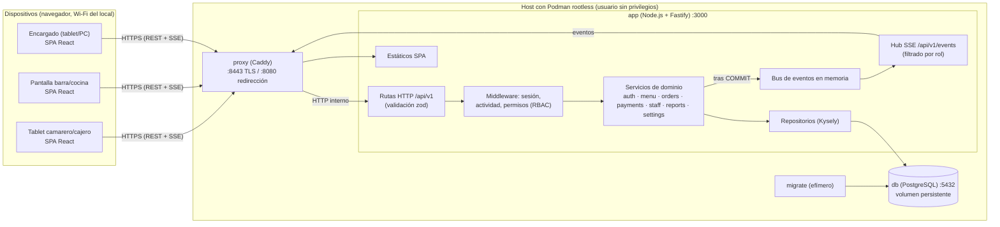
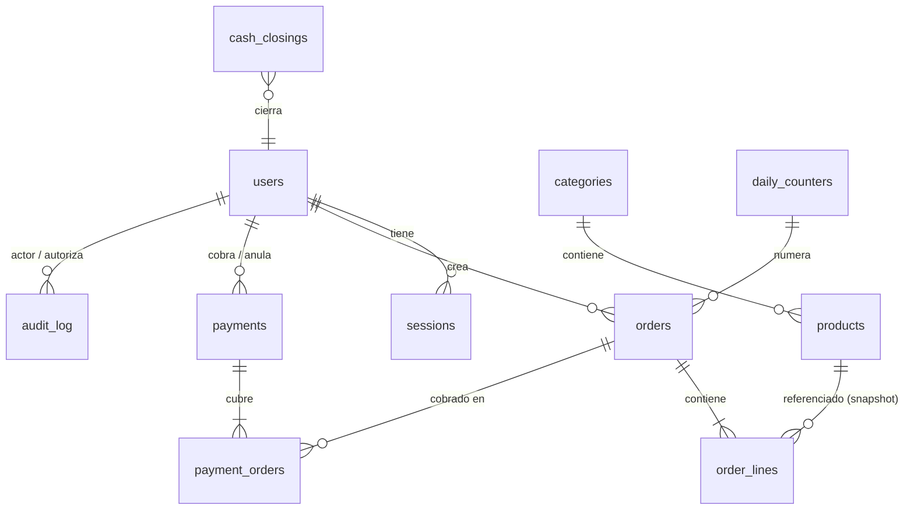
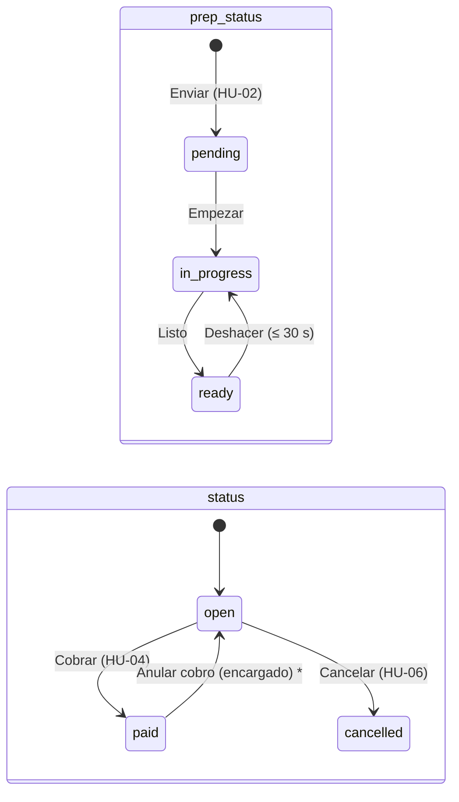

# Arquitectura — Toma de pedidos para cafetería (MVP)

> Responsable: Software Engineer. Entradas: `docs/historias/` (HU-01 a HU-08 y
> supuestos del README), `docs/reglas-equipo.md` (sección 3). Los entregables de
> UX (`docs/ux/`) aún no existían al redactar esto; la arquitectura solo asume
> una **UI web táctil** que funciona en navegador (tablets de 10", pantalla de
> barra de 15"+, TPV u ordenador).

## 1. Visión general

Tamaño del problema (supuestos del PO): 1 local, ~20 mesas, ≤15 empleados,
~10 dispositivos a la vez, ~500 pedidos/día, ~200 productos. Esto es una carga
**muy pequeña y limitada por E/S** (base de datos y red Wi-Fi), no por CPU.

Decisión de forma: **monolito modular, una sola instancia**, con tres
contenedores en ejecución:

| Servicio | Imagen | Función |
|---|---|---|
| `proxy` | Caddy (oficial, sin modificar) | TLS, HTTP/2, proxy inverso hacia `app` |
| `app` | Imagen propia (Node.js distroless) | API REST + flujo SSE de tiempo real + archivos estáticos de la SPA |
| `db` | PostgreSQL (oficial, alpine) | Persistencia |

Más un contenedor efímero `migrate` (misma imagen que `app`, otro comando) que
aplica las migraciones antes de arrancar `app`.

Stack (ver ADRs):

| Capa | Elección | ADR |
|---|---|---|
| Backend | TypeScript + Node.js LTS + Fastify | [ADR-001](decisiones/ADR-001-lenguaje-y-framework-backend.md) |
| Frontend | SPA React + Vite + TypeScript | [ADR-002](decisiones/ADR-002-frontend.md) |
| Base de datos | PostgreSQL + Kysely (SQL tipado) | [ADR-003](decisiones/ADR-003-base-de-datos.md) |
| Tiempo real | Server-Sent Events + resincronización por snapshot | [ADR-004](decisiones/ADR-004-tiempo-real.md) |
| Autenticación/autorización | Usuario + PIN (argon2id), sesión opaca en servidor, RBAC en servidor | [ADR-005](decisiones/ADR-005-autenticacion-y-autorizacion.md) |
| Dinero | Enteros en céntimos de euro | [ADR-006](decisiones/ADR-006-importes-monetarios.md) |
| Exposición/TLS | Caddy como proxy inverso, puertos > 1024 | [ADR-007](decisiones/ADR-007-proxy-tls-y-puertos.md) |
| Concurrencia | IDs generados por el cliente (idempotencia) + versión optimista | [ADR-008](decisiones/ADR-008-concurrencia-e-idempotencia.md) |

Rust no se usa: no hay ningún componente con carga de CPU, latencia sub-ms o
memoria restringida; el cuello de botella sería la BD/red (justificación en ADR-001).

## 2. Componentes y capas



Capas dentro de `app` (dependencias solo hacia abajo):

1. **Rutas (HTTP/SSE):** parseo y validación de entrada con esquemas zod,
   serialización de salida por rol. Sin lógica de negocio.
2. **Middleware:** resolución de sesión, control de inactividad, comprobación
   de permiso de la ruta.
3. **Servicios de dominio:** reglas de negocio (máquina de estados del pedido,
   cálculo de totales, bloqueo de PIN, cobro, cierre). Reciben sus dependencias
   por constructor (repositorios, reloj, bus, hasher) → testeables sin BD.
4. **Repositorios:** acceso a PostgreSQL con Kysely; transacciones.
5. **Bus de eventos:** el servicio publica **después del COMMIT**; el hub SSE
   reenvía a los clientes conectados. En memoria porque hay **una sola
   instancia** (si algún día hay varias, se sustituye por `LISTEN/NOTIFY` de
   PostgreSQL sin tocar los servicios).

Funciones puras en `packages/shared`: dinero, máquina de estados, reglas de PIN,
matriz de permisos. Las usa el servidor (autoridad) y el cliente (feedback
inmediato, p. ej. total en ≤ 200 ms en HU-02), pero **el servidor siempre
recalcula**.

## 3. Estructura de carpetas

```
mi-app/
├── apps/
│   ├── api/                      # Backend Fastify
│   │   ├── src/
│   │   │   ├── main.ts           # arranque, composición de dependencias (DI manual)
│   │   │   ├── config.ts         # lectura de variables/secretos (fallo si faltan)
│   │   │   ├── http/             # rutas por módulo + plugins (sesión, rbac, errores)
│   │   │   ├── realtime/         # hub SSE, serializadores por rol, heartbeat
│   │   │   ├── modules/
│   │   │   │   ├── auth/         # login, logout, sesiones, bloqueo, cambio de PIN
│   │   │   │   ├── staff/        # HU-07
│   │   │   │   ├── menu/         # HU-05
│   │   │   │   ├── orders/       # HU-02, HU-03, HU-06
│   │   │   │   ├── payments/     # HU-04
│   │   │   │   ├── reports/      # HU-08
│   │   │   │   ├── settings/
│   │   │   │   └── audit/
│   │   │   ├── db/               # cliente Kysely, tipos de tablas, migraciones
│   │   │   └── healthcheck.ts    # usado por HEALTHCHECK de la imagen
│   │   └── test/
│   └── web/                      # SPA React + Vite
│       ├── src/
│       │   ├── app/              # router, layout por rol, guardas de ruta
│       │   ├── features/         # login, pedido, cola, cobro, menu, personal, resumen
│       │   ├── realtime/         # cliente SSE, watchdog "Sin conexión", resync
│       │   ├── api/              # cliente HTTP tipado
│       │   └── ui/               # componentes del design system (de docs/ux)
│       └── test/
├── packages/
│   └── shared/                   # esquemas zod/DTOs, dinero, permisos, estados, reglas PIN
├── deploy/                       # (Infrastructure) Containerfile, compose.*.yaml, Caddyfile, quadlet/
├── infra/                        # (Infrastructure) Terraform PROD
├── docs/
└── package.json                  # workspaces (pnpm)
```

Gestor de paquetes: **pnpm workspaces** (un único lockfile, versiones fijadas).

## 4. Modelo de datos

Convenciones: claves `uuid` (las de pedidos, líneas y cobros las **genera el
cliente**, ver ADR-008); fechas `timestamptz` en UTC; **fecha de negocio**
(`business_date`) = día natural en `Europe/Madrid`, calculada en SQL
(`(now() AT TIME ZONE 'Europe/Madrid')::date`); importes `integer` en céntimos
con `CHECK`; nombres de tabla en inglés, `snake_case`.



### 4.1 Tablas

**users** — personal (HU-01, HU-07). No se borran.
| Columna | Tipo | Notas |
|---|---|---|
| id | uuid PK | |
| name | varchar(30) | nombre visible y de inicio de sesión; único sin distinguir mayúsculas (`UNIQUE (lower(name))`) |
| role | enum `waiter` \| `kitchen` \| `manager` | camarero/cajero, barra/cocina, encargado |
| pin_hash | text | argon2id con pepper (ADR-005) |
| must_change_pin | boolean | true tras alta o restablecimiento |
| active | boolean | |
| failed_attempts | smallint | intentos fallidos consecutivos |
| locked_until | timestamptz null | bloqueo de 5 min |
| created_at, updated_at | timestamptz | |

**sessions** (ADR-005)
| Columna | Tipo | Notas |
|---|---|---|
| id | uuid PK | |
| token_hash | bytea UNIQUE | SHA-256 del token; el token en claro solo vive en la cookie |
| user_id | uuid FK users | |
| created_at | timestamptz | |
| last_activity_at | timestamptz | para inactividad de 15 min |
| expires_at | timestamptz | caducidad absoluta (por defecto 14 h, configurable) |
| revoked_at | timestamptz null | logout, desactivación, restablecimiento de PIN |
| user_agent | varchar(200) | solo diagnóstico |

**settings** — una sola fila (`id = 1`): `table_count` (N mesas, por defecto 20),
`delay_threshold_minutes` (10), `undo_ready_seconds` (30).

**categories**: `id`, `name varchar(30)`, `position int`, `archived_at null`.
Único `lower(name)` entre no archivadas (índice parcial). "Borrar" = archivar,
y solo si no tiene productos activos (HU-05).

**products**: `id`, `category_id FK`, `name varchar(40)`,
`price_cents integer CHECK (price_cents BETWEEN 1 AND 99999)`,
`available boolean` (agotado/disponible), `active boolean` (desactivado),
`position int`, `updated_at`. Único `(category_id, lower(name))` entre activos.

**daily_counters**: `business_date date PK`, `last_number int`. El número
correlativo se obtiene con
`INSERT … ON CONFLICT (business_date) DO UPDATE SET last_number = last_number + 1 RETURNING last_number`
dentro de la transacción que crea el pedido (sin huecos por concurrencia).

**orders** (HU-02, HU-03, HU-06)
| Columna | Tipo | Notas |
|---|---|---|
| id | uuid PK | generado por el cliente (idempotencia del envío) |
| business_date | date | del envío |
| daily_number | int | `UNIQUE (business_date, daily_number)` |
| type | enum `table` \| `counter` | Mesa / Mostrador-Para llevar |
| table_number | smallint null | `CHECK` coherente con `type`; ≤ `settings.table_count` (validado en servicio) |
| customer_ref | varchar(30) null | |
| status | enum `open` \| `paid` \| `cancelled` | ciclo económico |
| prep_status | enum `pending` \| `in_progress` \| `ready` | ciclo de preparación (independiente, ver 4.2) |
| kitchen_flag | enum `none` \| `modified` \| `cancelled` | etiqueta pendiente de confirmar por barra |
| total_cents | integer ≥ 0 | recalculado en servidor en cada cambio de líneas, misma transacción |
| version | integer | control optimista (ADR-008) |
| created_by | uuid FK users | |
| sent_at | timestamptz | |
| prep_started_at, ready_at | timestamptz null | `ready_at` habilita "Deshacer" 30 s |
| cancelled_at, cancelled_by, cancel_authorized_by, cancel_reason_code, cancel_reason_text | | motivo: `customer_left` \| `entry_error` \| `other` (+ texto ≤ 100) |

Índices: `(status) WHERE status = 'open'`, `(prep_status, sent_at)` para la cola,
`(table_number) WHERE status = 'open'` para el aviso de mesa ocupada,
`(business_date)`.

**order_lines**
| Columna | Tipo | Notas |
|---|---|---|
| id | uuid PK | generado por el cliente |
| order_id | uuid FK | |
| product_id | uuid FK | |
| product_name | varchar(40) | **snapshot** al enviar |
| unit_price_cents | integer | **snapshot** del precio vigente al enviar (HU-02, HU-05) |
| quantity | smallint > 0 | |
| note | varchar(100) null | |
| added_after_send | boolean | etiqueta "AÑADIDO" (HU-06) |
| removed_at, removed_by, removal_authorized_by | null | línea "ELIMINADO" (se conserva, no se borra) |

**payments** (HU-04)
| Columna | Tipo | Notas |
|---|---|---|
| id | uuid PK | generado por el cliente (anti doble cobro por reintento) |
| method | enum `cash` \| `card` | |
| amount_cents | integer > 0 | suma de los pedidos cubiertos, calculada en servidor |
| tendered_cents, change_cents | integer null | solo efectivo; `tendered ≥ amount` |
| business_date | date | del cobro |
| paid_at, paid_by | | |
| voided_at, voided_by, void_reason | null | anulación por encargado (motivo ≥ 5 caracteres) |

**payment_orders**: `payment_id`, `order_id`, `voided boolean`. Índice único
parcial `UNIQUE (order_id) WHERE NOT voided` → **la BD impide cobrar dos veces**
el mismo pedido aunque falle la lógica de aplicación. "Cobrar mesa" = un
`payment` con varias filas aquí.

**cash_closings** (HU-08): `business_date PK`, `expected_cash_cents`,
`counted_cash_cents`, `difference_cents`, `summary jsonb` (cifras congeladas),
`closed_by`, `closed_at`. Inmutable.

**audit_log** (HU-04, HU-05, HU-06, HU-07): `id bigserial`, `at`, `actor_id`,
`authorized_by null` (PIN de encargado), `action` (p. ej. `price.changed`,
`order.line_removed`, `payment.voided`, `user.role_changed`), `entity_type`,
`entity_id`, `details jsonb` (p. ej. precio anterior y nuevo). **Nunca contiene
PIN ni hashes.** Inmutable a dos niveles: el rol de BD de la aplicación solo
tiene `INSERT, SELECT` y un trigger rechaza `UPDATE/DELETE`. Las mismas
restricciones (sin `DELETE`) aplican a `payments`, `payment_orders` y
`cash_closings`.

### 4.2 Estados del pedido

Se separan dos dimensiones porque un pedido de mostrador se puede **cobrar antes
de prepararse** (supuesto 9) y no debe desaparecer de la cola de barra:



\* Pendiente de confirmar por el PO (ver `docs/estado.md`).

- **Cola de barra** = `status <> 'cancelled' AND prep_status <> 'ready'`, más los
  cancelados con `kitchen_flag = 'cancelled'` hasta que barra los confirme.
- **Pedidos abiertos** del camarero = `status = 'open'`.
- Reglas de HU-06 (necesita PIN de encargado si `prep_status ∈ {in_progress, ready}`)
  y HU-04 (no se modifica si `status = 'paid'`) viven en la máquina de estados
  de `packages/shared`, que el servicio aplica en servidor.

### 4.3 Conservación de datos

90 días es la **ventana de consulta** del resumen (HU-08), no un borrado. No hay
purga en el MVP: ~500 pedidos/día ≈ 180 000 pedidos/año, unos pocos cientos de
MB como mucho. La conservación legal la decide el humano (pregunta 10 del README).
Las copias de seguridad (`pg_dump` diario) son tarea de Infrastructure.

## 5. API principal

REST JSON bajo `/api/v1`, mismo origen que la SPA (sin CORS). Importes siempre
en **céntimos enteros** (`…Cents`). Fechas ISO 8601 UTC. Toda respuesta que el
cliente use para calcular tiempos de espera incluye `serverTime` (el cliente
calcula su desfase de reloj; los minutos de espera y el "retrasado" no dependen
del reloj de la tablet).

Errores con formato único:
```json
{ "error": { "code": "ORDER_VERSION_CONFLICT", "message": "El pedido ha cambiado", "details": { } } }
```
Códigos HTTP: `400` validación (con campo y regla, para los mensajes de HU-05/HU-07),
`401` sin sesión o caducada, `403` sin permiso, `404`, `409` conflicto de
estado/versión (incluye la versión actual del recurso), `423` usuario bloqueado
(con `retryAfterSeconds`), `429` límite de peticiones.

Autorización puntual de encargado (HU-06): las operaciones que la requieren
aceptan en el cuerpo `"managerApproval": { "name": "...", "pin": "..." }`. Se
valida en servidor, cuenta para el bloqueo por intentos de ese encargado y se
guarda en `authorized_by`.

### 5.1 Endpoints

Permisos: **W** = camarero/cajero, **K** = barra/cocina, **M** = encargado
(M puede todo).

| Método y ruta | Permiso | Historia | Descripción |
|---|---|---|---|
| `POST /auth/login` | público | HU-01 | `{name, pin}` → `200 {user:{id,name,role,mustChangePin}}` + cookie; `401 INVALID_CREDENTIALS` ("Usuario o PIN incorrectos"); `423 LOCKED {retryAfterSeconds}`; `403 USER_DISABLED` (solo si el PIN es correcto) |
| `POST /auth/logout` | sesión | HU-01 | revoca la sesión |
| `GET /auth/me` | sesión | HU-01 | usuario, rol, permisos efectivos, `serverTime` |
| `POST /auth/pin` | sesión | HU-07 | `{currentPin, newPin}`; única ruta permitida con `mustChangePin` |
| `POST /session/activity` | sesión | HU-01 | latido de interacción del usuario (el cliente lo envía como mucho 1/min si hay toques sin otras peticiones) |
| `GET /events` | sesión | HU-03, HU-05 | flujo SSE (sección 6) |
| `GET /menu` | W, K, M | HU-02, HU-05 | categorías y productos activos ordenados, con `available` (K los recibe sin precio) |
| `PATCH /products/:id/availability` | W, M | HU-05 | `{available}` |
| `POST /categories` · `PATCH /categories/:id` · `DELETE /categories/:id` | M | HU-05 | `DELETE` archiva; `409 CATEGORY_HAS_ACTIVE_PRODUCTS {count}` |
| `POST /products` · `PATCH /products/:id` | M | HU-05 | precio en `priceCents`; cambio de precio auditado; `active:false` desactiva |
| `PUT /menu/order` | M | HU-05 | `{categories:[id…], products:{categoryId:[id…]}}` reordenación |
| `GET /tables/:n/open-orders` | W, M | HU-02 | para el aviso "La mesa X ya tiene un pedido abierto" |
| `POST /orders` | W, M | HU-02 | `{id, type, tableNumber?, customerRef?, lines:[{id, productId, quantity, note?}]}` → `201` pedido con número del día y precios del servidor; si el `id` ya existe del mismo usuario → `200` con el mismo pedido (reintento) |
| `GET /orders?status=open` | W, M | HU-02, HU-04 | lista de abiertos con `prepStatus` (el camarero ve "Listo") |
| `GET /orders/:id` | W, M | HU-04 | detalle con importes |
| `GET /kitchen/queue` | K, M | HU-03 | snapshot de la cola **sin importes**, `serverTime`, `delayThresholdMinutes` |
| `POST /orders/:id/prep` | K, M | HU-03 | `{action: "start" \| "ready" \| "undo_ready"}`; transición validada; `409 INVALID_TRANSITION`; `undo_ready` solo en ≤ 30 s desde `ready_at` |
| `POST /orders/:id/kitchen-ack` | K, M | HU-03 | barra confirma la etiqueta MODIFICADO/CANCELADO |
| `PATCH /orders/:id/lines` | W, M | HU-06 | `{expectedVersion, add:[{id, productId, quantity, note?}], change:[{lineId, quantity}], remove:[lineId], managerApproval?}`; `409 ORDER_VERSION_CONFLICT {order}`; `403 MANAGER_APPROVAL_REQUIRED` |
| `POST /orders/:id/cancel` | W, M | HU-06 | `{expectedVersion, reasonCode, reasonText?, managerApproval?}` |
| `POST /payments` | W, M | HU-04 | `{id, orderIds:[…], method, tenderedCents?, expectedTotalCents}` → `201 {payment, changeCents}`; `409 TOTAL_CHANGED` si el total del servidor no coincide con lo que vio el cajero; `409 ALREADY_PAID`; `422 INSUFFICIENT_CASH {missingCents}`; reintento con el mismo `id` → `200` |
| `GET /payments/:id/ticket` | W, M | HU-04 | resumen en pantalla |
| `POST /payments/:id/void` | M | HU-04 | `{reason}` (≥ 5 caracteres) |
| `GET /staff` · `POST /staff` · `PATCH /staff/:id` | M | HU-07 | alta `{name, role, pin}`; `PATCH` cambia nombre/rol/activo; `409 LAST_MANAGER` |
| `POST /staff/:id/reset-pin` | M | HU-07 | `{pin}` provisional; revoca sesiones del usuario |
| `GET /settings` · `PATCH /settings` | lectura: todos; escritura: M | HU-02, HU-03 | nº de mesas, umbral de retraso |
| `GET /reports/daily?date=YYYY-MM-DD` | M | HU-08 | fecha dentro de los últimos 90 días; totales, productos, cancelados, anulados, abiertos, cierre guardado si existe |
| `POST /reports/daily/:date/closing` | M | HU-08 | `{countedCashCents}`; `409` si ya está cerrado |
| `GET /healthz` | interno | — | lo usa el `HEALTHCHECK`; no lo expone el proxy |

**Serialización por rol:** cada recurso de pedido tiene dos serializadores,
`toStaffDto` (con importes) y `toKitchenDto` (sin `unitPriceCents`,
`totalCents` ni datos de cobro). La ruta y el hub SSE eligen por el rol de la
sesión. Así "barra no ve importes" (HU-03) no depende de la UI.

## 6. Tiempo real (ADR-004)

- **Transporte:** Server-Sent Events en `GET /api/v1/events` (un único flujo por
  dispositivo). Las acciones van por REST; SSE solo empuja del servidor al
  cliente. El navegador reconecta solo (`EventSource`).
- **Eventos** (`event:` / `data:` JSON, filtrados y serializados según el rol):

| Evento | Destinatarios | Origen |
|---|---|---|
| `order.created` | W, K, M | HU-02 |
| `order.updated` (líneas, estado, prep, flag; incluye `version`) | W, K, M | HU-03, HU-04, HU-06 |
| `product.updated` (disponibilidad/precio/activo) | W, K, M | HU-05 |
| `menu.changed` (estructura/orden → el cliente recarga `GET /menu`) | W, K, M | HU-05 |
| `settings.updated` | todos | — |
| `session.revoked` (y se cierra el flujo) | la sesión afectada | HU-01, HU-07 |
| `session.updated` (cambio de rol → el cliente recarga `/auth/me` y reconecta) | la sesión afectada | HU-07 |
| `ping` cada 2 s (`serverTime`) | todos | latido |

- **"Sin conexión" en ≤ 5 s (HU-03):** el cliente tiene un vigilante; si no
  recibe nada (ni `ping`) en 5 s muestra el aviso y fuerza reconexión.
- **Resincronización sin pérdidas:** al (re)conectar, el servidor envía primero
  `hello`; el cliente entonces pide el snapshot (`GET /kitchen/queue` u
  `GET /orders?status=open` + `GET /menu`) y lo **reemplaza** por completo.
  Los eventos que lleguen durante la carga se aplican si su `version` es mayor
  que la del snapshot. No se necesita reproducir eventos perdidos (`Last-Event-ID`)
  porque el estado completo es pequeño (≤ decenas de pedidos abiertos).
- **Orden y consistencia:** se publica tras el `COMMIT`; cada evento de pedido
  lleva `version`, el cliente descarta los de versión menor o igual a la que ya
  tiene.
- **Capacidad:** ~10 conexiones SSE abiertas; trivial para Node. Con HTTP/2
  (Caddy) no aplica el límite de 6 conexiones por origen de HTTP/1.1.
- **Presupuesto de latencia** (HU-02/HU-03/HU-06 ≤ 2 s p95, HU-05 ≤ 5 s):
  transacción (< 50 ms) + publicación en memoria + entrega SSE en LAN (< 100 ms).
  Margen amplio.

## 7. Autenticación y autorización (ADR-005)

- **Credenciales:** nombre + PIN de 4 a 6 dígitos. PIN guardado con
  **argon2id** + *pepper* (secreto inyectado en ejecución con `podman secret`,
  nunca en BD ni imagen). Parámetros ajustados para ≤ ~250 ms por verificación
  (HU-01 pide ≤ 1 s p95). Reglas de PIN (no repetidos, no secuencias) en
  `packages/shared`, validadas en servidor.
- **Sesión:** token aleatorio de 256 bits en cookie `HttpOnly; Secure;
  SameSite=Strict; Path=/`; en BD solo su SHA-256. Se resuelve en **cada**
  petición junto con el usuario → un cambio de rol o una desactivación surte
  efecto en la siguiente petición (HU-07), y la desactivación además revoca
  sesiones y cierra el flujo SSE al instante (HU-07 pide ≤ 1 min).
- **Inactividad 15 min (HU-01):** cuenta como actividad cualquier petición
  REST (no el flujo SSE ni sus `ping`) y `POST /session/activity`, que el cliente
  envía como mucho 1/min si hay toques en pantalla. `last_activity_at` se
  actualiza como mucho cada 30 s. El cliente también cierra la pantalla por su
  cuenta al llegar a 15 min. **Excepción rol barra:** mientras su flujo SSE esté
  abierto, la sesión no caduca por inactividad. Todas las sesiones tienen además
  caducidad absoluta (14 h por defecto, configurable) — propuesta a validar por
  Cybersecurity.
- **Bloqueo (HU-01):** `failed_attempts` y `locked_until` por usuario; al 5.º
  fallo consecutivo, bloqueo 5 min (`423` con tiempo restante). El contador se
  reinicia con un acceso correcto. Se verifica el PIN incluso si el usuario no
  existe (hash ficticio) para no filtrar por tiempo de respuesta qué nombres
  existen. Límite adicional por IP de origen en `/auth/login` (en memoria) para
  frenar ataques que prueben un PIN común contra todos los usuarios.
- **CSRF:** `SameSite=Strict` + mismo origen + comprobación de cabecera `Origin`
  en peticiones que modifican datos.
- **Autorización (RBAC):** matriz rol → permisos en `packages/shared/permissions.ts`.
  Cada ruta declara su permiso (`requirePermission('payment:void')`) y el
  middleware responde `403` antes de ejecutar nada (HU-01). La UI usa la misma
  matriz solo para ocultar opciones. Matriz inicial:

| Permiso | W | K | M |
|---|---|---|---|
| `menu:read` | ✓ | ✓ (sin precios) | ✓ |
| `product:set_availability` | ✓ | | ✓ |
| `menu:manage` | | | ✓ |
| `order:create`, `order:read`, `order:modify`, `order:cancel` | ✓ | | ✓ |
| `kitchen:read`, `kitchen:transition` | | ✓ | ✓ |
| `payment:create`, `payment:read` | ✓ | | ✓ |
| `payment:void` | | | ✓ |
| `staff:manage`, `settings:manage`, `reports:read` | | | ✓ |
| `approval:grant` (PIN de encargado en HU-06) | | | ✓ |

  La versión formal de permisos la mantienen Cybersecurity y Developer en
  `docs/permisos.md`.
- **Encargado inicial (HU-01):** comando de arranque `create-initial-manager`
  (en la imagen de `app`) que lee el nombre y un PIN provisional de un
  `podman secret`, solo si no existe ningún encargado; queda con
  `must_change_pin = true`.

## 8. Dinero (ADR-006)

- Todo importe es un **entero de céntimos** (`integer` en PostgreSQL, `number`
  entero validado en TS; 99 999 × cantidad × líneas queda muy lejos de 2^31).
- Precio de entrada del encargado ("2,50") se convierte a céntimos **parseando
  la cadena** (máx. 2 decimales, coma o punto), nunca multiplicando un float.
- Total = Σ (`unit_price_cents` × `quantity`) en servidor; cambio =
  `tendered − amount`. Sin divisiones → sin redondeos.
- Formato en pantalla con una única función `formatCents` (es-ES, "1.234,50 €").
- Los agregados de HU-08 usan `SUM()` sobre enteros en SQL → coinciden al céntimo.

## 9. Concurrencia, idempotencia y fiabilidad (ADR-008)

- **Sin duplicados al reintentar (HU-02, HU-04):** el cliente genera el `uuid`
  del pedido, de cada línea y del cobro antes de enviarlos. Si la red falla, el
  reintento usa el mismo id; el servidor devuelve el recurso existente. El
  índice único parcial de `payment_orders` es la última barrera contra el doble
  cobro.
- **Pedido en edición no se pierde (HU-02):** el borrador vive solo en el cliente
  (estado + `localStorage` del dispositivo) hasta el `201`; "Descartar" lo borra.
  No hay borradores en servidor.
- **Modificaciones simultáneas (HU-06):** `orders.version` se incrementa en cada
  cambio; las modificaciones envían `expectedVersion` y se ejecutan con
  `UPDATE … WHERE id = $1 AND version = $2`. Si no coincide → `409` con el pedido
  actual; la UI avisa "El pedido ha cambiado" y muestra la versión nueva.
- **Transiciones de barra:** validadas contra el estado actual (no por versión),
  porque son idempotentes ("Listo" sobre un pedido ya listo → `409 INVALID_TRANSITION`
  inocuo).
- **Cobro:** una transacción con `SELECT … FOR UPDATE` de los pedidos; comprueba
  `status = 'open'` y que `expectedTotalCents` coincide con el total actual.

## 10. Despliegue con contenedores rootless

Detalle y ficheros: Infrastructure (`docs/infraestructura.md`, `deploy/`). Lo que
la arquitectura exige:

| Servicio | Imagen base | Usuario | Puertos (contenedor) | Persistencia | Notas |
|---|---|---|---|---|---|
| `app` | multi-stage: `node:<LTS>-alpine` para compilar → **distroless nodejs** (`nonroot`) | UID ≥ 1000 | 3000 (solo red interna) | ninguna (`--read-only`, `/tmp` tmpfs) | `HEALTHCHECK` en forma exec con `node dist/healthcheck.js` (no hay shell). Construir con formato docker para que Podman guarde el `HEALTHCHECK` |
| `migrate` | misma imagen que `app` | igual | — | — | efímero, usa el rol de BD propietario |
| `db` | `postgres:<versión>-alpine` | UID ≥ 1000 (`--user`), datos en volumen con ese dueño | 5432 (solo red interna) | volumen `pgdata` | `--read-only` con tmpfs en `/var/run/postgresql` y `/tmp` |
| `proxy` | `caddy:<versión>-alpine` | UID ≥ 1000 | 8080 (redirección) y 8443 (TLS) | volumen para `/data` (certificados) | único servicio publicado al host |

- Todos con `cap-drop: ALL`, `no-new-privileges`, límites de memoria/CPU,
  red interna propia (sin `network=host`). Ninguno necesita capacidades extra
  (todos los puertos son > 1024).
- **Secretos** (`podman secret`, nunca en imagen ni en `docs/`): contraseña del
  rol de BD de la app, contraseña del rol propietario (solo `migrate`), *pepper*
  de PIN, datos del encargado inicial.
- **Dos roles de BD:** `app_owner` (DDL, migraciones) y `app_rw` (DML sin
  `DELETE` en tablas de auditoría y cobros).
- **Puertos 80/443:** ver ADR-007 (por defecto se publica 8443; si se quiere 443,
  se ajusta `net.ipv4.ip_unprivileged_port_start` en el host de PROD).
- **Entornos:**
  - DEV: `compose.dev.yaml` con `db`, `api` en modo `watch` (código montado) y
    servidor Vite con recarga en caliente (proxy de `/api` hacia `api`). Sin
    Caddy: `http://localhost` es contexto seguro para el navegador.
  - TESTING / DEMO: las tres imágenes definitivas (`proxy`, `app`, `db`).
  - PROD: las mismas imágenes con Quadlet bajo un usuario sin privilegios.
- **Una sola réplica de `app`** (estado SSE y bus en memoria). Reinicio
  automático por el motor; los clientes reconectan y resincronizan solos.

## 11. Observabilidad (puntos de enganche)

El estándar lo define Monitoring (`docs/logging.md`). La arquitectura aporta:
logs JSON de Fastify (pino) a stdout con `requestId`, `userId` y `role`;
**redacción obligatoria** de `pin`, `currentPin`, `newPin`, `managerApproval.pin`,
cookies y cabecera `Authorization`; `/healthz` (BD alcanzable); métricas mínimas
posibles: latencia por ruta, conexiones SSE abiertas, logins fallidos, bloqueos.

## 12. Convenciones de código

- TypeScript `strict`, ESLint + Prettier; sin `any` salvo justificado.
- Validación de toda entrada en el borde con zod (esquemas en `packages/shared`,
  reutilizados para tipos de request/response).
- Dominio en inglés en código y BD; textos de UI en español.
- Servicios con dependencias por constructor (DI manual en `main.ts`, sin
  contenedor de DI). Reloj inyectable (`Clock`) para tests de expiración,
  bloqueo y "Deshacer 30 s".
- Funciones puras para reglas (totales, transiciones, reglas de PIN, permisos);
  datos inmutables en el dominio (`readonly`).
- Toda operación que cambia varias tablas va en una transacción; los eventos se
  publican después del `COMMIT`.
- SQL parametrizado siempre (Kysely); nada de concatenar cadenas.
- Migraciones versionadas en `apps/api/src/db/migrations`, solo hacia delante.
- Nada de secretos en el repo; configuración por variables de entorno y
  archivos de secreto montados.

## 13. Riesgos técnicos

| Riesgo | Impacto | Mitigación |
|---|---|---|
| PIN de 4 dígitos = 10 000 combinaciones; con bloqueo de 5/5 min, ~1 440 intentos/día por usuario | Acceso indebido en días | Límite por IP, aviso en logs/alertas de bloqueos repetidos, propuesta de PIN de 6 dígitos para encargado (ver `docs/estado.md`). Decide Cybersecurity/PO |
| TLS en red local: los certificados de CA interna de Caddy requieren instalar la CA raíz en cada tablet | Avisos del navegador; sin HTTPS no hay cookies `Secure`, Wake Lock ni sonido fiable | ADR-007; si PROD es una VM en internet, certificados ACME con dominio real |
| Sin conexión a internet/servidor no hay servicio (offline fuera de alcance) | Parada del local si cae el Wi-Fi o el host | Pregunta 11 del README; servidor en el propio local reduce dependencia de internet |
| Una sola instancia de `app` | Un fallo deja sin servicio hasta el reinicio (segundos) | Reinicio automático + resync de clientes; suficiente para 1 local |
| Reloj de las tablets desfasado | Minutos de espera y "retrasado" erróneos | `serverTime` en respuestas y `ping` |
| Navegadores bloquean el audio sin gesto previo; la pantalla de barra se apaga | Aviso sonoro (HU-03) no suena; cola no visible | Reportado a UX (ver `docs/estado.md`); Wake Lock API (requiere HTTPS) |
| Requisitos fiscales (pregunta 1) | Cambio de alcance mayor: ticket fiscal encadenado, firma, envío a AEAT | El modelo de `payments` inmutable y auditado facilita añadirlo; requeriría nuevo ADR |
