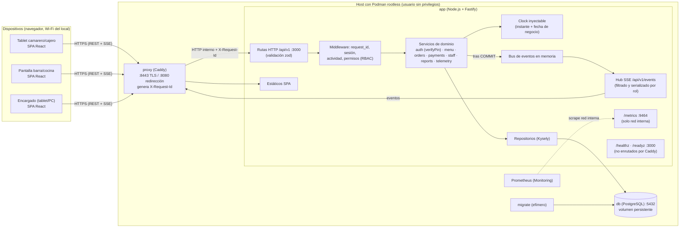
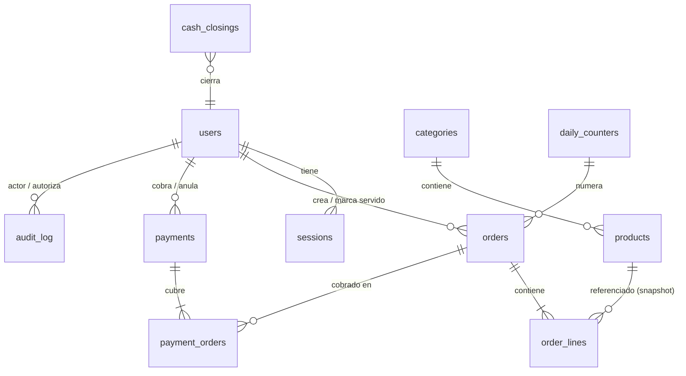
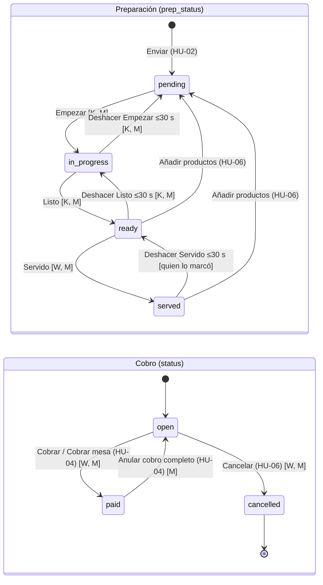

# Arquitectura — Toma de pedidos para cafetería (MVP)

> Responsable: Software Engineer. Entradas: `docs/historias/` (HU-01 a HU-08 y
> supuestos del README; HU-09 **fuera del MVP**, decisión del humano
> 2026-11-23), `docs/ux/`, `docs/testing.md`, `docs/logging.md` y
> `docs/reglas-equipo.md` (sección 3). La arquitectura asume una **UI web
> táctil** que funciona en navegador (tablets de 10", pantalla de barra de 24"
> FHD o mayor —supuesto 21—, TPV u ordenador).
>
> Revisión 2026-11-21 (tarea 1.3b): dos dimensiones de estado, estado "Servido",
> deshacer, vuelta a la cola, lista de sala, "Cobrados hoy", anulación del cobro
> completo, día natural `Europe/Madrid`, autorización de encargado para una sola
> acción, ajustes del local (condicionado a HU-09), hallazgos T-10, T-11,
> M-01..M-04 y decisiones de Cybersecurity SEC-001, 002, 004, 005, 006, 007 y
> 012 (`docs/seguridad.md` §6). Registro de decisiones en la §14.
>
> Revisión 2026-11-23 (tarea 1.3c): `verifyPin` única para toda verificación de
> PIN (SEC-016), redacción de logs por `/pin/i` (SEC-017), cookie `__Host-sid`
> (SEC-021), cobros del día para el camarero (SEC-022), UID 1000 en la imagen
> de `app` (SEC-010) y retirada de los ajustes editables (HU-09 fuera del MVP).
> Registro en la §15.

## 1. Visión general

Tamaño del problema (supuestos del PO): 1 local, ~20 mesas, ≤15 empleados,
~10 dispositivos a la vez, ~500 pedidos/día, ~200 productos. Esto es una carga
**muy pequeña y limitada por E/S** (base de datos y red Wi-Fi), no por CPU.

Decisión de forma: **monolito modular, una sola instancia**, con tres
contenedores en ejecución:

| Servicio | Imagen | Función |
|---|---|---|
| `proxy` | Caddy (oficial, sin modificar) | TLS, HTTP/2, proxy inverso hacia `app`, genera `X-Request-Id` |
| `app` | Imagen propia (Node.js distroless) | API REST + flujo SSE de tiempo real + archivos estáticos de la SPA (puerto 3000); métricas Prometheus en puerto interno 9464 |
| `db` | PostgreSQL (oficial, alpine) | Persistencia |

Más un contenedor efímero `migrate` (misma imagen que `app`, otro comando) que
aplica las migraciones antes de arrancar `app`.

Stack (ver ADRs):

| Capa | Elección | ADR |
|---|---|---|
| Backend | TypeScript + Node.js LTS + Fastify | [ADR-001](decisiones/ADR-001-lenguaje-y-framework-backend.md) |
| Frontend | SPA React + Vite + TypeScript | [ADR-002](decisiones/ADR-002-frontend.md) |
| Base de datos | PostgreSQL + Kysely (SQL tipado) | [ADR-003](decisiones/ADR-003-base-de-datos.md) |
| Tiempo real | Server-Sent Events + resincronización por snapshot | [ADR-004](decisiones/ADR-004-tiempo-real.md) |
| Autenticación/autorización | Usuario + PIN (argon2id), sesión opaca en servidor, RBAC en servidor | [ADR-005](decisiones/ADR-005-autenticacion-y-autorizacion.md) |
| Dinero | Enteros en céntimos de euro | [ADR-006](decisiones/ADR-006-importes-monetarios.md) |
| Exposición/TLS | Caddy como proxy inverso, puertos > 1024 | [ADR-007](decisiones/ADR-007-proxy-tls-y-puertos.md) |
| Concurrencia | IDs generados por el cliente (idempotencia) + versión optimista + máquina de estados | [ADR-008](decisiones/ADR-008-concurrencia-e-idempotencia.md) |

Rust no se usa: no hay ningún componente con carga de CPU, latencia sub-ms o
memoria restringida; el cuello de botella sería la BD/red (justificación en ADR-001).

## 2. Componentes y capas



Capas dentro de `app` (dependencias solo hacia abajo):

1. **Rutas (HTTP/SSE):** parseo y validación de entrada con esquemas zod,
   serialización de salida por rol. Sin lógica de negocio.
2. **Middleware:** `request_id`, resolución de sesión, control de inactividad,
   comprobación de permiso de la ruta.
3. **Servicios de dominio:** reglas de negocio (máquina de estados del pedido,
   cálculo de totales, bloqueo de PIN, cobro, anulación, cierre). Reciben sus
   dependencias por constructor (repositorios, `Clock`, bus, hasher) →
   testeables sin BD y con reloj falso.
4. **Repositorios:** acceso a PostgreSQL con Kysely; transacciones. Reciben las
   marcas de tiempo y la fecha de negocio como **parámetros** (§4, T-10).
5. **Bus de eventos:** el servicio publica **después del COMMIT**; el hub SSE
   reenvía a los clientes conectados. En memoria porque hay **una sola
   instancia** (si algún día hay varias, se sustituye por `LISTEN/NOTIFY` de
   PostgreSQL sin tocar los servicios).

La aplicación se construye con una factoría `buildApp(deps)` (en `main.ts` se
compone con `SystemClock`; los tests de integración la componen en proceso con
un `FakeClock` y la BD real). No hay endpoints de prueba en la imagen.

Funciones puras en `packages/shared`: dinero, máquina de estados del pedido
(preparación y cobro), deshacer, fecha de negocio, reglas de PIN, matriz de
permisos. Las usa el servidor (autoridad) y el cliente (feedback inmediato,
p. ej. total en ≤ 200 ms en HU-02), pero **el servidor siempre recalcula**.

## 3. Estructura de carpetas

```
mi-app/
├── apps/
│   ├── api/                      # Backend Fastify
│   │   └── src/
│   │       ├── main.ts           # arranque: compone buildApp() con SystemClock (DI manual)
│   │       ├── app.ts            # buildApp(deps): factoría usada por main y por los tests
│   │       ├── config.ts         # lectura de variables/secretos (fallo si faltan); configuración de instalación (§4.1)
│   │       ├── http/             # rutas por módulo + plugins (request_id, sesión, rbac, errores)
│   │       ├── realtime/         # hub SSE, serializadores por rol, ping
│   │       ├── metrics/          # registro prom-client y servidor interno :9464
│   │       ├── modules/
│   │       │   ├── auth/         # verifyPin (única que usa el hasher), login, logout, sesiones, bloqueo, cambio de PIN, aprobación y reconfirmación
│   │       │   ├── staff/        # HU-07
│   │       │   ├── menu/         # HU-05
│   │       │   ├── orders/       # HU-02, HU-03, HU-06 (cola, lista de sala, servido)
│   │       │   ├── payments/     # HU-04 (cobro, anulación, cobrados hoy)
│   │       │   ├── reports/      # HU-08
│   │       │   ├── telemetry/    # POST /telemetry → métricas (M-03)
│   │       │   └── audit/
│   │       ├── db/               # cliente Kysely, tipos de tablas, migraciones
│   │       └── healthcheck.ts    # usado por HEALTHCHECK de la imagen (GET /healthz)
│   └── web/                      # SPA React + Vite
│       └── src/
│           ├── app/              # router, layout por rol, guardas de ruta
│           ├── features/         # login, pedidos (sala), toma, cola, cobro, cobrados-hoy, menu, personal, resumen
│           ├── realtime/         # cliente SSE, vigilante "Sin conexión", resync, cambio de día
│           ├── telemetry/        # cola de métricas del cliente, envío por lotes
│           ├── api/              # cliente HTTP tipado
│           └── ui/               # componentes del design system (de docs/ux)
├── packages/
│   └── shared/                   # esquemas zod/DTOs, dinero, permisos, estados, deshacer, fecha de negocio, reglas PIN
├── tests/                        # (Testing) todos los tests: estructura en docs/testing.md §4.1
├── deploy/                       # (Infrastructure) Containerfile, compose.*.yaml, Caddyfile, quadlet/
├── infra/                        # (Infrastructure) Terraform PROD
├── docs/
└── package.json                  # workspaces (pnpm): apps/*, packages/*, tests
```

Gestor de paquetes: **pnpm workspaces** (un único lockfile, versiones fijadas).
Los tests **no** viven dentro de `apps/*` (T-11): así se ejecutan como imagen de
pruebas independiente sin tocar las imágenes de producción.

## 4. Modelo de datos

Convenciones:
- Claves `uuid` (las de pedidos, líneas y cobros las **genera el cliente**,
  ver ADR-008). Nombres de tabla en inglés, `snake_case`.
- Fechas `timestamptz` en UTC; importes `integer` en céntimos con `CHECK`.
- **Fecha de negocio** (`business_date`) = día natural en `Europe/Madrid`
  (supuesto 15), de 00:00:00 a 23:59:59. **Se calcula en la aplicación** con la
  función pura `businessDate(instant)` de `packages/shared` sobre el instante
  que da el `Clock` inyectado, y se pasa como parámetro a las consultas junto
  con las marcas de tiempo (`sent_at`, `paid_at`…). La lógica de negocio no usa
  `now()` de SQL; `DEFAULT now()` solo existe como red de seguridad en columnas
  de auditoría técnica (`created_at`). Así los tests de integración controlan
  el paso de medianoche y los cambios de hora (T-10). La zona horaria es una
  constante (`Europe/Madrid`), no un ajuste (YAGNI; pregunta 14 del README).



### 4.1 Tablas

**users** — personal (HU-01, HU-07). No se borran.
| Columna | Tipo | Notas |
|---|---|---|
| id | uuid PK | |
| name | varchar(30) | nombre visible y de inicio de sesión; único sin distinguir mayúsculas (`UNIQUE (lower(name))`) |
| role | enum `waiter` \| `kitchen` \| `manager` | camarero/cajero, barra/cocina, encargado |
| pin_hash | text | argon2id con pepper (ADR-005) |
| pin_digits | smallint `CHECK (pin_digits BETWEEN 4 AND 6)` | longitud del PIN; al promocionar a encargado con < 6 → `must_change_pin` (SEC-001) |
| must_change_pin | boolean | true tras alta, restablecimiento o promoción a encargado con PIN corto |
| active | boolean | |
| failed_attempts | smallint | fallos **consecutivos acumulados** de cualquier verificación del PIN de este usuario (login, `managerApproval`, `confirmPin`, `currentPin`; `verifyPin`, §7); no se reinicia al expirar un bloqueo (SEC-001, SEC-016) |
| locked_until | timestamptz null | bloqueo temporal: 5 / 15 / 60 min al llegar a 5 / 10 / 15 fallos |
| locked_manual | boolean | true al llegar a 20 fallos: bloqueo indefinido hasta desbloqueo por encargado o `unlock-user`; al ponerse a true se revocan **todas** las sesiones del usuario (SEC-016) |
| created_at, updated_at | timestamptz | |

**sessions** (ADR-005)
| Columna | Tipo | Notas |
|---|---|---|
| id | uuid PK | |
| token_hash | bytea UNIQUE | SHA-256 del token; el token en claro solo vive en la cookie |
| user_id | uuid FK users | |
| created_at | timestamptz | |
| last_activity_at | timestamptz | para inactividad de 15 min |
| expires_at | timestamptz | caducidad absoluta **12 h** para todos los roles, configurable solo a la baja (SEC-004) |
| revoked_at | timestamptz null | logout, desactivación, restablecimiento de PIN, cambio de PIN propio (las demás), bloqueo indefinido (todas) |
| user_agent | varchar(200) | solo diagnóstico |

**Configuración de instalación (sin tabla; HU-09 fuera del MVP, supuesto 20).**
Número de mesas y umbral de retraso son valores **de solo lectura** para la
aplicación: no hay tabla `settings`, ni ruta de escritura, ni evento, ni
auditoría de ajustes (YAGNI). `config.ts` los lee al arrancar de variables de
entorno no secretas y **no arranca** si están fuera de rango:

| Variable | Rango | Valor por defecto | Uso |
|---|---|---|---|
| `TABLE_COUNT` | 1–99 | 20 (supuestos 1 y 20) | rejilla de mesas (HU-02/CA-F01); `POST /orders` rechaza mesas > N con `422 TABLE_OUT_OF_RANGE` |
| `DELAY_THRESHOLD_MINUTES` | 1–60 | 10 (supuesto 24) | "RETRASADO" en la cola (HU-03/CA-F06) |

- Solo los cambia soporte técnico (variable del despliegue + reinicio de
  `app`). Tras el reinicio, los clientes reconectan y vuelven a leer
  `GET /auth/me` (§6), así que reciben el valor nuevo sin evento propio.
- Bajar `TABLE_COUNT` no toca los pedidos ya abiertos en mesas mayores: siguen
  visibles y se pueden cobrar; solo se impide crear pedidos nuevos en ellas.
- El tiempo de "Deshacer" (30 s) tampoco es configurable: es una constante de
  `packages/shared`.
- Si HU-09 entra más adelante, se añadirá una tabla de una fila y su ruta en un
  ADR nuevo; los contratos de lectura (`localConfig`, `delayThresholdMinutes`
  de la cola) no cambian.

**categories**: `id`, `name varchar(30)`, `position int`, `archived_at null`.
Único `lower(name)` entre no archivadas (índice parcial). "Borrar" = archivar,
y solo si no tiene productos activos (HU-05).

**products**: `id`, `category_id FK`, `name varchar(40)`,
`price_cents integer CHECK (price_cents BETWEEN 1 AND 99999)`,
`available boolean` (agotado/disponible), `active boolean` (desactivado),
`position int`, `updated_at`. Único `(category_id, lower(name))` entre activos.

**daily_counters**: `business_date date PK`, `last_number int`. El número
correlativo se obtiene con
`INSERT … VALUES ($businessDate, 1) ON CONFLICT (business_date) DO UPDATE SET last_number = daily_counters.last_number + 1 RETURNING last_number`
dentro de la transacción que crea el pedido (sin huecos ni repeticiones por
concurrencia; los cancelados conservan su número). `$businessDate` viene del
`Clock` (HU-02: 23:59:59 → número siguiente; 00:00:00 → 1 del día nuevo).

**orders** (HU-02, HU-03, HU-06)
| Columna | Tipo | Notas |
|---|---|---|
| id | uuid PK | generado por el cliente (idempotencia del envío) |
| business_date | date | del envío; **no cambia** aunque se modifique o cobre otro día |
| daily_number | int | `UNIQUE (business_date, daily_number)` |
| type | enum `table` \| `counter` | Mesa / Mostrador-Para llevar |
| table_number | smallint null | `CHECK` coherente con `type` y `BETWEEN 1 AND 99`; ≤ `TABLE_COUNT` al crear (validado en servicio) |
| customer_ref | varchar(30) null | |
| status | enum `open` \| `paid` \| `cancelled` | **dimensión de cobro** (Abierto / Cobrado / Cancelado) |
| prep_status | enum `pending` \| `in_progress` \| `ready` \| `served` | **dimensión de preparación** (Pendiente / En preparación / Listo / Servido) |
| prep_last_action | enum `start` \| `ready` \| `serve` \| `requeue` \| `undo` null | última transición de preparación; decide qué "Deshacer" es válido (§4.2) |
| prep_changed_at | timestamptz null | hora de la última transición de preparación (ventana de 30 s) |
| prep_changed_by | uuid FK users null | quién la hizo ("Deshacer Servido" solo por quien lo marcó) |
| kitchen_flag | enum `none` \| `modified` \| `cancelled` | etiqueta pendiente de confirmar por barra |
| total_cents | integer ≥ 0 | recalculado en servidor en cada cambio de líneas, misma transacción |
| version | integer | control optimista (ADR-008); sube con **cualquier** cambio |
| created_by | uuid FK users | |
| sent_at | timestamptz | hora de envío original (se muestra siempre) |
| queued_at | timestamptz | hora de entrada en la cola vigente: `= sent_at` al enviar; se actualiza al **volver a la cola** (§4.2). Ordena la cola y cuenta la espera |
| prep_started_at, ready_at, served_at | timestamptz null | del ciclo de preparación vigente |
| served_by | uuid FK users null | |
| cancelled_at, cancelled_by, cancel_authorized_by, cancel_reason_code, cancel_reason_text | | motivo: `customer_left` \| `entry_error` \| `other` (+ texto ≤ 100) |

Índices: `(status) WHERE status = 'open'` (por cobrar y lista de sala),
`(queued_at) WHERE prep_status IN ('pending','in_progress')` (cola),
`(business_date, status)` (lista de sala del día y HU-08),
`(table_number) WHERE status = 'open'` (aviso de mesa ocupada).

**order_lines**
| Columna | Tipo | Notas |
|---|---|---|
| id | uuid PK | generado por el cliente |
| order_id | uuid FK | |
| product_id | uuid FK | |
| product_name | varchar(40) | **snapshot** al enviar |
| unit_price_cents | integer | **snapshot** del precio vigente al enviar/añadir (HU-02, HU-05) |
| quantity | smallint `CHECK (quantity BETWEEN 1 AND 99)` | máx. 100 líneas no eliminadas por pedido → total ≤ 989 990 100 < 2³¹ − 1 (SEC-006, ADR-006) |
| note | varchar(100) null | |
| added_at | timestamptz null | null = línea del envío original; con valor = añadida después (HU-06) |
| removed_at, removed_by, removal_authorized_by | null | línea "ELIMINADO" (se conserva, no se borra) |

Etiquetas en barra: una línea se marca **"AÑADIDO"** si `added_at >= queued_at`
y **"ELIMINADO"** si `removed_at >= queued_at` (cambios del ciclo de cola
vigente). Las líneas añadidas o eliminadas en ciclos anteriores (ya preparadas)
se muestran sin etiqueta o no se muestran (eliminadas), para que barra no
confunda lo ya servido con lo nuevo. La vista de sala muestra todo el historial.

**payments** (HU-04)
| Columna | Tipo | Notas |
|---|---|---|
| id | uuid PK | generado por el cliente (anti doble cobro por reintento) |
| method | enum `cash` \| `card` | |
| amount_cents | integer > 0 | suma de los pedidos cubiertos, calculada en servidor |
| tendered_cents, change_cents | integer null | solo efectivo; `tendered ≥ amount` |
| business_date | date | **del cobro** (HU-08: un cobro a las 00:05 cuenta en el día nuevo) |
| paid_at, paid_by | | |
| voided_at, voided_by, void_reason | null | anulación por encargado (motivo ≥ 5 caracteres); `CHECK` todos nulos o todos con valor |

**payment_orders**: `payment_id`, `order_id`, `voided boolean`. Índice único
parcial `UNIQUE (order_id) WHERE NOT voided` → **la BD impide cobrar dos veces**
el mismo pedido aunque falle la lógica de aplicación. "Cobrar mesa" = un
`payment` con varias filas aquí. La anulación marca `voided = true` en **todas**
las filas del cobro a la vez (no existe operación para anular una sola).

**cash_closings** (HU-08): `business_date PK`, `expected_cash_cents`,
`counted_cash_cents`, `difference_cents`, `summary jsonb` (cifras congeladas),
`closed_by`, `closed_at`. Inmutable. Los cobros de un día cerrado anulados
después se detectan con `payments.voided_at > cash_closings.closed_at` y se
muestran aparte, sin tocar el cierre.

**audit_log** (HU-04, HU-05, HU-06, HU-07): `id bigserial`, `at`,
`actor_id`, `authorized_by null` (encargado que autorizó), `action` (p. ej.
`price.changed`, `order.line_removed`, `order.cancelled`, `payment.voided`,
`user.role_changed`, `user.unlocked`), `entity_type`, `entity_id`,
`details jsonb` (p. ej. valor anterior y nuevo). `actor_id` nulo = actor
`system` (comandos `create-initial-manager` y `unlock-user`). **Nunca contiene
PIN ni hashes.** Inmutable a dos niveles: el rol de BD de la aplicación solo tiene
`INSERT, SELECT` y un trigger rechaza `UPDATE/DELETE`. Las mismas restricciones
(sin `DELETE`) aplican a `payments`, `payment_orders` y `cash_closings`
(en `payments` y `payment_orders` solo se permite `UPDATE` de las columnas de
anulación).

### 4.2 Estados del pedido

Dos dimensiones **independientes** (supuesto 14): cobrar no saca un pedido de la
cola, y ninguna transición de preparación cambia el cobro (ni al revés).



**Transiciones de preparación** (función pura `prepTransition(order, action, actor, now)`):

| Acción | Desde → hasta | Quién | Condición | Efecto |
|---|---|---|---|---|
| `start` | pending → in_progress | K, M | `status <> 'cancelled'` | `prep_started_at = now` |
| `ready` | in_progress → ready | K, M | `status <> 'cancelled'` | `ready_at = now`; aviso a sala |
| `serve` | ready → served | W, M (**nunca K**: `403`) | cualquier `status` salvo `cancelled` | `served_at = now`, `served_by = actor` |
| `undo` (barra) | in_progress → pending / ready → in_progress | K, M | `prep_last_action ∈ {start, ready}` y `now − prep_changed_at ≤ 30 s` | limpia `prep_started_at` / `ready_at` |
| `undo_serve` | served → ready | W, M | `prep_last_action = 'serve'`, `prep_changed_by = actor` y ≤ 30 s | limpia `served_at`, `served_by` |
| `requeue` (interna) | ready/served → pending | al añadir líneas (HU-06) | `status = 'open'` | `queued_at = now`; limpia `prep_started_at`, `ready_at`, `served_at` |

- Toda transición fija `prep_last_action`, `prep_changed_at`, `prep_changed_by`
  y sube `version`. Un `undo` deja `prep_last_action = 'undo'`: no se puede
  deshacer un deshacer ni deshacer dos veces.
- Consecuencia directa: si sala marca "Servido", la última acción ya es `serve`
  y el "Deshacer Listo" de barra deja de ser válido (HU-03). Si se añaden
  productos, la última acción es `requeue` y ningún "Deshacer" anterior vale.
- Ventana de 30 s: constante `UNDO_WINDOW_SECONDS = 30`; el servidor acepta
  hasta 32 s (tolerancia de red), el cliente oculta el botón a los 30 s según
  `serverTime`. "Solo la última acción de esa pantalla" lo gestiona el cliente;
  el servidor garantiza que el pedido sigue en el estado que se quiere deshacer.

**Transiciones de cobro:**
- `open → paid`: cobro (HU-04), en cualquier estado de preparación.
- `paid → open`: **anulación del cobro completo** (supuesto 16): todos los
  pedidos del cobro vuelven a `open` en una transacción; la preparación no
  cambia; el cobro se conserva marcado como anulado y no se puede anular otra
  vez. Se vuelven a cobrar con un cobro **nuevo**.
- `open → cancelled`: definitivo; un pedido cancelado no se modifica, no se
  cobra y no se reabre (no hay transición de salida).

**Reglas de HU-06** (en la misma máquina de estados):
- Solo con `status = 'open'`. Con `paid` → `409 ORDER_PAID` (la UI indica que el
  encargado debe anular el cobro); con `cancelled` → `409 ORDER_CANCELLED`.
- Quitar líneas, reducir cantidades o cancelar exige autorización de encargado
  si `prep_status ∈ {in_progress, ready, served}`; añadir nunca la exige.
- Añadir con `prep_status ∈ {pending, in_progress}`: el pedido sigue en su sitio
  de la cola y `kitchen_flag = 'modified'`. Con `ready` o `served`: **vuelta a
  la cola** (`requeue`), sin etiqueta MODIFICADO (no estaba en la cola); barra
  lo recibe como entrada nueva (con aviso sonoro) y líneas "AÑADIDO".
- Cancelar un pedido que está en la cola (`pending`/`in_progress`) pone
  `kitchen_flag = 'cancelled'`; si ya no estaba en la cola (`ready`/`served`),
  `kitchen_flag` no cambia (barra no tiene nada que confirmar).

**Orden de la cola al volver un pedido (decisión técnica, reportada al PO):**
un pedido que vuelve a la cola se ordena por **`queued_at` (hora de la
modificación)**, no por la hora de envío original, y los minutos de espera y el
"retrasado" se cuentan desde `queued_at`. Motivo: ordenado por el envío
original, un pedido servido hace 20 min y ampliado con un cruasán se colaría el
primero y saldría como "RETRASADO" al instante, aunque lo nuevo lleva segundos
esperando; barra atendería antes un añadido que pedidos completos que llevan
más tiempo. La tarjeta sigue mostrando el número y la hora de envío original y
añade la hora del añadido. Añadir productos a un pedido que **sigue** en la
cola no cambia su posición. Pendiente de confirmar por el PO (`docs/estado.md`).

**Vistas derivadas** (consultas en servidor; `today` = `businessDate(clock.now())`):

| Vista | Condición | Roles | Endpoint |
|---|---|---|---|
| Cola de barra | (`prep_status IN ('pending','in_progress') AND status <> 'cancelled'`) OR (`status = 'cancelled' AND kitchen_flag = 'cancelled'`), orden `queued_at` ASC | K, M | `GET /kitchen/queue` |
| Lista de sala "Pedidos" | `status = 'open'` (cualquier preparación y fecha) OR (`status = 'paid' AND prep_status <> 'served' AND business_date = today`), orden `sent_at` ASC; el cliente agrupa por mesa | W, M | `GET /orders/floor` |
| "Listos para servir" | subconjunto de la lista de sala con `prep_status = 'ready'` (se pinta delante) | W, M | incluido en `/orders/floor` |
| Por cobrar | `status = 'open'` | W, M | incluido en `/orders/floor` |
| "Cobrados hoy" | `payments.business_date = today`, orden `paid_at` DESC, con anulados marcados | W, M | `GET /payments/today` |

Un pedido cobrado y "Listo" que nadie marca "Servido" deja de cumplir la
condición de la lista de sala a las 00:00 `Europe/Madrid` (HU-03); el cliente lo
detecta porque el `ping` lleva `businessDate` (§6) y recarga el snapshot.

| Preparación \ Cobro | open | paid | cancelled |
|---|---|---|---|
| pending / in_progress | Cola + sala | Cola + sala (COBRADO) | Cola hasta confirmar CANCELADO |
| ready | Sala: "Listos para servir" | Sala: "Listos para servir" (COBRADO), hasta fin del día de envío | — |
| served | Sala (por cobrar) | Solo "Cobrados hoy" | — |

### 4.3 Conservación de datos

90 días es la **ventana de consulta** del resumen (HU-08, supuesto 11), no un
borrado. No hay purga en el MVP: ~500 pedidos/día ≈ 180 000 pedidos/año, unos
pocos cientos de MB como mucho. La conservación legal la decide el humano
(pregunta 10 del README). Las copias de seguridad (`pg_dump` diario) son tarea
de Infrastructure. La validación de la ventana (`today − 90 ≤ date ≤ today`) se
hace en servidor con el `Clock`.

## 5. API principal

REST JSON bajo `/api/v1`, mismo origen que la SPA (sin CORS). Importes siempre
en **céntimos enteros** (`…Cents`). Fechas ISO 8601 UTC; fechas de negocio
`YYYY-MM-DD`. Toda respuesta que el cliente use para calcular tiempos de espera
o ventanas de deshacer incluye `serverTime` (el cliente calcula su desfase de
reloj; los minutos de espera, el "retrasado" y los 30 s no dependen del reloj
de la tablet).

**Correlación (M-04):** Caddy genera un UUID por petición en `X-Request-Id`;
`app` lo acepta solo si es un UUID válido (si falta —DEV, tests— genera uno),
lo devuelve en la cabecera `X-Request-Id` de todas las respuestas y en
`error.requestId`.

Errores con formato único:
```json
{ "error": { "code": "ORDER_VERSION_CONFLICT", "message": "El pedido ha cambiado", "requestId": "6f1c2b0e-…", "details": { } } }
```
Códigos HTTP: `400` validación (con campo y regla, para los mensajes de
HU-05/HU-07), `401` sin sesión o caducada, `403` sin permiso, `404`,
`409` conflicto de estado/versión (incluye el recurso actual), `422` regla de
negocio sobre datos válidos, `423` usuario bloqueado (con `retryAfterSeconds`),
`429` límite de peticiones.

**Autorización del encargado (HU-06, supuesto 22).** Las operaciones que la
requieren aceptan en el cuerpo
`"managerApproval": { "managerId": "uuid", "pin": "1234" }`:
- `managerId` se elige de `GET /staff/managers` (solo encargados activos; si hay
  uno, la UI lo preselecciona).
- **Vale para una sola acción por construcción:** va dentro de la petición de
  esa acción, se verifica en esa petición y no deja ningún estado en servidor
  (ni token ni "modo autorizado"). La siguiente acción la vuelve a necesitar.
  El cliente vacía el PIN tras la respuesta (éxito o error) y nunca lo guarda
  en el borrador ni en `localStorage`.
- Si la sesión es de un encargado, se omite y `authorized_by = actor`. Si
  Cybersecurity exige reautenticación, el campo pasa a ser obligatorio también
  para el rol M sin cambiar el contrato.
- Errores: `403 MANAGER_APPROVAL_REQUIRED` (falta), `403 MANAGER_APPROVAL_INVALID`
  ("PIN de encargado incorrecto"; la misma respuesta si el id no es un encargado
  activo, para no revelar nada; también si el encargado está bloqueado,
  desactivado o con PIN provisional), `429` (5 fallos por sesión en 10 min, o
  límite por IP). El cambio pendiente no se aplica y el cliente lo conserva.
- Se verifica con `verifyPin` (§7): los fallos cuentan en el contador de
  bloqueo del encargado elegido (misma escala que el login,
  `docs/seguridad.md` §6.1), en el límite por IP y en el de la sesión del
  camarero. PIN de encargado: 6 dígitos.

**Reconfirmación del encargado (SEC-007).** Anular un cobro, crear un usuario,
cambiar su rol, activarlo/desactivarlo, restablecer su PIN o desbloquearlo
exigen en el cuerpo `"confirmPin": "123456"` (PIN del propio encargado de la
sesión), aunque la sesión ya sea de encargado. Se verifica con `verifyPin`
(§7) sobre el usuario de la sesión, sin estado en servidor. Errores:
`403 PIN_CONFIRMATION_REQUIRED`, `403 PIN_CONFIRMATION_INVALID`,
`423 LOCKED {retryAfterSeconds}` / `423 ACCOUNT_LOCKED_MANUAL` (en este caso la
sesión ya está revocada), `429 TOO_MANY_ATTEMPTS {retryAfterSeconds}`.
Cambiar solo el nombre de un usuario no la exige.

Durante un **bloqueo temporal** de la cuenta del encargado (HU-01/CA-F12), la
reconfirmación se rechaza **sin comprobar el PIN** con
`423 LOCKED {retryAfterSeconds}` (la UI muestra "Cuenta bloqueada. Espera X
min") y ese rechazo **no cuenta como fallo** (paso 3 de `verifyPin`, §7).

**Cambio obligatorio del PIN provisional (SEC-016).** `POST /auth/pin` solo
existe para el PIN provisional (`mustChangePin = true`, HU-07/CA-F04, CA-F09);
no hay cambio voluntario del PIN en el MVP. Su `currentPin` es una
verificación de PIN más: pasa por `verifyPin` (§7) sobre el usuario de la
sesión, con los mismos contadores y límites que `confirmPin`.

### 5.1 Endpoints

Permisos: **W** = camarero/cajero, **K** = barra/cocina, **M** = encargado
(M puede todo).

| Método y ruta | Permiso | Historia | Descripción |
|---|---|---|---|
| `GET /auth/login-options` | público | HU-01 | rejilla de P-01 (SEC-005): solo `[{name, role}]` de usuarios **activos**, sin `id`, bloqueo ni `mustChangePin`; `Cache-Control: no-store`; mismo límite por IP que el login |
| `POST /auth/login` | público | HU-01 | `{name, pin}` → `200 {user:{id,name,role,mustChangePin}}` + cookie; `401 INVALID_CREDENTIALS`; `423 LOCKED {retryAfterSeconds}`; `423 ACCOUNT_LOCKED_MANUAL`; `429 TOO_MANY_ATTEMPTS {retryAfterSeconds}` (por IP, antes del hash); `403 USER_DISABLED` (solo si el PIN es correcto) |
| `POST /auth/logout` | sesión | HU-01 | revoca la sesión |
| `GET /auth/me` | sesión | HU-01 | usuario, rol, permisos efectivos, `serverTime`, `businessDate`, `localConfig` (configuración de instalación, §4.1) filtrado por rol: W `{tableCount}`, K `{delayThresholdMinutes}`, M ambos |
| `POST /auth/pin` | sesión **con `mustChangePin = true`** | HU-07/CA-F04, CA-F09 | **Solo el cambio obligatorio del PIN provisional** (ronda 1.1f: ninguna historia pide el cambio voluntario; un PIN que se sospecha visto lo restablece el encargado con `reset-pin`). Con `mustChangePin = false` → `403 FORBIDDEN` sin verificar nada (no suma a ningún contador). `{currentPin, newPin}` → `204`; pone `must_change_pin = false`; revoca las demás sesiones del usuario; única ruta (con `/auth/me` y logout) permitida con `mustChangePin`. `currentPin` pasa por `verifyPin` (SEC-016): `403 PIN_INVALID` (incorrecto; no `401`, la sesión sigue válida); `423 LOCKED {retryAfterSeconds}`; `423 ACCOUNT_LOCKED_MANUAL` (al llegar a 20 fallos: todas las sesiones del usuario, incluida esta, quedan revocadas); `429 TOO_MANY_ATTEMPTS {retryAfterSeconds}` (por IP o por sesión, antes del hash); `400` si `newPin` incumple las reglas de PIN |
| `POST /session/activity` | sesión | HU-01 | latido de interacción (como mucho 1/min si hay toques sin otras peticiones) |
| `GET /events` | sesión | HU-02..HU-06 | flujo SSE (§6) |
| `GET /menu` | W, K, M | HU-02, HU-05 | categorías y productos activos ordenados, con `available` (K sin precio) |
| `PATCH /products/:id/availability` | W, M | HU-05 | `{available}` |
| `POST /categories` · `PATCH /categories/:id` · `DELETE /categories/:id` | M | HU-05 | `DELETE` archiva; `409 CATEGORY_HAS_ACTIVE_PRODUCTS {count}` |
| `POST /products` · `PATCH /products/:id` | M | HU-05 | precio en `priceCents`; cambio de precio auditado; `active:false` desactiva |
| `PUT /menu/order` | M | HU-05 | `{categories:[id…], products:{categoryId:[id…]}}` |
| `GET /tables/:n/open-orders` | W, M | HU-02 | aviso "La mesa X ya tiene un pedido abierto" (`status = 'open'`) |
| `POST /orders` | W, M | HU-02 | `{id, type, tableNumber?, customerRef?, lines:[{id, productId, quantity, note?}]}` → `201` pedido con número del día, `businessDate` y precios del servidor; `422 TABLE_OUT_OF_RANGE`; `422 ORDER_TOO_MANY_LINES` (> 100); `quantity` 1–99; mismo `id` del mismo usuario → `200` con el mismo pedido; `id` de otro usuario → `409` sin datos |
| `GET /orders/floor` | W, M | HU-02, HU-03, HU-04 | **lista de sala** (§4.2): `{serverTime, businessDate, orders:[staffDto]}`; incluye abiertos, cobrados sin servir del día y "Listos para servir" |
| `GET /orders/:id` | W, M | HU-04, HU-06 | detalle con importes, líneas con historial y `version` |
| `POST /orders/:id/serve` | W, M (`order:serve`) | HU-03 | marca "Servido"; `409 INVALID_TRANSITION` si no está "Listo"; K → `403` |
| `POST /orders/:id/serve/undo` | W, M (`order:serve`) | HU-03 | Servido → Listo; `409 UNDO_NOT_AVAILABLE` si pasó la ventana, no es la última acción o no la hizo este usuario |
| `GET /kitchen/queue` | K, M | HU-03 | snapshot de la cola **sin importes ni cobro**, orden `queued_at`, con `serverTime` y `delayThresholdMinutes` |
| `POST /orders/:id/prep` | K, M (`kitchen:transition`) | HU-03 | `{action: "start" \| "ready" \| "undo"}`; `undo` deshace el último `start` o `ready` (≤ 30 s); `409 INVALID_TRANSITION` / `409 UNDO_NOT_AVAILABLE` |
| `POST /orders/:id/kitchen-ack` | K, M | HU-03 | barra confirma la etiqueta MODIFICADO/CANCELADO; un cancelado sale de la cola |
| `PATCH /orders/:id/lines` | W, M | HU-06 | `{expectedVersion, add:[{id, productId, quantity, note?}], change:[{lineId, quantity}], remove:[lineId], managerApproval?}` → pedido actualizado (`requeued: true` si volvió a la cola); `409 ORDER_VERSION_CONFLICT {order}`; `409 ORDER_PAID` / `ORDER_CANCELLED`; errores de aprobación (§5) |
| `POST /orders/:id/cancel` | W, M | HU-06 | `{expectedVersion, reasonCode, reasonText?, managerApproval?}` |
| `GET /staff/managers` | W, M (`approval:request`) | HU-06 | `[{id, name}]` de encargados activos, para el diálogo de autorización |
| `POST /payments` | W, M | HU-04 | `{id, orderIds:[…], method, tenderedCents?, expectedTotalCents}` → `201 {payment, changeCents}`; `409 TOTAL_CHANGED`; `409 ALREADY_PAID`; `409 ORDER_CANCELLED`; `422 INSUFFICIENT_CASH {missingCents}`; `422 PAYMENT_AMOUNT_TOO_HIGH` (ADR-006); `tenderedCents` ≤ 10 000 000; reintento con el mismo `id` → `200` |
| `GET /payments/today` | W, M | HU-04 | "Cobrados hoy": `{serverTime, businessDate, payments:[{id, paidAt, method, amountCents, orders:[{id, dailyNumber, tableNumber?, customerRef?}], voided, voidedAt?}]}` |
| `GET /payments/:id` | W (solo hoy), M | HU-04 | detalle del cobro y pedidos que cubre (para el diálogo de anulación). **W (SEC-022):** solo si `payments.business_date = businessDate(clock.now())`; si no, `404 NOT_FOUND`, la misma respuesta que un id inexistente. M: cualquier día |
| `GET /payments/:id/ticket` | W (solo hoy), M | HU-04 | resumen en pantalla; misma regla de fecha que `GET /payments/:id` para W (SEC-022) |
| `POST /payments/:id/void` | M + `confirmPin` | HU-04 | `{reason, confirmPin}` (motivo ≥ 5 caracteres) → anula el **cobro completo**; `200 {payment, reopenedOrders:[…]}`; `409 PAYMENT_ALREADY_VOIDED`. No existe anulación por pedido |
| `GET /staff` | M (`staff:read`) | HU-07 | nunca devuelve `pin_hash`, `failed_attempts` ni sesiones; sí `locked` (temporal/indefinido) para mostrar "Desbloquear" |
| `POST /staff` · `PATCH /staff/:id` | M (`staff:manage`) + `confirmPin` | HU-07 | alta `{name, role, pin, confirmPin}` (PIN de encargado: 6 dígitos); `PATCH` cambia nombre/rol/activo (`confirmPin` obligatorio salvo si solo cambia el nombre); promoción a encargado con PIN < 6 → `must_change_pin`; `409 LAST_MANAGER` |
| `POST /staff/:id/reset-pin` | M (`staff:manage`) + `confirmPin` | HU-07 | `{pin, confirmPin}` provisional; reinicia el contador y el bloqueo; revoca sesiones del usuario |
| `POST /staff/:id/unlock` | M (`staff:unlock`) + `confirmPin` | HU-07 | `{confirmPin}`; `failed_attempts = 0`, quita `locked_until` y `locked_manual`; auditado (SEC-001) |
| `GET /reports/daily?date=YYYY-MM-DD` | M | HU-08 | fecha en `[today − 90, today]`; totales (sin anulados), productos, cancelados (por día de cancelación), anulados (por día del cobro original), abiertos, cierre guardado y anulados posteriores al cierre |
| `POST /reports/daily/:date/closing` | M (`reports:close`) | HU-08 | `{countedCashCents}`; `409` si ya está cerrado |
| `POST /telemetry` | sesión (`telemetry:write`) | M-03 | lote de métricas del cliente (§11); `204`; `413` si supera el tamaño, `429` si supera la frecuencia |
| `GET /healthz` | interno | — | **liveness** (M-01): proceso y bucle de eventos; no consulta la BD. Lo usa el `HEALTHCHECK` |
| `GET /readyz` | interno | — | **readiness**: `SELECT 1` (timeout 1 s), migraciones al día, secretos cargados. Sin versiones ni mensajes de error |
| `GET /metrics` (puerto 9464) | interno | — | Prometheus (M-02); no es parte de `/api/v1` |

`/healthz` y `/readyz` no requieren sesión, no generan `http.request` y Caddy
responde `404` a ambos (no se enrutan). El puerto 9464 no se publica ni lo
enruta Caddy.

**Sin rutas de ajustes en el MVP** (HU-09 fuera): no existen `GET /settings` ni
`PATCH /settings` (`404`). Los clientes conocen la configuración de instalación
por `localConfig` de `GET /auth/me` (W: mesas; K: umbral; M: ambos) y barra,
además, por `delayThresholdMinutes` de `GET /kitchen/queue`. Se mantiene
`localConfig` porque la rejilla de mesas (HU-02/CA-F01) y el "RETRASADO"
(HU-03/CA-F06) necesitan el valor en el cliente y `/auth/me` ya se lee al
iniciar sesión y al reconectar: no hace falta una ruta más.

**Serialización por rol:** cada recurso de pedido tiene dos serializadores,
`toStaffDto` (con importes, cobro e historial completo) y `toKitchenDto` (sin
`unitPriceCents`, `totalCents`, `status` de cobro ni datos de cobro; expone
`cancelled: boolean`, `sentAt`, `queuedAt`, `prepStatus`, `prepLastAction`,
`prepChangedAt`, `kitchenFlag` y las líneas del ciclo vigente con las marcas
AÑADIDO/ELIMINADO). La ruta y el hub SSE eligen por el rol de la sesión. Así
"barra no ve importes" (HU-03) no depende de la UI.

## 6. Tiempo real (ADR-004)

- **Transporte:** Server-Sent Events en `GET /api/v1/events` (un único flujo por
  dispositivo). Las acciones van por REST; SSE solo empuja del servidor al
  cliente. El navegador reconecta solo (`EventSource`).
- **Formato:** `event:` + `data:` JSON. Todos los eventos de dominio llevan
  `emittedAt` (hora del servidor, tomada del `Clock` justo tras el `COMMIT`)
  para que el cliente mida la propagación extremo a extremo con su desfase
  respecto a `serverTime` (M-03). Los de pedido llevan además `version` y
  `change`.
- **Eventos y destinatarios** (W = camarero/cajero, K = barra, M = encargado):

| Evento | `change` / contenido | W | K | M | Origen |
|---|---|---|---|---|---|
| `hello` | `serverTime`, `businessDate` | ✓ | ✓ | ✓ | conexión |
| `order.created` | pedido nuevo | staff | kitchen (con aviso sonoro) | staff | HU-02 |
| `order.updated` | `lines_changed` (añadir/quitar con el pedido en cola → `kitchenFlag`) | staff | kitchen | staff | HU-06 |
| `order.updated` | `requeued` (vuelta a la cola desde Listo/Servido) | staff | kitchen (como entrada nueva, aviso sonoro) | staff | HU-06, supuesto 17 |
| `order.updated` | `prep_started`, `prep_ready`, `prep_undone` | staff (`prep_ready` dispara el aviso "Pedido N está listo") | kitchen | staff | HU-03 |
| `order.updated` | `served`, `served_undone` | staff | kitchen (para retirar "Deshacer Listo" y la tarjeta) | staff | HU-03, supuesto 18 |
| `order.updated` | `kitchen_ack` | staff | kitchen | staff | HU-03 |
| `order.updated` | `cancelled` | staff | kitchen **solo si** `kitchenFlag = cancelled` | staff | HU-06 |
| `order.updated` | `paid`, `payment_voided` | staff | — (barra no ve cobros) | staff | HU-04 |
| `payment.created` · `payment.voided` | fila de "Cobrados hoy" | ✓ | — | ✓ | HU-04 |
| `product.updated` | disponibilidad/precio/activo | ✓ | ✓ (sin precio) | ✓ | HU-05 |
| `menu.changed` | estructura/orden → recarga `GET /menu` | ✓ | ✓ | ✓ | HU-05 |
| `session.revoked` (y se cierra el flujo) | — | sesión afectada | sesión afectada | sesión afectada | HU-01, HU-07 |
| `session.updated` (cambio de rol → recarga `/auth/me` y reconecta) | — | sesión afectada | sesión afectada | sesión afectada | HU-07 |
| `ping` cada 2 s | `serverTime`, `businessDate` | ✓ | ✓ | ✓ | latido |

- **Cambio de día:** no hay temporizador en servidor. El `ping` lleva
  `businessDate`; cuando el cliente de sala ve que cambia, recarga
  `GET /orders/floor` y `GET /payments/today` (los cobrados sin servir del día
  anterior desaparecen a las 00:00, HU-03).
- **"Sin conexión" en ≤ 5 s (HU-03):** el cliente tiene un vigilante; si no
  recibe nada (ni `ping`) en 5 s muestra el aviso y fuerza reconexión.
- **Resincronización sin pérdidas:** al (re)conectar, el servidor envía primero
  `hello`; el cliente entonces pide el snapshot de su rol (K: `GET /kitchen/queue`;
  W/M: `GET /orders/floor` + `GET /payments/today`; todos: `GET /menu` y
  `GET /auth/me`, que trae `localConfig` tras un reinicio de `app`) y lo
  **reemplaza** por completo. Los eventos que lleguen durante la carga se
  aplican si su `version` es mayor que la del snapshot. No se usa
  `Last-Event-ID`: el estado completo es pequeño (≤ decenas de pedidos).
- **Orden y consistencia:** se publica tras el `COMMIT`; el cliente descarta los
  eventos de pedido con `version` ≤ a la que ya tiene. Un mismo cambio que afecta
  a varios pedidos (cobrar mesa, anular) publica un `order.updated` por pedido
  más un `payment.*`.
- **Capacidad:** ~10 conexiones SSE abiertas; trivial para Node. Con HTTP/2
  (Caddy) no aplica el límite de 6 conexiones por origen de HTTP/1.1.
- **Presupuesto de latencia** (HU-02/HU-03/HU-06 ≤ 2 s p95, HU-05 ≤ 5 s,
  umbral de retraso ≤ 60 s): transacción (< 50 ms) + publicación en memoria +
  entrega SSE en LAN (< 100 ms). Margen amplio.

## 7. Autenticación y autorización (ADR-005)

Fuente de las reglas de seguridad: `docs/seguridad.md` §6 y `docs/permisos.md`
(Cybersecurity). Aquí se resume cómo las implementa la arquitectura.

- **Credenciales (SEC-001):** nombre + PIN; **encargado exactamente 6 dígitos**
  (también el inicial), camarero/cajero y barra 4–6. PIN guardado con
  **argon2id** + *pepper* (secreto montado como fichero con `podman secret`,
  nunca en BD ni imagen). Parámetros ajustados para ≤ ~250 ms por verificación
  (HU-01 pide ≤ 1 s p95). Reglas de composición y **lista de PIN prohibidos**
  (versionada) en `packages/shared`, validadas en servidor.
- **Red (SEC-002, condición de despliegue):** el login y la API solo son
  alcanzables desde la red del personal; nunca desde internet ni la Wi-Fi de
  clientes (ADR-007, `docs/infraestructura.md`).
- **Sesión:** token aleatorio de 256 bits en la cookie **`__Host-sid`** con
  `HttpOnly; Secure; SameSite=Strict; Path=/`, **sin** `Domain` ni
  `Max-Age`/`Expires` (cookie de sesión del navegador; la caducidad la decide
  el servidor) (SEC-021, RS-10). El prefijo `__Host-` hace que el navegador
  rechace cualquier cookie con ese nombre que no cumpla esas condiciones, así
  que otro servicio de la red no puede fijarla ni pisarla. En DEV
  (`http://localhost`) Chromium y Firefox la aceptan. En BD solo su SHA-256.
  Se resuelve en **cada** petición junto con el usuario → un cambio de rol o una desactivación surte
  efecto en la siguiente petición (HU-07), y la desactivación además revoca
  sesiones y cierra el flujo SSE al instante.
- **Inactividad 15 min (HU-01):** cuenta como actividad cualquier petición REST
  salvo `POST /telemetry` (y no el flujo SSE ni sus `ping`), más
  `POST /session/activity`. `last_activity_at` se actualiza como mucho cada
  30 s. El cliente también cierra la pantalla al llegar a 15 min. **Excepción
  rol barra:** mientras su flujo SSE esté abierto, la sesión no caduca por
  inactividad (un encargado con la cola abierta no hereda la exención).
  **Caducidad absoluta 12 h** para todos los roles (SEC-004); `config.ts` no
  arranca con un valor mayor (solo se puede bajar).
- **Una sola verificación de PIN: `verifyPin` (SEC-016).** Toda comprobación
  de un PIN contra su hash —login (`pin`), autorización de encargado
  (`managerApproval.pin`), reconfirmación (`confirmPin`) y cambio del PIN
  propio (`currentPin` de `POST /auth/pin`)— pasa por una única función del
  módulo `auth`:

  ```ts
  verifyPin(target: User | null, pin: string,
            ctx: { ip: string; sessionId?: string; purpose: 'login' | 'approval' | 'confirm' | 'change' })
    → Promise<{ ok: true } | { ok: false; reason: 'invalid' | 'locked' | 'locked_manual' | 'rate_limited'; retryAfterSeconds?: number }>
  ```

  Es el **único** componente que recibe el hasher argon2id por constructor
  (ningún otro servicio ni ruta puede llamarlo; una ruta nueva no puede
  saltarse los límites). Cada ruta traduce `reason` a su error público
  (`401 INVALID_CREDENTIALS`, `403 MANAGER_APPROVAL_INVALID`,
  `403 PIN_CONFIRMATION_INVALID`, `403 PIN_INVALID`, `423`, `429`). Orden:
  1. **Límite por IP**: si la IP de `ctx.ip` tiene 10 fallos en los últimos
     10 min → `rate_limited` (`429` durante 10 min, para cualquier usuario y
     cualquier ruta de PIN). **Antes** del hash.
  2. **Límite por sesión** (solo si hay `ctx.sessionId`, es decir, aprobación,
     reconfirmación y cambio de PIN): 5 fallos de la sesión en 10 min, sumando
     los tres usos → `rate_limited` (`429`). **Antes** del hash.
  3. **Bloqueo de la cuenta** (`locked_until > now` o `locked_manual`) →
     `locked` / `locked_manual` sin calcular el hash ni contar el intento
     (tampoco en IP ni sesión). Vale para todos los usos: en `confirmPin` y
     `currentPin` la respuesta es `423 LOCKED {retryAfterSeconds}`
     ("Cuenta bloqueada. Espera X min", HU-01/CA-F12); en `managerApproval`,
     el error genérico `403 MANAGER_APPROVAL_INVALID`.
  4. **Hash** argon2id(pin + pepper); si `target` es `null` (usuario
     inexistente o, en aprobaciones, id que no es un encargado activo), contra
     un hash ficticio, en tiempo constante.
  5. **Fallo**: en una transacción, `failed_attempts += 1` del usuario cuyo PIN
     se verificaba (el encargado elegido en una aprobación; el de la sesión en
     `confirmPin` y `currentPin`) y se aplica la escala 5/10/15/20 → 5 min /
     15 min / 60 min / `locked_manual`; además suman el contador de la IP y,
     si hay, el de la sesión. **Al llegar a `locked_manual` se revocan todas
     las sesiones de esa cuenta** en la misma transacción (y, tras el
     `COMMIT`, `session.revoked` y cierre de sus flujos SSE): sea por login,
     por aprobaciones o desde una sesión propia (HU-01/CA-F13), a los 20 fallos alguien está
     probando PIN y ninguna sesión de esa cuenta debe seguir viva. Si la
     petición venía de una de esas sesiones, responde
     `423 ACCOUNT_LOCKED_MANUAL` y la siguiente petición recibe `401`.
  6. **Acierto**: `failed_attempts = 0` (y limpia `locked_until`). En
     aprobaciones, las reglas de "no aprueba" (desactivado, PIN provisional)
     se comprueban después y devuelven el mismo error genérico.
- **Escala y reinicio (SEC-001):** `failed_attempts` cuenta fallos
  consecutivos acumulados y no se reinicia al expirar un bloqueo. Durante un
  bloqueo no se verifica el PIN ni cuenta el intento. Lo reinician un acierto
  en `verifyPin`, "Desbloquear" (`POST /staff/:id/unlock`), el
  restablecimiento de PIN y el comando `unlock-user <nombre>` (operador del
  host, sin root, actor `system`).
- **Contadores por IP y por sesión:** en memoria (una sola instancia; un
  reinicio de `app` los vacía, aceptado). `GET /auth/login-options` no
  verifica PIN, pero se rechaza con `429` mientras la IP está limitada. Requiere
  la IP real del dispositivo (`trustProxy` solo para `proxy`; red rootless que
  conserva la IP, SEC-003).
- **Borrador local (SEC-012):** clave `draft:<userId>` en `localStorage`, solo
  se ofrece al mismo usuario, se descarta a las 12 h, sin importes ni PIN.
- **CSRF:** `SameSite=Strict` + mismo origen + comprobación de `Origin` en
  peticiones que modifican datos.
- **Autorización (RBAC):** matriz rol → permisos en `packages/shared/permissions.ts`.
  Cada ruta declara su permiso (`requirePermission('order:serve')`) y el
  middleware responde `403` antes de ejecutar nada (HU-01). La UI usa la misma
  matriz solo para ocultar opciones. Matriz:

| Permiso | W | K | M |
|---|---|---|---|
| `session:self`, `events:subscribe`, `telemetry:write` | ✓ | ✓ | ✓ |
| `menu:read` | ✓ | ✓ (sin precios) | ✓ |
| `product:set_availability` | ✓ | | ✓ |
| `menu:manage` | | | ✓ |
| `order:create`, `order:read` (lista de sala, detalle), `order:modify`, `order:cancel` | ✓ (quitar/cancelar fuera de Pendiente: **A**) | | ✓ |
| `order:serve` (Servido y su deshacer) **[nuevo]** | ✓ | | ✓ |
| `kitchen:read`, `kitchen:transition` (Empezar, Listo, Deshacer, confirmar etiqueta) | | ✓ | ✓ |
| `payment:create`, `payment:read` (incluye "Cobrados hoy") | ✓ (lectura solo del día actual, SEC-022) | | ✓ |
| `payment:void` | | | ✓ **P** |
| `approval:request` (listar encargados, `GET /staff/managers`) **[nuevo]** | ✓ | | ✓ |
| `approval:grant` (ser el encargado que autoriza) | | | ✓ |
| `staff:read` | | | ✓ |
| `staff:manage`, `staff:unlock` | | | ✓ **P** |
| `reports:read`, `reports:close` | | | ✓ |

  **A** = con `managerApproval`; **P** = con `confirmPin` (SEC-007). La versión
  formal la mantienen Cybersecurity y Developer en `docs/permisos.md`. En el
  MVP no existen `settings:read` ni `settings:manage` (HU-09 fuera; la
  configuración de instalación llega por `localConfig`, sin permiso propio).
- **Encargado inicial (HU-01):** comando `create-initial-manager` (en la imagen
  de `app`) que lee nombre y PIN provisional (6 dígitos) de un `podman secret`,
  solo si no existe ningún encargado; queda con `must_change_pin = true`.

## 8. Dinero (ADR-006)

- Todo importe es un **entero de céntimos** (`integer` en PostgreSQL, `number`
  entero validado en TS; 99 999 × cantidad × líneas queda muy lejos de 2^31).
- Precio de entrada del encargado ("2,50") se convierte a céntimos **parseando
  la cadena** (máx. 2 decimales, coma o punto), nunca multiplicando un float.
- Total = Σ (`unit_price_cents` × `quantity`) de líneas no eliminadas, en
  servidor; cambio = `tendered − amount`. Sin divisiones → sin redondeos.
- Formato en pantalla con una única función `formatCents` (es-ES, "1.234,50 €").
- Los agregados de HU-08 usan `SUM()` sobre enteros en SQL, filtrando
  `voided_at IS NULL` → coinciden al céntimo con los cobros vigentes.

## 9. Concurrencia, idempotencia y fiabilidad (ADR-008)

- **Sin duplicados al reintentar (HU-02, HU-04):** el cliente genera el `uuid`
  del pedido, de cada línea y del cobro antes de enviarlos. Si la red falla, el
  reintento usa el mismo id; el servidor devuelve el recurso existente. El
  índice único parcial de `payment_orders` es la última barrera contra el doble
  cobro.
- **Pedido en edición no se pierde (HU-02):** el borrador vive solo en el
  cliente (estado + `localStorage` con clave `draft:<userId>`, caduca a las
  12 h, SEC-012) hasta el `201`; "Descartar" lo borra. No hay borradores en
  servidor. Ningún PIN se guarda en él.
- **Modificaciones simultáneas (HU-06):** `orders.version` sube en cada cambio;
  líneas y cancelación envían `expectedVersion` y se ejecutan con
  `UPDATE … WHERE id = $1 AND version = $2`. Si no coincide → `409` con el
  pedido actual ("El pedido ha cambiado").
- **Transiciones de preparación (barra y Servido):** validadas contra el estado
  actual con la máquina de estados (no por versión), bajo `SELECT … FOR UPDATE`
  del pedido. Repetir una acción ya aplicada → `409 INVALID_TRANSITION` inocuo.
  Si barra pulsa "Deshacer Listo" a la vez que sala marca "Servido", el bloqueo
  serializa ambas: la que llega segunda recibe `409` y el cliente se corrige con
  el evento.
- **Vuelta a la cola:** se decide dentro de la misma transacción que añade las
  líneas (bloqueo del pedido), así no hay carrera con "Servido".
- **Cobro:** una transacción con `SELECT … FOR UPDATE` de los pedidos; comprueba
  `status = 'open'` y que `expectedTotalCents` coincide con el total actual.
- **Anulación:** una transacción: `FOR UPDATE` del cobro (si `voided_at` no es
  nulo → `409`) y de sus pedidos; marca el cobro y **todas** sus filas de
  `payment_orders`; pone los pedidos en `open` y sube su `version`.

## 10. Despliegue con contenedores rootless

Detalle y ficheros: Infrastructure (`docs/infraestructura.md`, `deploy/`). Lo que
la arquitectura exige:

| Servicio | Imagen base | Usuario | Puertos (contenedor) | Persistencia | Notas |
|---|---|---|---|---|---|
| `app` | multi-stage: `node:<LTS>-alpine` para compilar → **distroless nodejs** (por digest) | **`USER 1000:1000`** numérico (no el `nonroot` 65532 de distroless; ver abajo) | 3000 (API, red interna hacia Caddy) y 9464 (`/metrics`, red interna hacia Prometheus) | ninguna (`--read-only`, `/tmp` tmpfs) | `HEALTHCHECK` en forma exec con `node dist/healthcheck.js` → `GET 127.0.0.1:3000/healthz` (liveness, sin BD). Construir con formato docker para que Podman guarde el `HEALTHCHECK` |
| `migrate` | misma imagen que `app` | igual (1000:1000) | — | — | efímero, usa el rol de BD propietario |
| `db` | `postgres:<versión>-alpine` | UID ≥ 1000 (`--user`), datos en volumen con ese dueño | 5432 (solo red interna) | volumen `pgdata` | `--read-only` con tmpfs en `/var/run/postgresql` y `/tmp` |
| `proxy` | `caddy:<versión>-alpine` | UID ≥ 1000 | 8080 (redirección) y 8443 (TLS) | volumen para `/data` (certificados) | único servicio publicado al host; genera `X-Request-Id`; `404` a `/healthz` y `/readyz` |

- **Requisito previo de red (SEC-002, bloqueante):** login y API solo
  alcanzables desde la red del personal (Wi-Fi separada + cortafuegos del host;
  o VM con lista blanca de IP fija / WireGuard). Ver ADR-007 y
  `docs/infraestructura.md`. La red rootless conserva la IP de origen (SEC-003).
- **UID de la imagen de `app` (SEC-010, decisión 2026-11-23): 1000:1000.** La
  etapa final hace `COPY --chown=1000:1000` de `dist/` y `node_modules` de
  producción y declara `USER 1000:1000`; en ejecución, `--user 1000:1000`
  (`User=1000`/`Group=1000` en Quadlet). Motivos: es el valor que fija
  `docs/reglas-equipo.md` §3.4 (`--user 1000:1000`), el mismo que el
  Containerfile de DEV y que el `uid=1000` ya diseñado para los secretos de
  PROD; usar 65532 dejaría imagen, ejecución y secretos con UID distintos (el
  origen del hallazgo). La distroless no tiene entrada en `/etc/passwd` para
  1000: no afecta a Node (la app no usa `os.userInfo()` ni `HOME`; si alguna
  librería necesita `HOME`, `ENV HOME=/tmp`). **Secretos** de `app` y
  `migrate`: `type=mount,uid=1000,gid=1000,mode=0400`; nunca `0444`. Los
  comandos `create-initial-manager` y `unlock-user` se ejecutan con ese mismo
  usuario (`podman exec` sin `-u`). En rootless, el UID 1000 del contenedor
  se mapea a un subuid del usuario de servicio, nunca a 0 en el host.
- Todos con `cap-drop: ALL`, `no-new-privileges`, límites de memoria/CPU,
  red interna propia (sin `network=host`). Ninguno necesita capacidades extra
  (todos los puertos son > 1024). El puerto 9464 **no** se publica al host.
- **Secretos** (`podman secret`, nunca en imagen ni en `docs/`): contraseña del
  rol de BD de la app, contraseña del rol propietario (solo `migrate`), *pepper*
  de PIN, datos del encargado inicial. `TABLE_COUNT` y
  `DELAY_THRESHOLD_MINUTES` (§4.1) **no** son secretos: variables de entorno
  normales del servicio `app`.
- **Dos roles de BD:** `app_owner` (DDL, migraciones) y `app_rw` (DML sin
  `DELETE` en tablas de auditoría y cobros). Monitoring/Infrastructure añaden un
  rol de solo monitorización (`pg_monitor`) para `postgres_exporter`.
- **Puertos 80/443:** ver ADR-007.
- **Entornos:**
  - DEV: `compose.dev.yaml` con `db`, `api` en modo `watch` y servidor Vite con
    recarga en caliente. Sin Caddy: `app` genera el `request_id`.
  - TESTING / DEMO: las tres imágenes definitivas (`proxy`, `app`, `db`) más la
    imagen de pruebas construida desde `tests/`.
  - PROD: las mismas imágenes con Quadlet bajo un usuario sin privilegios.
- **Una sola réplica de `app`** (estado SSE y bus en memoria). Reinicio
  automático por el motor; los clientes reconectan y resincronizan solos.

## 11. Observabilidad (puntos de enganche)

El estándar lo define Monitoring (`docs/logging.md`). La arquitectura aporta:

- **Logs** JSON de Fastify (pino) a stdout con campos en `snake_case`
  (`request_id`, `user_id`, `role`, `session_id`…, M-04);
  `requestIdHeader: 'x-request-id'`, `requestIdLogLabel: 'request_id'`.
  **Redacción obligatoria (SEC-017), regla común con `docs/logging.md`:**
  el detalle (rutas, profundidad, tests) es el de `docs/logging.md` §4.3, que
  manda si hay diferencia.
  1. Se sustituye por `"[REDACTED]"` el valor de **cualquier clave, a
     cualquier profundidad (objetos y *arrays*), cuyo nombre case con
     `/pin/i`**: cubre `pin`, `currentPin`, `newPin`, `confirmPin`,
     `managerApproval.pin`, `pin_hash` y cualquier campo futuro. Sin lista de
     excepciones: si un campo de log que sí se quiere ver casa con la regla,
     se **renombra el campo**, no se cambia la regla. Por eso el evento
     `auth.login.succeeded` registra `provisional_credential` (antes
     `must_change_pin`), según `docs/logging.md`. Ningún campo del catálogo de
     logs lleva `pin` en el nombre. La regla no afecta a la API: `mustChangePin`
     sigue siendo el nombre del campo en las respuestas de `/auth/login` y
     `/auth/me`; solo se redactaría si alguien registrara ese objeto.
  2. Además, siempre: cabeceras `cookie`, `set-cookie` y `authorization` (la
     cookie de sesión es `__Host-sid`), y la lista de rutas fijas de
     `docs/logging.md` §4.3 (a).
  3. Como pino `redact` no admite expresiones regulares, la regla 1 la aplica
     una función recursiva (con protección frente a ciclos y límite de 10
     niveles) en `formatters.log`, en los *bindings* de los loggers hijos y al
     final del serializador `err`. La prueba es la de `docs/logging.md` §4.5
     (PIN centinela también como `confirmPin`; RS-29).
  4. La primera barrera sigue siendo no registrar cuerpos de petición.
- **Salud:** `/healthz` (liveness) y `/readyz` (BD + migraciones), §5.1 (M-01).
- **Métricas:** `prom-client` en un servidor HTTP aparte dentro del mismo
  proceso, escuchando en 9464 (`/metrics`), sin rutas de la API (M-02). Lista
  de métricas en `docs/logging.md` §6; etiquetas sin cardinalidad ilimitada.
- **Telemetría del cliente (M-03):** `POST /api/v1/telemetry`, con sesión
  (rechazado con PIN provisional) y comprobación de `Origin`, por lotes (como
  mucho 1 envío cada 30 s por sesión → `429`; ≤ 16 KiB y ≤ 50 elementos por
  lote → `413`), esquema zod `.strict()` con solo enums (pantalla, flujo, paso,
  campo, código) y números acotados; sin texto libre salvo `client.js_error`
  filtrado según `docs/logging.md` §4.4; sin importes. Se convierte en métricas
  y logs; **no se guarda en BD** y no cuenta como actividad de sesión. Los
  flujos y pasos los define UX. Condiciones aprobadas por Cybersecurity (RS-43).

## 12. Convenciones de código

- TypeScript `strict`, ESLint + Prettier; sin `any` salvo justificado.
- Validación de toda entrada en el borde con zod (esquemas en `packages/shared`,
  reutilizados para tipos de request/response).
- Dominio en inglés en código y BD; textos de UI en español.
- Servicios con dependencias por constructor (DI manual en `main.ts`, sin
  contenedor de DI). **`Clock` inyectable** (`now(): Date`) para expiración,
  bloqueo, "Deshacer 30 s", espera/retraso y fecha de negocio; prohibido
  `new Date()`/`Date.now()` y `now()` de SQL en la lógica de negocio.
- Funciones puras para reglas (totales, transiciones, deshacer, fecha de
  negocio, reglas de PIN, permisos); datos inmutables en el dominio (`readonly`).
- Toda operación que cambia varias tablas va en una transacción; los eventos se
  publican después del `COMMIT`.
- SQL parametrizado siempre (Kysely); nada de concatenar cadenas.
- Migraciones versionadas en `apps/api/src/db/migrations`, solo hacia delante.
- Nada de secretos en el repo; configuración por variables de entorno y
  archivos de secreto montados.
- Tests en `tests/` (estructura y convenciones en `docs/testing.md` §4).

## 13. Riesgos técnicos

| Riesgo | Impacto | Mitigación |
|---|---|---|
| PIN corto de camarero/barra (4 dígitos) | Adivinación por fuerza bruta | Decidido por Cybersecurity (SEC-001): bloqueo progresivo hasta indefinido a los 20 fallos, límite por IP antes del hash, encargado con 6 dígitos, lista de PIN prohibidos, alertas; red restringida (SEC-002) |
| La autorización de encargado se teclea en el dispositivo del camarero | PIN de encargado observado o probado contra el encargado | Aprobación sin estado ni reutilización; mismo contador de bloqueo; 5 fallos por sesión → `429` |
| Sesión desatendida usada para probar PIN (`currentPin`, `confirmPin`) y quedarse con la cuenta | Robo de la cuenta (de encargado: control total) | `verifyPin` única: mismo contador, límite por IP y por sesión antes del hash; a los 20 fallos se revocan todas las sesiones de la cuenta (SEC-016) |
| Una ruta nueva que verifique PIN sin límites | Reabre la fuerza bruta | Solo `verifyPin` recibe el hasher por constructor; revisión de Cybersecurity en Etapa 2 |
| Sesión de encargado abierta en una tablet compartida | Alta de encargados, restablecer PIN o anular cobros por otra persona | `confirmPin` en esas acciones (SEC-007) |
| Bloqueo indefinido del único encargado | Nadie puede desbloquear desde la app | Comando `unlock-user` en el host (actor `system`) |
| TLS en red local: la CA interna de Caddy requiere instalar la CA raíz en cada tablet | Avisos del navegador; sin HTTPS no hay cookies `Secure`, Wake Lock ni sonido fiable | ADR-007; si PROD es una VM en internet, ACME con dominio real |
| Sin conexión a internet/servidor no hay servicio (offline fuera de alcance) | Parada del local si cae el Wi-Fi o el host | Pregunta 11 del README; servidor en el propio local |
| Una sola instancia de `app` | Un fallo deja sin servicio hasta el reinicio (segundos) | Reinicio automático + resync de clientes; `/healthz` sin BD evita bucles de reinicio |
| Reloj de las tablets desfasado | Minutos de espera, "retrasado" y ventana de 30 s erróneos | `serverTime` en respuestas y `ping` |
| Local abierto después de medianoche o fuera de la península | Numeración y "Cobrados hoy" se parten a las 00:00 | Supuesto 15 y pregunta 14; `businessDate()` está en un solo sitio, cambiarlo a "jornada con hora de corte" sería un cambio acotado |
| Navegadores bloquean el audio sin gesto previo; la pantalla de barra se apaga | Aviso sonoro (HU-03) no suena; cola no visible | Reportado a UX/PO; Wake Lock API (requiere HTTPS) |
| Requisitos fiscales (pregunta 1) | Cambio de alcance mayor | `payments` inmutable y auditado facilita añadirlo; requeriría nuevo ADR |

## 14. Registro de decisiones de la revisión 1.3b

| Origen | Decisión | Dónde |
|---|---|---|
| PO ronda 1 (supuestos 11, 14–17) | Dos dimensiones de estado; anulación del cobro completo (incluido "Cobrar mesa") sin anulación por pedido; 90 días = ventana de consulta sin purga; día natural `Europe/Madrid` | §4.1–4.3, §5.1, §9 |
| PO ronda 2 (supuestos 17–22, HU-09) | Estado `served`; deshacer Empezar/Listo (barra) y Servido (quien lo marcó) con `prep_last_action`; vuelta a la cola desde Listo/Servido; lista de sala y "Cobrados hoy"; aprobación de encargado sin estado y para una sola acción; ajustes con auditoría en `audit_log`, `PATCH` solo si se aprueba HU-09 | §4.1, §4.2, §5, §6, §7, §9 |
| Detalle del PO (orden al volver a la cola) | Orden y espera por `queued_at` (hora de la modificación); la tarjeta conserva número y hora de envío original. **Reportado al PO** | §4.2 |
| T-10 | **Aceptado.** Fecha de negocio y marcas de tiempo desde el `Clock` inyectado, como parámetros SQL; `buildApp(deps)` permite `FakeClock` en integración sin endpoints de prueba | §2, §4, §12, ADR-003 |
| T-11 | **Aceptado.** Tests en `tests/` en la raíz; fuera de `apps/*` | §3, §12 |
| M-01 | **Aceptado.** `/healthz` = liveness sin BD (lo usa el `HEALTHCHECK`); nuevo `/readyz` | §5.1, §10, §11, ADR-007 |
| M-02 | **Aceptado.** `/metrics` en 9464, servidor aparte en el mismo proceso, no publicado ni enrutado por Caddy | §1, §2, §10, §11 |
| M-03 | **Aceptado con ajustes.** `emittedAt` en **todos** los eventos de dominio (no solo pedido/producto, coste nulo); `POST /telemetry` con las condiciones de RS-43, sin persistir en BD y sin contar como actividad de sesión | §5.1, §6, §7, §11, ADR-004 |
| M-04 | **Aceptado.** `X-Request-Id` de Caddy (validado como UUID), devuelto en cabecera y `error.requestId`; logs en `snake_case` | §5, §11 |
| M-03 (condiciones de Cybersecurity, RS-43) | Lote ≤ 16 KiB y **≤ 50** elementos, ≤ 1/30 s por sesión, `Origin`, rechazado con PIN provisional, sin importes | §11 |
| SEC-001 | **Aceptado.** Encargado 6 dígitos; lista de PIN prohibidos; bloqueo 5/15/60 min/indefinido con contador acumulado (`locked_manual`); límite por IP antes del hash; aprobaciones en el mismo contador; `POST /staff/:id/unlock` y `unlock-user`; promoción → `must_change_pin` (`pin_digits`) | §4.1, §5, §7, ADR-005 |
| SEC-002 | **Aceptado** (parte de arquitectura): condición de despliegue en ADR-007 y §10; la implementación de red es de Infrastructure | §7, §10, ADR-007 |
| SEC-004 | **Aceptado.** Caducidad absoluta 12 h, solo configurable a la baja | §4.1, §7, ADR-005 |
| SEC-005 | **Aceptado.** `GET /auth/login-options` público con `[{name, role}]` de activos | §5.1, ADR-005 |
| SEC-006 | **Aceptado y ampliado.** `quantity` 1–99, ≤ 100 líneas; además tope de importe de un cobro de varios pedidos y de `tenderedCents` | §4.1, §5.1, ADR-006 |
| SEC-007 | **Aceptado.** `confirmPin` en anular cobro y escrituras de Personal (salvo cambio solo de nombre) | §5, §5.1, §7, ADR-005 |
| SEC-012 | **Aceptado.** Borrador por `userId`, caduca a las 12 h, sin importes ni PIN | §7, §9, ADR-002 |

Nota (2026-11-23): la fila "PO ronda 2" queda sustituida en lo que toca a los
ajustes por la §15 (HU-09 fuera del MVP).

## 15. Registro de decisiones de la revisión 1.3c (2026-11-23)

| Origen | Decisión | Dónde |
|---|---|---|
| SEC-016 (alta) | **Aceptado.** Función única `verifyPin` (único usuario del hasher) para login, `managerApproval`, `confirmPin` y `currentPin`: límite por IP (10/10 min) y por sesión (5/10 min) antes del hash, bloqueo sin hash, contador del usuario cuyo PIN se verifica con la escala 5/10/15/20; al llegar a `locked_manual` se revocan **todas** las sesiones de la cuenta (por cualquier vía, no solo desde sesión propia). `POST /auth/pin` con `403 PIN_INVALID`, `423`, `429` | §4.1, §5, §5.1, §7, §13, ADR-005 |
| PO ronda 1.1f | `POST /auth/pin` **solo** para el cambio obligatorio del PIN provisional (`mustChangePin = true`; si no, `403` sin verificar); sin cambio voluntario en el MVP. Bloqueo indefinido revoca todas las sesiones (HU-01/CA-F13). Durante un bloqueo temporal, `confirmPin`/`currentPin` → `423` sin comprobar y sin contar (HU-01/CA-F12) | §5, §5.1, §7, ADR-005 |
| SEC-017 | **Aceptado.** Redacción de cualquier clave cuyo nombre contenga "pin" sin distinguir mayúsculas (`/pin/i`), a cualquier profundidad, `confirmPin` incluido; misma regla que `docs/logging.md` §4.3 (que manda en el detalle). Campo de log `must_change_pin` → `provisional_credential` | §11 |
| SEC-021 | **Aceptado.** Cookie `__Host-sid`, `HttpOnly; Secure; SameSite=Strict; Path=/`, sin `Domain` ni `Max-Age`/`Expires` | §7, ADR-005 |
| SEC-022 | **Aceptado.** W solo lee `GET /payments/:id` y `/ticket` de cobros con `business_date` de hoy; si no, `404` igual que inexistente. M sin restricción | §5.1, §7 |
| SEC-010 (resto) | **Decidido:** imagen de `app`/`migrate` con `USER 1000:1000` numérico y `COPY --chown=1000:1000` (no 65532); ejecución `--user 1000:1000`; secretos `uid=1000,gid=1000,mode=0400` | §10, ADR-001 |
| HU-09 fuera del MVP | Sin tabla `settings`, sin `GET/PATCH /settings`, sin `settings.updated`, sin auditoría de ajustes ni permisos `settings:*`. Mesas (20) y umbral (10 min) son configuración de instalación de solo lectura (`TABLE_COUNT`, `DELAY_THRESHOLD_MINUTES` en `config.ts`, con rangos). Se **mantiene** `localConfig` en `GET /auth/me` (y `delayThresholdMinutes` en `/kitchen/queue`): el cliente necesita los valores y no hace falta una ruta más | §3, §4.1, §5, §5.1, §6, §7, §9, §10, ADR-001, ADR-003, ADR-004, ADR-008 |
