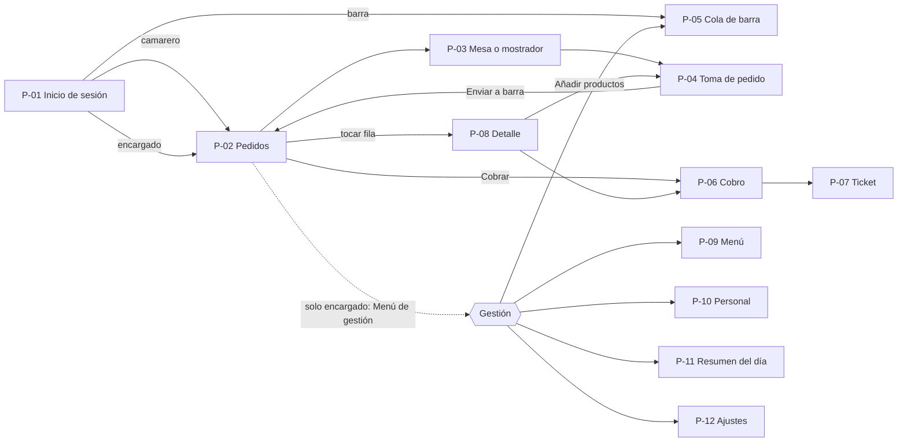
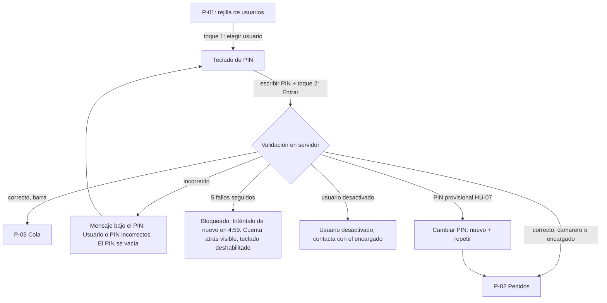
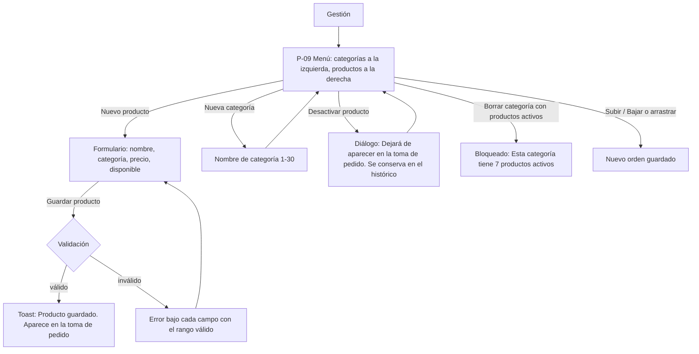
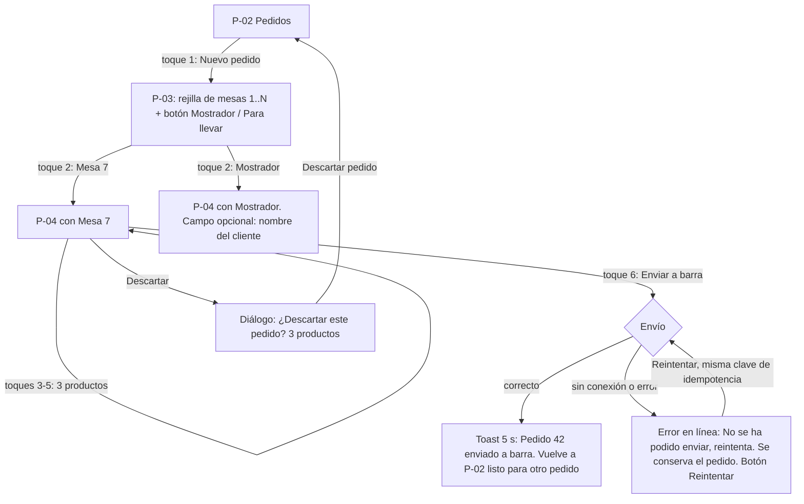
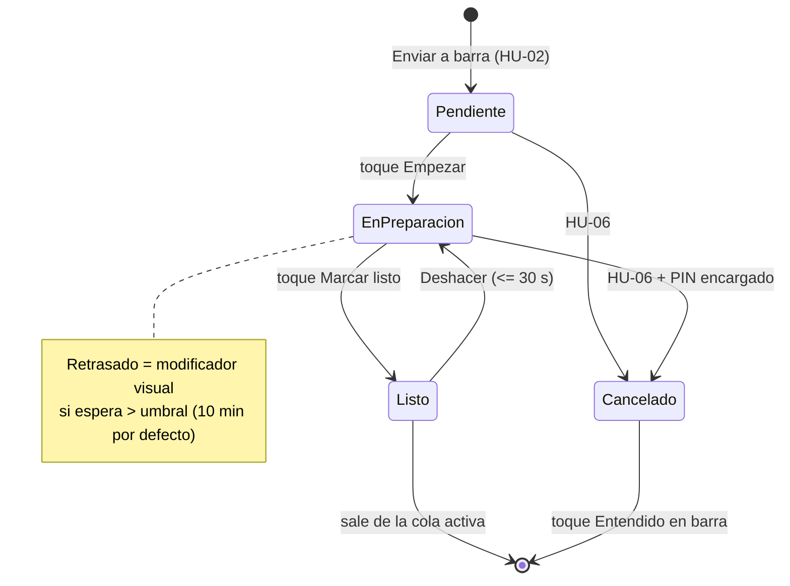
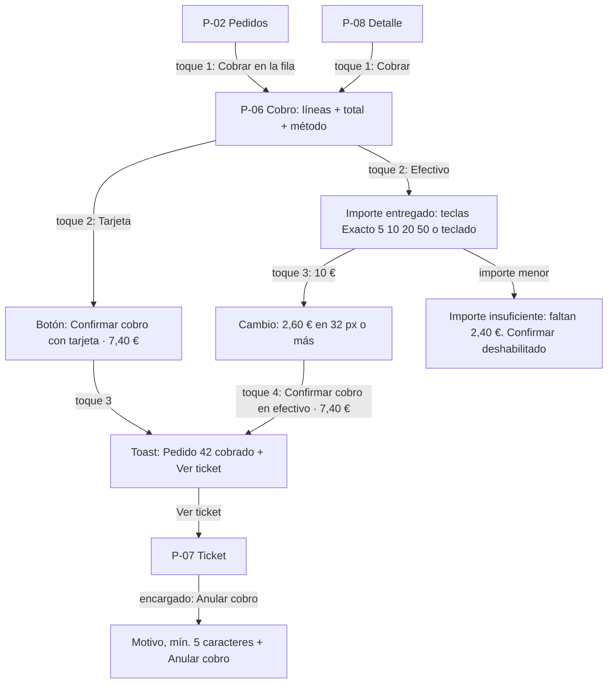
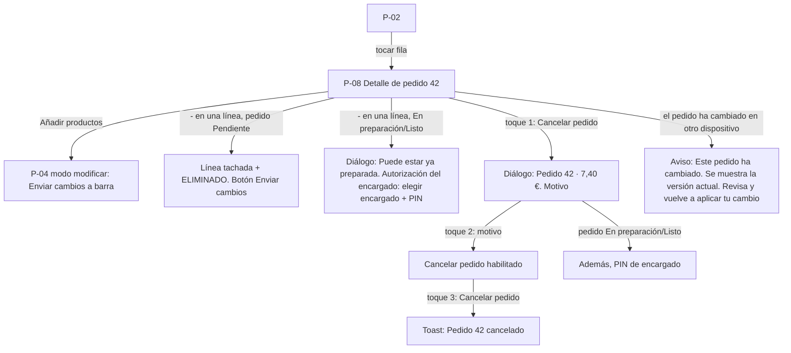

# Flujos de usuario

Autor: UX/UI Designer · Etapa 1, tarea 1.2 · Fecha: 2026-11-21
Entradas: `docs/historias/` (HU-01..HU-08). Estado: **propuesta, pendiente de aprobación humana**.

Convenciones:
- **Toque** = una pulsación en pantalla. Escribir texto o un importe se cuenta aparte, como indica cada historia.
- Los diagramas usan Mermaid (GitHub, GitLab y VS Code los muestran). Debajo de cada uno, los pasos van en texto para leerlos sin herramientas.
- Los IDs de pantalla (P-01...) coinciden con los de `wireframes/`.

## 0. Mapa de pantallas y navegación por rol

| ID | Pantalla | Camarero/cajero | Barra/cocina | Encargado | Wireframe |
|---|---|---|---|---|---|
| P-01 | Inicio de sesión | sí | sí | sí | `01-login.md` |
| P-02 | Pedidos (inicio de sala) | **inicio** | no | sí | `02-pedidos.md` |
| P-03 | Nuevo pedido: elegir mesa o mostrador | sí | no | sí | `03-toma-pedido.md` |
| P-04 | Toma de pedido (productos + ticket) | sí | no | sí | `03-toma-pedido.md` |
| P-05 | Cola de barra | no | **inicio** | sí | `04-cola-barra.md` |
| P-06 | Cobro | sí | no | sí | `05-cobro.md` |
| P-07 | Ticket en pantalla | sí | no | sí | `05-cobro.md` |
| P-08 | Detalle de pedido (modificar/cancelar) | sí | no | sí | `07-modificar-cancelar.md` |
| P-09 | Gestión del menú | no | no | sí | `06-gestion-menu.md` |
| P-10 | Personal | no | no | sí | `08-personal.md` |
| P-11 | Resumen del día | no | no | sí | `09-resumen-dia.md` |
| P-12 | Ajustes (mesas, umbral de retraso) | no | no | sí | `06-gestion-menu.md` (§ Ajustes) |

Pasos en texto:
- Camarero: P-01 -> P-02 Pedidos. Desde ahí crea (P-03 -> P-04), cobra (P-06) y abre el detalle (P-08).
- Barra: P-01 -> P-05 Cola. No tiene otra navegación (HU-01: no puede crear, cobrar ni cancelar).
- Encargado: P-01 -> P-02 Pedidos + botón "Gestión" en la barra superior (Menú, Personal, Resumen del día, Ajustes, Cola de barra).
- **Todas las pantallas** llevan la barra superior con "Nombre · Rol" y "Cerrar sesión" (HU-01).

Decisión: la "pantalla de toma de pedidos" a la que lleva HU-01 se interpreta como **P-02 Pedidos** (lista de pedidos abiertos + botón "Nuevo pedido"). HU-02 mide los toques "desde la pantalla principal (nuevo pedido, …)", HU-03 dice que el camarero ve los pedidos listos "en su lista de pedidos" y HU-04 cobra "desde el pedido". Las tres necesitan esa lista y ninguna historia la define. Lo he reportado al PO (ver `docs/estado.md`).

---

## 1. HU-01 — Iniciar sesión con mi rol

Pasos:
1. **Paso 1:** tocar la tarjeta del usuario (o escribirlo con "¿No apareces? Escribe tu usuario").
2. **Paso 2:** escribir el PIN en el teclado en pantalla y tocar "Entrar".
3. Resultado según el rol: camarero/encargado -> P-02; barra -> P-05.

Ramas: error (mensaje junto al campo, en texto, PIN vaciado), bloqueo con cuenta atrás, usuario desactivado, PIN provisional, cierre de sesión (vuelve a P-01) y cierre automático por inactividad. A los 14 min, aviso "Tu sesión se cerrará en 60 s por inactividad · Seguir conectado"; a los 15 min, P-01 con el mensaje "Sesión cerrada por inactividad". La cola de barra no caduca.

Criterios UX cubiertos: <= 2 pasos; teclado de 72 px (>= 44); error en texto junto al campo y PIN vaciado; nombre y rol en la barra superior de todas las pantallas.

---

## 2. HU-05 — Gestionar el menú (encargado)

Marcar agotado desde la toma de pedido (camarero o encargado), en **2 toques**:
1. En P-04, tocar "Marcar agotados" (barra de categorías). Aparece el banner de modo agotados.
2. Tocar el producto: pasa a "AGOTADO" (o vuelve a "Disponible"). Se ve en todos los dispositivos en <= 5 s.
3. "Terminar" sale del modo. No cuenta para el criterio porque el cambio ya está hecho en el toque 2.

Criterios UX cubiertos: 1 formulario con 4 campos obligatorios; agotado en 2 toques; errores con campo y rango.

---

## 3. HU-02 — Tomar un pedido

Recuento del criterio "<= 6 toques": Nuevo pedido (1) · Mesa 7 (2) · producto (3) · producto (4) · producto (5) · Enviar a barra (6). **Cumple con 6**, siempre que:
- la elección de tipo y de mesa sea **un único toque** (P-03 muestra mesas y "Mostrador" en la misma rejilla, sin paso previo de "tipo");
- los 3 productos estén en la categoría que se abre por defecto (la primera según el orden de HU-05). Si están en otra categoría, cada cambio suma 1 toque. Lo he reportado al PO como ambigüedad.

Otros pasos:
- Tocar el mismo producto otra vez sube la cantidad. En el ticket, "+" y "-" (48 px); al llegar a 0 la línea desaparece y aparece un toast "Café con leche quitado · Deshacer".
- Nota de línea: tocar "Añadir nota" en la línea -> campo de texto (máx. 100, contador "23/100") con sugerencias rápidas como chips ("Sin azúcar", "Leche de avena", "Para llevar") -> "Guardar nota".
- Mesa con pedido abierto: en P-03 la mesa se muestra con el texto "Abierta · #38". Al elegirla, P-04 muestra un aviso **no bloqueante**: "La mesa 7 ya tiene un pedido abierto (#38). Este se enviará como pedido independiente." No añade toques.
- "Enviar a barra" está deshabilitado sin líneas, con la ayuda "Añade al menos un producto".
- Confirmación: el toast muestra "Pedido **42**" (número en `text-4xl`) durante 5 s (>= 3 s exigidos) **sin bloquear**: la pantalla ya está lista para el siguiente pedido.

Criterios UX cubiertos: <= 6 toques; categoría en 1 toque; producto de 120x88 px con nombre y precio; confirmación >= 3 s con número; total recalculado al momento en el cliente (presentación; el servidor recalcula al enviar, ver HU-02 no funcionales).

---

## 4. HU-03 — Cola de barra

Pasos (cada cambio de estado = **1 toque**, botón de 72 px):
1. Llega un pedido: aparece al final de la cola (orden: más antiguo arriba a la izquierda), con sonido (desactivable) y borde resaltado 2 s, sin recargar.
2. "Empezar" -> EN PREPARACIÓN.
3. "Marcar listo" -> LISTO. La tarjeta sale de la cola y aparece el toast "Pedido 42 listo · Deshacer (30 s)".
4. Pedido modificado o cancelado: la tarjeta muestra la franja "✎ MODIFICADO" o "✕ CANCELADO" y el botón de acción pasa a "Entendido" (1 toque), que hay que pulsar antes de seguir. En una cancelación, "Entendido" quita la tarjeta.
5. Sin conexión: banner "Sin conexión. Reintentando…" en <= 5 s; los botones de estado se deshabilitan con el texto "Sin conexión". Al reconectar se resincroniza solo.

En sala (P-02), un pedido LISTO sube arriba con la insignia "✓ LISTO" y un aviso "Pedido 42 (Mesa 7) está listo" (toast 5 s, `aria-live`).

Criterios UX cubiertos: texto >= 18 px (36 px de diseño); 1 toque y 72 px (>= 60); 6 pedidos sin desplazamiento a 1920x1080 (rejilla 3x2, ver el límite de líneas en el wireframe); estados con texto, icono y color.

---

## 5. HU-04 — Cobrar y cerrar

Recuento:
- Tarjeta: Cobrar (1) · Tarjeta (2) · Confirmar (3) = **3 toques** (cumple <= 3). Antes del 3 se lee "Total 7,40 € · Tarjeta" y el aviso "Confirma solo cuando el datáfono haya aprobado el pago".
- Efectivo: Cobrar (1) · Efectivo (2) · tecla rápida o importe (3) · Confirmar (4) = **4 toques** (cumple <= 4 + importe).
- Cobrar mesa: en P-02, el grupo de la mesa con varios pedidos abiertos muestra "Cobrar mesa 7 · 2 pedidos · 15,20 €" (1 toque) -> P-06 con los dos pedidos agrupados y un único total.
- Tras confirmar: el botón pasa a "Cobrando…" y se deshabilita (contra el doble toque). Después, toast "Pedido 42 cobrado" y vuelta a P-02, donde el pedido ya no está en abiertos.

Criterios UX cubiertos: 3 toques con tarjeta; 4 con efectivo y botones rápidos; cambio >= 32 px (40 px de diseño); total y método visibles antes de confirmar (en el propio botón); mensaje "Pedido N cobrado".

---

## 6. HU-06 — Modificar o cancelar (Should)

Criterios UX cubiertos: cancelar en 3 toques (Cancelar, motivo, Confirmar) desde el detalle; el diálogo muestra número e importe; "AÑADIDO" y "ELIMINADO" (tachado) en texto.

---

## 7. HU-07 — Personal (Should)

Gestión -> Personal: lista (nombre, rol, estado en texto) -> "Nuevo usuario" -> formulario de 3 campos (nombre, rol, PIN inicial) -> "Crear usuario". En cada fila: "Editar", "Restablecer PIN" y "Desactivar"/"Activar" (con diálogo). Si es el único encargado, "Desactivar" se deshabilita con el texto "Debe existir al menos un encargado activo".

## 8. HU-08 — Resumen del día (Could)

Gestión -> **Resumen del día** (1 toque, abre hoy) -> cifras + aviso "Hay 3 pedidos sin cobrar · Ver pedidos" -> "Efectivo contado" (teclado de importe) -> diferencia ("Falta 2,50 €" / "Sobra 1,00 €" / "Cuadra") -> "Guardar cierre" -> diálogo "El cierre no se podrá modificar" -> "Guardar cierre". Selector de fecha (últimos 90 días) arriba.
